# Vigil demo test book

13 October 2026 · risk policy 2026.10.07-v3.1

**Every test input for demonstrating Vigil, in order: what to type or click, the result it must give, where to look, and what it proves.** Each expected result in this book was produced by the real system and is checked again by one command (section 10). Nothing here is a mock-up.

## 1. How to use this book

**Every case card has the same six parts.**

| Part | Meaning |
| --- | --- |
| **Input** | The exact payer, payee, amount, note and (simulated) call context, or the pattern to inject. |
| **Do** | Where to click. Almost everything starts from **Test inputs** in the top bar (or **Alt + T**). |
| **Expect** | What the system must produce: tier, score, screen text, detection result, Vigilance alert. |
| **Look at** | The screen where the result is visible. |
| **Infer** | What the result proves about the system, in one or two sentences you can say aloud. |
| **If different** | The usual reason a number moves, and how to get the book's number back. |

**Seven suites, each starting from a reset.**

| Suite | What it demonstrates | Starts with | Time |
| --- | --- | --- | --- |
| **A** | The PRIMA tier ladder: one payment for each of Tier 0 → Tier 4 | Reset | 4 min |
| **B** | How evidence combines: words alone, corroboration, large-but-normal, velocity | Reset | 3 min |
| **C** | Attack injection: all 11 mule-network patterns, each graded | Reset before each pattern | 1–2 min each |
| **D** | The network learns: confirm a scam → TaintTrace → the same payment is now held → Vigilance procedure | Reset | 4 min |
| **E** | Controls: false-positive control and shadow mode | Reset | 2 min |
| **F** | A long demo: all 11 patterns back to back, no reset | Reset | 3 min |
| **G** | A combination: three cash-outs in one city become a cash-out cluster | Reset | 1 min |

### 1.1 Golden rules (read once)

1. **Reset first.** Test inputs → section 5 → **Reset demo world** (confirm). The world returns to the identical seeded state: 594 accounts, the same balances, the same history. Every number in this book is "after a reset".
2. **Pause background traffic for exact numbers.** Test inputs → section 5 → **Pause background traffic**. Background traffic never changes a tier, but pausing keeps the tape and the KPI tiles calm while you explain. Resume it for the "live bank" feel.
3. **One payer, at most four payments an hour.** The fifth payment by the same customer within 60 minutes adds the **velocity** signal (case B4). That is real policy behaviour, but it lifts a Tier 2 payment to Tier 3. Reset between suites and the numbers stay exact.
4. **Midnight to 5 a.m. (IST) adds an "unusual hour" signal.** It is small (+0.05 inside the behaviour dimension). On the risky-recipient payment it can still push behaviour past 0.5, so two dimensions agree and the corroboration bonus lifts Tier 2 to Tier 3. Run Suite A before midnight, or say why it moved. Scenario runs (s0–s4, the attacks) pin their own clock and are not affected.
5. **One injection at a time.** The Inject button is disabled while a pattern runs (about 9–23 seconds), and the drawer shows its progress.
6. **What is already on screen after a reset is expected.** The seeded world contains Kiran Traders, a 9-day-old account that already moves money on fast. Vigilance therefore shows one alert at the start (**Medium · Account flagged · Kiran Traders**). That is part of the story, not a leftover.
7. **Vigilance wording may vary; the facts do not.** With a Gemini key in `.env`, Vigilance phrases its narrative itself. Every number, classification, severity, deadline and procedure step is computed by code and is identical with or without the key.

### 1.2 How a payment becomes a tier (30-second version)

Every payment is scored in five **dimensions** before any money moves. Each dimension is a 0–1 score; the weighted sum is the **base score**.

| Dimension | Weight | Looks at | Example rules |
| --- | --- | --- | --- |
| External | 0.25 | The (simulated) payment-safety registry's view of the recipient | `EXT_REPORTED` 0.65, `EXT_CONFIRMED_MULE` 1.0 |
| Network | 0.25 | How money flows through the recipient | `NET_PASS_THROUGH`, `NET_FAN_IN`, `NET_TAINT_EXPOSURE` |
| Sequence | 0.20 | The sender's last 30 minutes: new device, payee added, limit raised | `SEQ_LOGIN_NEW_DEVICE`, `SEQ_ORDERED_CHAIN` |
| Behaviour | 0.15 | This payment against the sender's own history | `BEH_FIRST_TIME_PAYEE`, `BEH_AMOUNT_OUTLIER`, `BEH_VELOCITY` |
| Context | 0.15 | The (simulated) call or message the customer is on | `CTX_FEAR_AUTHORITY`, `CTX_SECRECY`, `CTX_URGENCY` |

Then four named policy steps, each recorded on the decision:

- **Corroboration bonus**: when two or more dimensions each reach 0.5, add +0.10 for every extra one. Independent evidence agreeing counts more than one loud signal.
- **Floors**: a recipient confirmed as a mule by the registry, or holding at least ₹10,000 of confirmed-scam money, is never below Tier 3.
- **Friction guard**: an established payee (3+ payments) with no journey, pressure or registry signals is capped at Tier 1.
- **Circuit-breaker cap**: Tier 4 (which alerts the trusted contact) needs evidence that the *sender* is compromised or coerced. Recipient risk alone stops at Tier 3.

| Final score | Tier | What the customer gets |
| --- | --- | --- |
| below 0.15 | **0 · Approved** | Nothing. The payment goes through. |
| 0.15 – 0.28 | **1 · Heads-up** | One line of warning; **Continue** or **Cancel**. |
| 0.28 – 0.42 | **2 · Confirm before paying** | Must type what the payment is for; nothing is sent until then. |
| 0.42 – 0.55 | **3 · Scoped hold** | Only this amount is held for bank review (30 min); the account keeps working. |
| 0.55 and above | **4 · Hold + trusted contact** | As Tier 3, and the customer's trusted contact gets a facts-only alert. |

## 2. The cast

**The accounts the test inputs use, and why each one was chosen.**

| Account | UPI id | Role in the tests |
| --- | --- | --- |
| Ramesh Kumar | `ramesh@vigil` | Salaried engineer, Bengaluru. The everyday payer: usually small payments, 13 to his grocer, rent to his landlord. |
| Sunita Rao | `sunita@vigil` | Retired, 67. The coercion target. Trusted contact: her son Arjun. |
| Arjun Rao | trusted-contact page `/contact/arjun` | Receives the Tier 4 alert on his phone. |
| Meena General Stores | `meena.grocer@vigil` | Ramesh's grocer. Clean, long-standing payee. |
| MedPlus Pharma | `medplus.pharma@vigil` | A clean merchant Ramesh has never paid. |
| Landlord Iyer | `landlord.iyer@vigil` | Ramesh's landlord (3 rent payments). Clean. |
| Kiran Traders | `kiran.traders@vigil` | 9 days old, already received ₹64,500 and moves money on within ~17 minutes; **reported** in the simulated registry. The risky recipient. |
| QuickLoan Agent | `quickloan.agent@vigil` | **Confirmed mule** in the simulated registry. |
| RK Legal Services | `rk.legal.services@vigil` | 2 days old, no history. The coercion payee. |
| Zenith Exports, Pooja M, Rahul M | `zenith.exports@`, `pooja.m@`, `rahul.m@vigil` | Downstream of Kiran in the money-mule network (s2). |
| Anita, Vikram, Farah, Joseph, Lakshmi | `anita.s@` … `lakshmi.n@vigil` | The five victims who pay Kiran in s2. |

## 3. Suite A — the PRIMA tier ladder

**Six inputs, one per tier, run in this order after one reset. Together they show that friction rises only with evidence.**

| Case | Input (Test inputs → section 1) | Expected tier | Score | Customer sees |
| --- | --- | --- | --- | --- |
| A1 | *Everyday · grocer ₹500* | **Tier 0** | 0.00 | "Paid ₹500" |
| A2 | *T0 · new payee ₹8,000* | **Tier 0** | 0.07 | "Paid ₹8,000" |
| A3 | *T1 · pressure words only* | **Tier 1** | 0.20 | "Quick heads-up before you pay" |
| A4 | *Risky recipient · ₹45,000* | **Tier 2** | 0.34 | "Please confirm before you pay" |
| A5 | *T3 · registry-confirmed mule* | **Tier 3** | 0.32 (floored) | "We're holding this payment while the bank checks the recipient" |
| A6 | Section 3 → **Run journey** | **Tier 4** | 0.64 | "We've paused this payment to protect you" + Arjun alerted |

For every payment case: click the preset, then **Open on customer device** → **Pay** on the phone (the bank's full assessment appears on the right). **Submit directly** gives the same decision without the phone, with a link to the case. The drawer now shows an **Expected:** line under the preset you picked; it matches this book.

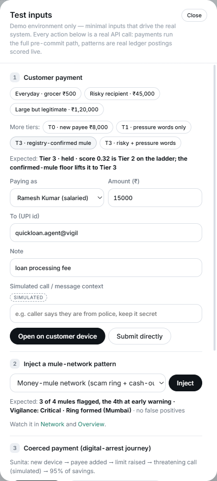

### A1 · Everyday payment → Tier 0

- **Input:** Ramesh → `meena.grocer@vigil`, ₹500, note "groceries".
- **Expect:** **Tier 0 · Approved**, score **0.00**, intent state APPROVED. No rule fires. The phone shows **Paid ₹500** and "Known recipient, usual amount, no warning signs."
- **Look at:** the phone; the assessment panel on the right (every dimension 0.00); the decision latency in the KPI row (a few milliseconds).
- **Infer:** every payment is assessed before the provider is called, and most pass with zero friction. Vigil is not a nag.

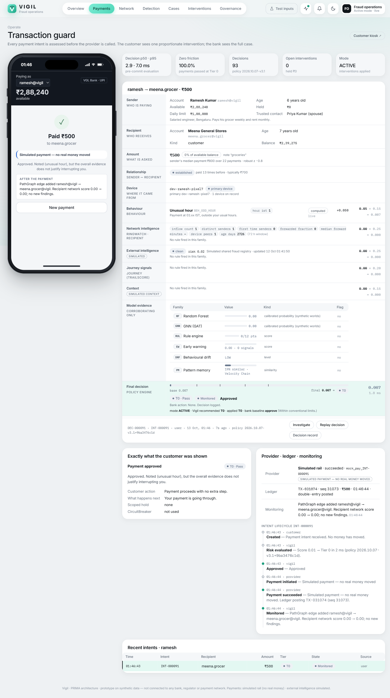

### A2 · New payee, unusual amount → still Tier 0

- **Input:** Ramesh → `medplus.pharma@vigil`, ₹8,000, note "medicines".
- **Expect:** **Tier 0**, score **0.07**. Rules fired: `BEH_FIRST_TIME_PAYEE` and `BEH_AMOUNT_OUTLIER` (behaviour dimension 0.45 × 0.15 = 0.0675). The phone says "Approved. Noted (…), but the overall evidence does not justify interrupting you."
- **Look at:** the assessment panel: behaviour shows two signals, every other dimension is zero.
- **Infer:** a single dimension, however unusual, does not stop a customer. Signals are recorded for the audit trail; friction needs more than one kind of evidence.

### A3 · Pressure words only → Tier 1

- **Input:** Sunita → `rk.legal.services@vigil`, ₹50,000, note "fees", simulated context *"Caller says he is from CBI, do not tell anyone, transfer immediately"*.
- **Expect:** **Tier 1 · Heads-up shown**, score **0.20**, state CHALLENGED. Context dimension 0.90 (`CTX_FEAR_AUTHORITY`, `CTX_SECRECY`, `CTX_URGENCY`), behaviour 0.45. The phone shows **"Quick heads-up before you pay"** with **Continue** and **Cancel**.
- **Look at:** the phone; the Context row of the assessment (each category with its words).
- **Infer:** what someone says on a call is a signal, not a verdict. Words alone earn a warning, never a hold. Compare A6: the same kind of words plus the account-takeover journey reach Tier 4.

### A4 · Risky recipient → Tier 2

- **Input:** Ramesh → `kiran.traders@vigil`, ₹45,000, note "advance for goods".
- **Expect:** **Tier 2 · Confirm before paying**, score **0.34**, state CHALLENGED. External 0.65 (`EXT_REPORTED`), network 0.45 (`NET_PASS_THROUGH`, `NET_NEW_ACCOUNT_INFLOW`), behaviour 0.45. The phone shows **"Please confirm before you pay"** and four facts: reported to a payment-safety registry (simulated); money sent here is usually moved on within 17 minutes; never paid before; opened 9 days ago and already received ₹64,500. **Confirm & pay** stays disabled until a purpose of 3+ characters is typed; **Don't send** cancels.
- **Look at:** the phone; on the case page, the reason line "Final score 0.34 → Tier 2 (confirm purpose). Main drivers: external intelligence, recipient's network." and the counterfactual "Without the external evidence the score would be 0.18 (Tier 1 instead of Tier 2)."
- **Infer:** the sender is behaving normally; the risk is the recipient. Vigil interrupts *before* the money moves and tells the customer facts, not accusations.

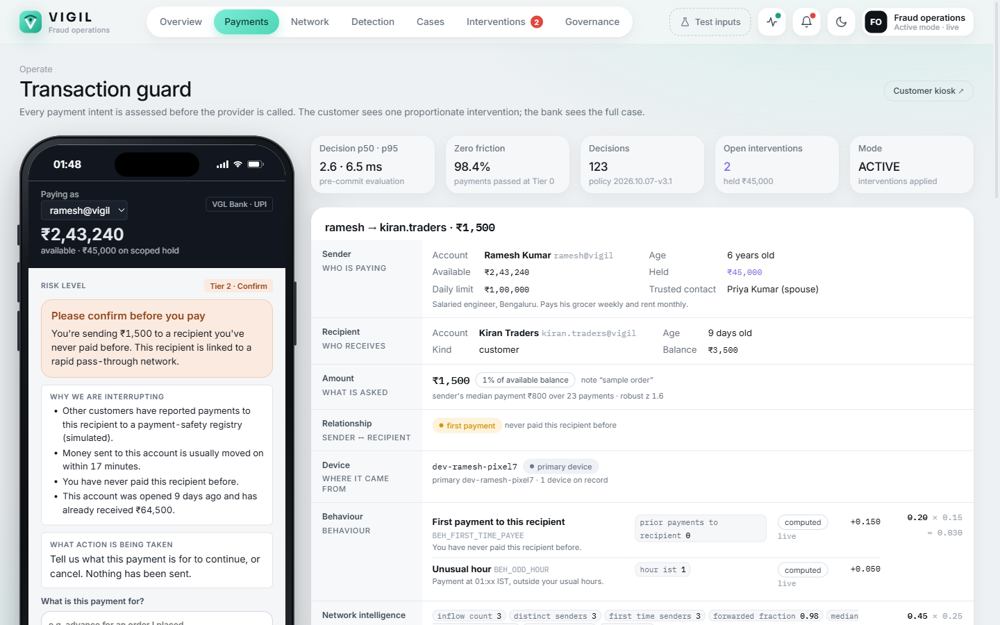

### A5 · Registry-confirmed mule → Tier 3 by floor

- **Input:** Ramesh → `quickloan.agent@vigil`, ₹15,000, note "loan processing fee".
- **Expect:** **Tier 3 · Payment held for review**, score **0.32**, state HELD. The score alone is Tier 2; the adjustment **FLOOR_EXTERNAL_CONFIRMED (tier ≥ 3)** lifts it. The phone shows **"We're holding this payment while the bank checks the recipient"**, "₹15,000 on scoped hold · ref VGL-HOLD-… · waiting for bank review", and **Cancel this payment**. Ramesh's available balance drops by exactly ₹15,000; nothing else is frozen.
- **Look at:** the phone; the case page's adjustments list; **Interventions** (a new open hold); Vigilance (**Medium · Payment held**).
- **Infer:** some evidence is decisive on its own. A confirmed mule gets a hold whatever the score says, and the policy records which rule did it.

### A6 · Coerced "digital arrest" journey → Tier 4

- **Input:** Test inputs → section 3 → **Run journey** (scenario s3, five steps over about 6 seconds). Open the trusted contact's phone (`/contact/arjun`) first.
- **What it plays:** 8 min ago, a sign-in on a new phone (Pune) → 6 min ago, RK Legal Services added as a payee → 4 min ago, the daily limit raised from ₹1,00,000 to ₹10,00,000 → 2 min ago, a simulated "Inspector Sharma" call threatening digital arrest → now, ₹5,61,600 (95% of her savings) to RK Legal Services.
- **Expect:** **Tier 4 · Held + trusted contact alerted**, score **0.64**. Sequence 0.90, behaviour 0.75, context 1.00, corroboration **+0.20** (three dimensions agree). The phone shows **"We've paused this payment to protect you"**: only this amount is held; Arjun has been told; "hang up on anyone pressuring you". Arjun's page shows the alert card with facts only: the recipient was added as a payee minutes ago; Sunita's account was signed in on a new device 8 minutes ago; the transfer limit was raised 4 minutes ago. Vigilance raises **Critical · Coercion alert · Sunita Rao → RK Legal Services ₹5.62 L held (Tier 4)**.
- **Then:** on Arjun's page tap **I'm calling them now**. The bank's Interventions row shows the response *calling user*.
- **Then:** Cases → the Tier 4 case → **Decision Replay → Play**: 11 frames (baseline → new device → payee → limit → context → transfer → intelligence → Tier 4 → hold → alert to Arjun). Below it, the **counterfactual ladder**: without the pressure context Tier 2; without the device/payee/limit journey Tier 2; with a normal amount Tier 3; all sender-side signals normal Tier 0.
- **Infer:** none of the events alone proves anything. The ordered chain within eight minutes, plus the amount, plus the pressure is what makes Tier 4. The customer's account keeps working, and the family hears facts, not accusations.

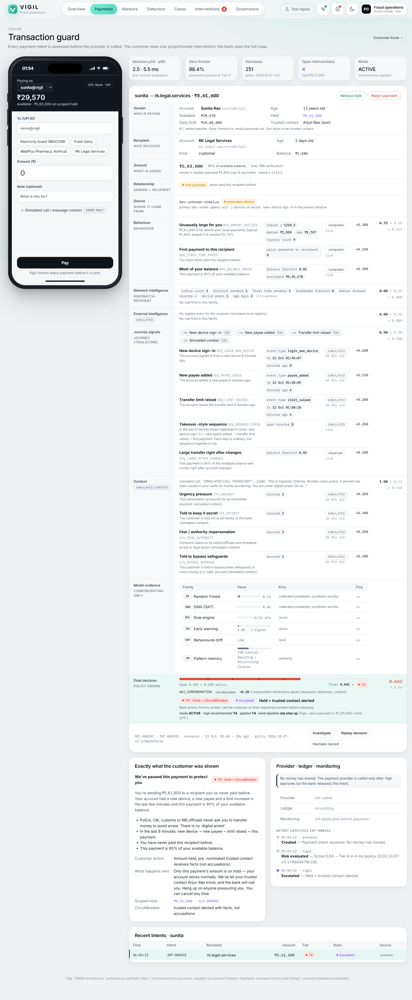

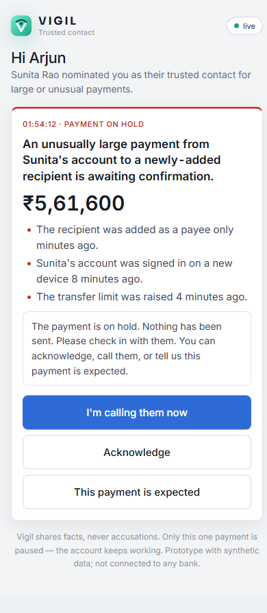

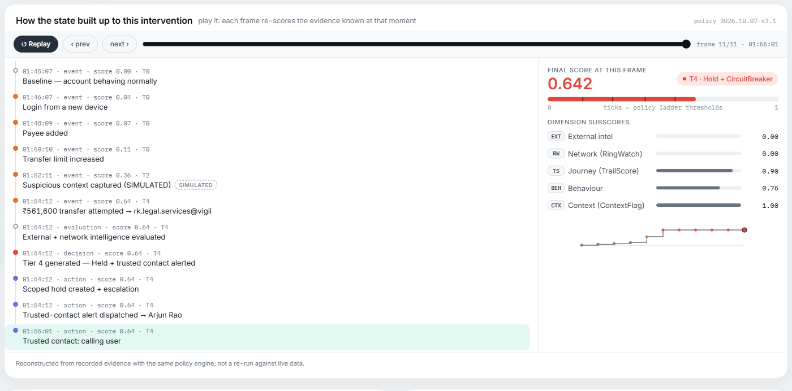

## 4. Suite B — how evidence combines

**Four inputs that each isolate one policy behaviour. Reset before B1, B2 and B3; B4 follows B3 directly.**

| Case | Input | Expected | What it isolates |
| --- | --- | --- | --- |
| B1 | Ramesh → RK Legal ₹30,000 + police script | **Tier 1**, 0.17 | Pressure words on an ordinary payee |
| B2 | *T3 · risky + pressure words* (Ramesh → Kiran ₹45,000 + police script) | **Tier 3**, 0.54 | Corroboration: two independent kinds of evidence |
| B3 | *Large but legitimate · ₹1,20,000* | **Tier 0**, 0.05 | Large amount, normal relationship |
| B4 | 4 × grocer ₹500, then *Risky recipient · ₹45,000* | **Tier 3**, 0.47 | Velocity tips Tier 2 into Tier 3 |

### B1 · Pressure words, ordinary payee → Tier 1

- **Input:** Ramesh → `rk.legal.services@vigil`, ₹30,000, note "fees", context *"Caller says he is from the police, keep this secret, pay now or you will be arrested"*. (Type it in the Simulated context field.)
- **Expect:** **Tier 1**, score **0.17** (context 0.65, behaviour 0.45). Heads-up only.
- **Infer:** same lesson as A3 with a different customer: words are weighed, not obeyed.

### B2 · Risky recipient + pressure words → Tier 3 (corroboration)

- **Input:** preset *T3 · risky + pressure words* (Ramesh → Kiran ₹45,000 + the police script).
- **Expect:** **Tier 3**, score **0.54**, state HELD. External 0.65, network 0.45, behaviour 0.45, context 0.65 → base 0.44, plus **ADJ_CORROBORATION +0.10** (external and context both ≥ 0.5).
- **Compare:** A4 is the same payment without the words: Tier 2, 0.34.
- **Infer:** two unrelated kinds of evidence (a reported recipient and a pressured sender) agreeing is worth more than their sum. The decision says so by name.

### B3 · Large but legitimate → Tier 0 (false-positive control)

- **Input:** preset *Large but legitimate · ₹1,20,000* (Ramesh → his landlord, "deposit + October rent").
- **Expect:** **Tier 0**, score **0.05**. Only `BEH_AMOUNT_OUTLIER` fires; known payee, known device, clean registry, no journey.
- **Infer:** a big number is not fraud. Customers who pay a deposit are not punished; this is the control that shows Vigil cares about friction.

### B4 · Velocity: the fifth payment in an hour

- **Input:** right after B3, pay *Everyday · grocer ₹500* four times (Submit directly is quickest), then *Risky recipient · ₹45,000*.
- **Expect:** the grocer payments stay **Tier 0** (from the fifth, `BEH_VELOCITY` is noted, score 0.02). The risky payment becomes **Tier 3**, score **0.47**: behaviour reaches 0.60 with `BEH_VELOCITY`, so behaviour and external both fire and **ADJ_CORROBORATION +0.10** applies.
- **Infer:** a burst of payments is itself a signal (a takeover often empties an account in many quick steps). It is also why golden rule 3 exists: if a rehearsal leaves Kiran at Tier 3 instead of Tier 2, this is the reason, and a reset restores the book's number.

**The circuit-breaker cap** is shown in Suite D (case D2): a payment scores 0.58 (Tier 4 on the ladder) but stays at Tier 3, because nothing suggests the sender is coerced.

## 5. Suite C — attack injection (11 patterns)

**Test inputs → section 2 → pick a pattern → Inject. Reset before each pattern for the cleanest grading.** Each pattern is a fixed set of real ledger postings streamed over 9–23 seconds. The detectors never see the answer key; when the run ends, the drawer grades it against the simulator's ground truth: "detected N of M injected accounts, no false positives, X s to detection". The drawer also shows an **Expected:** line for the selected pattern.

| Pattern | What is injected | Expected detection | Vigilance raises | Typical role |
| --- | --- | --- | --- | --- |
| **Money-mule network** (s2) | 5 victims → Kiran → Zenith → Pooja / Rahul, smurfing, 2 ATM cash-outs (14 postings) | **3 of 4** flagged; Rahul M at early warning | **Critical · Ring formed** · 5 accounts around Mumbai | Kiran collector, Zenith distributor, Pooja exit |
| **Fan-In** | 6 first-time senders → Swift Collect (3 days old) → 90% out of the bank | **1 of 1** | **High · Account flagged** · Swift Collect | collector |
| **Fan-Out** | Bulk Payouts gets ₹2.4 L, pays 6 accounts in minutes | **1 of 1** | **High · Account flagged** · Bulk Payouts | distributor |
| **Circular Ring** | 4 accounts pass ₹48K → ₹45K round a loop | **4 of 4** | **Critical · Ring formed** · 4 accounts around Ahmedabad | coordinator ×4 |
| **Velocity Chain** | ₹80K hops through 5 accounts in minutes, then an ATM | **3 of 5**; first and last at early warning | **Critical · Ring formed** · 5 accounts around Kolkata; **High · Account flagged** | coordinator, distributor |
| **Cross-Channel Burst** | One hub: in by UPI / IMPS / NEFT, out by card / IMPS / UPI / NEFT; its phone "moves" Delhi → Kolkata | **1 of 1** | **High · Account flagged** + **Medium · Impossible travel** (Delhi → Kolkata, 1,304 km in under a minute) | unclassified (no single role) |
| **Shared Device Cluster** | 5 new accounts on one phone collect, consolidate, cash out ₹1.1 L | **5 of 5** | **Critical · Device farm** + **Critical · Ring formed** · 7 accounts around Mumbai | entry ×4, collector |
| **Behavioural Drift** | A quiet account pays 7 new people, then receives ₹90K and forwards ₹85K | **1 of 1** | **Medium · Account flagged** | coordinator |
| **Early Volume Spike** | Fresh Wallet (1 day old) takes 6 × ₹18K and pays 4 × ₹25K | **1 of 1** | **Medium · Account flagged** · Fresh Wallet | coordinator |
| **Smurfing** | ₹80K in, 7 transfers of ₹9,400–9,900 out | **1 of 1** | **High · Account flagged** | distributor |
| **Dormant Activation** | An account quiet for 76 days receives ₹1.63 L and sends ₹1.5 L out | **1 of 1** | **Medium · Account flagged** · Dormant Savings (R. Menon) | collector |

**Every pattern: 0 false positives, and every injected mule ends at early warning or above.** First warning arrives within 0.03–2.5 seconds of the first injected posting, a flag within 0.03–3.6 seconds (measured in the 13 October run).

**Where to look while it runs:**

- **Overview**: red rows on the live tape, red arcs converging on the city on the money map, Fraud-linked and Accounts-at-risk tiles rising, the Vigilance bar raising the alert (toast first, then the top of the bar).
- **Network**: the touched accounts turn amber then red; the Roles lens shows collector / distributor / exit.
- **Detection → section 2**: the graded run (detected, missed, false positives, latency) and the per-family agreement.
- **Account page** (click the flagged account): why it is flagged, detector consensus, role, SHAP, drift, pattern memory.

### C1 · Money-mule network (s2) — the headline attack

- **Input:** pattern *Money-mule network (scam ring + cash-out)* → **Inject** (17 steps, ~23 s).
- **Expect:** Kiran Traders **flagged · collector** (6 detector families agree), Zenith Exports **flagged · distributor**, Pooja M **flagged · exit**, Rahul M **early warning** (RF 0.75 is below the live threshold 0.85). Drawer: "detected 3 of 4 injected accounts, no false positives". Vigilance: **Critical · Ring formed · Chain of 5 accounts around Mumbai**: "5 connected accounts around Mumbai moved ₹4.53 L between them in the live window; 3 of them are already flagged", respond within **15 minutes**.
- **Also expected:** two of the victims (Joseph, Lakshmi) briefly show early warning; they are never flagged, so they are not false positives.
- **Infer:** Vigil finds the ring from money flow alone, shows how it is organised (collector → distributor → exit), and raises it as one incident with a deadline. Rahul staying at early warning is deliberate: a lone fast-forward signal also matches a victim who pays on quickly.

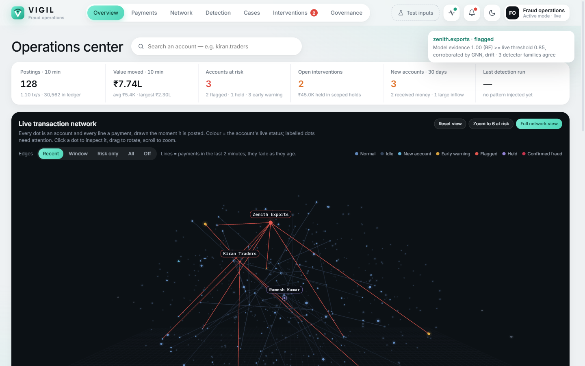

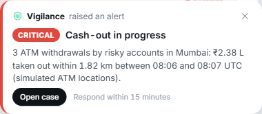

### C2–C11 · The ten single patterns

Run each the same way. The table above is the expected result; these notes say what each one proves.

- **Fan-In:** many first-time payers into a new account that forwards 90% is the classic collection point. Proves the fan-in + pass-through + new-account rules and the models agree (6 families).
- **Fan-Out:** the mirror image. A freshly funded account spraying money to six people is a distributor.
- **Circular Ring:** money returning to its origin within minutes has no business reason. All four members are flagged by the network rule, corroborated by RF and drift.
- **Velocity Chain:** hop-by-hop forwarding. The middle of the chain is flagged; the first and last stay at early warning, because on their own they look like a normal receive-then-pay.
- **Cross-Channel Burst:** switching rails (UPI, IMPS, NEFT, card) to hide a pattern does not help, and the simulated device locations add an impossible-travel alert (possible account takeover).
- **Shared Device Cluster:** five accounts on one phone is a device farm. Vigilance raises two incidents: the farm and the ring it forms.
- **Behavioural Drift:** the account is compared with its own past. A quiet saver who suddenly pays seven new people and stops keeping money has drifted.
- **Early Volume Spike:** a one-day-old account with heavy volume in and straight out.
- **Smurfing:** seven transfers just under ₹10,000 is structuring to stay under a threshold.
- **Dormant Activation:** an account asleep for 76 days that wakes up and empties itself is a bought or rented account.

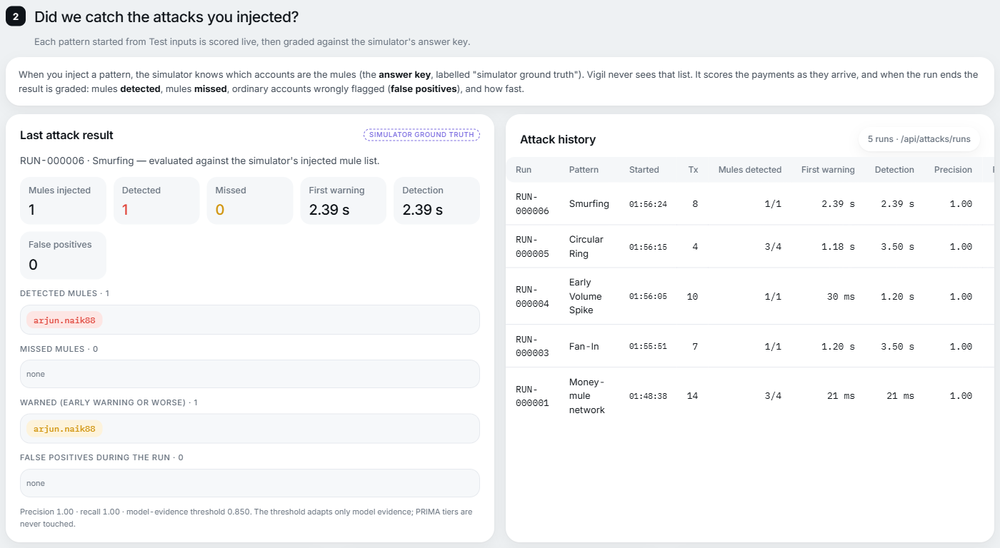

## 6. Suite D — the network learns

**A confirmed report changes what happens to the next payment. Reset, then run D1 → D5 in order.**

### D1 · Inject the ring, then report the scam

- **Input:** inject *Money-mule network* (as C1) and wait for it to finish. Then Test inputs → section 4 → **Find ring source** → **Report as confirmed scam**.
- **Expect:** Find ring source fills the first payment into Kiran from an outside payer (in a fresh world: `TX-029310`, deepak.r → Kiran Traders ₹21,500). Reporting it says **"Labelled LBL-… TaintTrace re-ran: 2 account(s) hold traced value."** Zenith Exports holds **₹19,000** of it (2 hops), Kiran Traders **₹2,500** (1 hop), by the Lowest Intermediate Balance Rule, conserving every rupee.
- **Look at:** Network → **Taint** lens; the account page of Zenith Exports.
- **Infer:** once a victim's payment is confirmed, Vigil follows that exact money downstream and says how much of it each account still holds, which is what a lien request needs.

### D2 · The same risky payment, now held

- **Input:** *Risky recipient · ₹45,000* again.
- **Expect:** **Tier 3 · Payment held for review**, score **0.58**. Network jumps to 1.00 (`NET_FAN_IN`, `NET_VELOCITY_CHAIN`, `NET_LABELLED_ACCOUNT`, `NET_TAINT_EXPOSURE` join the earlier rules). Two adjustments are recorded: **ADJ_CORROBORATION +0.10** and **CAP_NO_SENDER_EVIDENCE (tier ≤ 3)**. 0.58 is Tier 4 on the ladder, but Ramesh shows no sign of being coerced, so his family is not alerted.
- **Compare:** A4, the same input before the report: Tier 2, 0.34.
- **Infer:** the network learned. No account was frozen; only this payment to a now-proven mule is paused. The cap shows the policy is proportionate: alerting a family is reserved for a compromised sender.

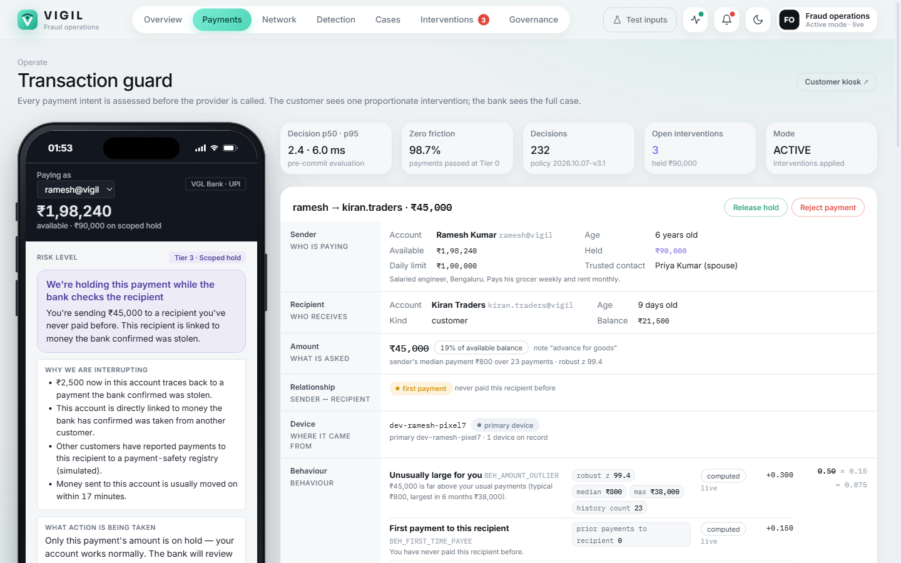

### D3 · Vigilance after the report

- **Expect four incidents, most urgent first:**

| Severity | Incident | Subject | Respond within |
| --- | --- | --- | --- |
| **Critical** | Confirmed scam money traced | "Scam money traced to 2 account(s)" | 15 minutes |
| **Critical** | Ring formed | "Chain of 5 accounts around Mumbai" | 15 minutes |
| High | Account flagged | Kiran Traders | 1 hour |
| Medium | Payment held | Ramesh Kumar → Kiran Traders ₹45,000 held (Tier 3) | 4 hours |

- **Infer:** each engine (network watcher, detection stream, TaintTrace, payment gate) raises its own finding; Vigilance ranks them by a stated rubric and gives each a deadline.

### D4 · Open the ring: assessment and procedure

- **Do:** click the **Ring formed** alert → **Open case**.
- **Expect the assessment:** headline "Mule ring forming: 5 accounts around Mumbai"; key facts **At stake ₹4.53 L · Accounts 5 (3 flagged) · Detectors agreeing 6 families · Where (simulated) Mumbai**; red flags (received a confirmed scam payment; 94% moved on within 60 minutes; money from 8 first-time payers in 72 hours; a chain of quick hops); "If nobody acts": mule money is very hard to recover once it leaves; **Vigilance recommends** contain first, confidence **high** (6 independent families).
- **Expect the procedure (12 steps, 4 phases):**

| Phase | Step | Owner | When | Where |
| --- | --- | --- | --- | --- |
| Contain | Confirm the ring in the network | Fraud analyst | now | in Vigil |
| Contain | Put members that are not yet flagged on close monitoring | Fraud analyst | now | in Vigil |
| Contain | Review pending outgoing payments from members | Fraud analyst | within the hour | in Vigil |
| Contain | Request a debit freeze or lien on member accounts | Branch / operations | per bank policy | core banking |
| Investigate | Trace where the money came from and where it went | Fraud analyst | today | in Vigil |
| Investigate | Re-verify KYC of member accounts | KYC team | within 2 days | KYC / branch |
| Investigate | Check identifiers against suspect registries | Fraud analyst | today | registry lookup |
| Report | Mark victim payments as confirmed scams | Fraud analyst | when a victim confirms | in Vigil (**already ticked** by D1) |
| Report | File a Suspicious Transaction Report with FIU-IND | Principal Officer (AML) | within 7 working days | FIU-IND FINnet |
| Report | Report the fraud to RBI (Fraud Monitoring Return) | Fraud risk / compliance | within 14 days | RBI FMR |
| Recover & close | Coordinate on 1930 / cybercrime.gov.in | Fraud operations | as soon as possible | 1930 / CFCFRMS |
| Recover & close | Record the outcome and acknowledge the alert | Fraud analyst | when done | in Vigil |

- **Do:** click **Show in network** (step 1 ticks itself), **Watch** an unflagged member (confirm; step 2 completes when Vigil sees it), tick the freeze step by hand as done outside Vigil, then **Draft STR note**: Vigilance drafts the grounds of suspicion; nothing is filed.
- **Infer:** Vigilance turns a detection into the bank's procedure, with owners and regulatory deadlines. It is read-only: steps inside Vigil tick themselves when they happen; steps outside are ticked by the analyst.

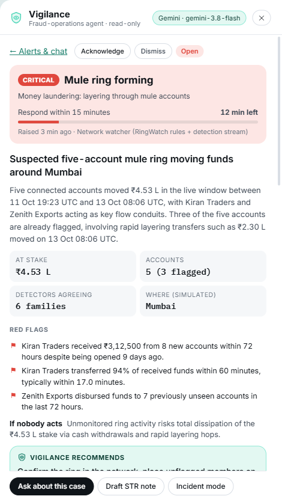

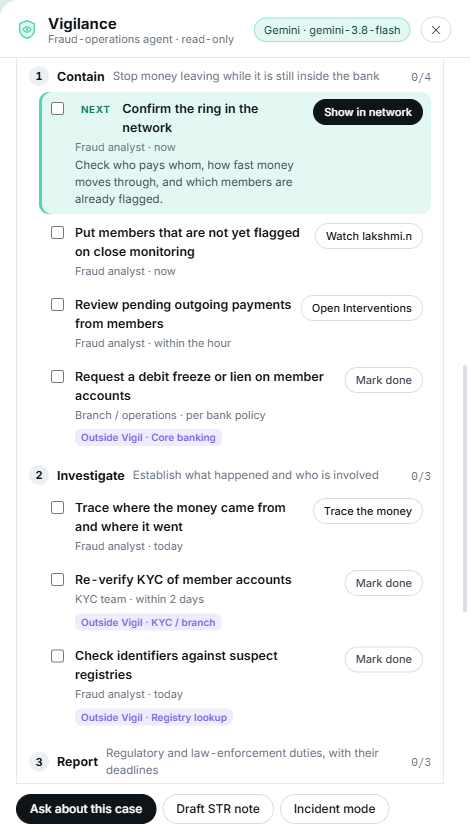

### D5 · The bank acts on the hold

- **Do:** **Interventions** → the held ₹45,000 → **Release** (or **Reject** for the other path).
- **Expect:** Release → state **APPROVED**, the phone offers "Bank released this payment — complete it". Reject → REJECTED, "The bank stopped this payment. Nothing was sent."
- **Infer:** Vigil recommends and holds; the bank decides. Every action is a real state change recorded on the case.

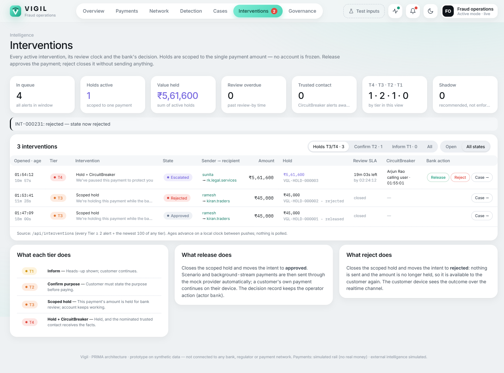

## 7. Suite E — controls and governance

### E1 · False-positive control (scenario s4)

- **Input:** Scenario lab → *False-positive control* (or the *Large but legitimate* preset, B3).
- **Expect:** **Tier 0**, score **0.05**.
- **Infer:** the same as B3, run as a named control so it can be replayed on the Governance page.

### E2 · Shadow mode

- **Input:** Test inputs → section 5 → **Switch to SHADOW**; then *Risky recipient · ₹45,000*. Switch back to ACTIVE afterwards.
- **Expect:** the decision is still computed and recorded (**Tier 2**, 0.34, mode **shadow**), but the customer is not interrupted: the intent goes straight to APPROVED. Governance → Shadow shows Vigil's recommendation next to the bank's baseline.
- **Infer:** a bank can run Vigil silently beside its current system, compare, and only then switch it on.

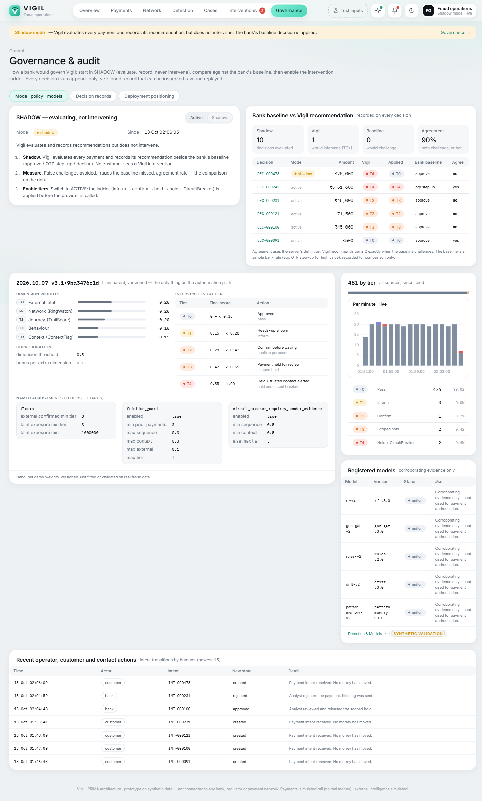

## 8. Suites F and G — a long demo

### F · All eleven patterns back to back, no reset

- **Input:** reset once, then inject every pattern in the drawer's order, waiting for each to finish.
- **Expect:** every pattern gives the **same detection result as in Suite C** (3 of 4, 1 of 1, 4 of 4, 3 of 5, 1 of 1, 5 of 5, 1 of 1 ×4), **0 false positives** throughout. The Vigilance bar ends with **16 open alerts**, most urgent first: Critical · Cash-out cluster (Mumbai), four Critical · Ring formed (Kolkata, Mumbai ×2, Ahmedabad), Critical · Device farm, then the High and Medium account alerts and the impossible-travel alert.
- **Infer:** detection does not degrade as the world fills up, and Vigilance keeps the queue ordered so the analyst starts with what matters.

### G · Cash-out cluster (a combination)

- **Input:** reset, then inject *Money-mule network*, *Velocity Chain* and *Shared Device Cluster* one after the other (within 45 minutes).
- **Expect:** **Critical · Cash-out cluster · 4 risky ATM withdrawals in Mumbai** (the rule: 3 or more risky ATM withdrawals within 8 km and 45 minutes), on top of each pattern's own alerts. On the money map, the Mumbai cash-out points glow.
- **Infer:** separate rings cashing out in the same place is a coordinated cash-out operation, something no single account's score shows. (ATM locations are simulated and labelled.)

## 9. A 15-minute demo built from these cases

**The same order as the demo script, with the checkpoint you should see at each step.**

| # | Do | Checkpoint (must see) | Case |
| --- | --- | --- | --- |
| 0 | Reset demo world; pause background traffic if you want calm numbers | Vigilance bar: 1 alert (Medium · Kiran Traders) | 1.1 |
| 1 | Everyday · grocer ₹500 → Open on device → Pay | Paid ₹500 · Tier 0 · 0.00 | A1 |
| 2 | T1 · pressure words only → Pay | Quick heads-up · Tier 1 · 0.20 | A3 |
| 3 | Risky recipient · ₹45,000 → Pay | Please confirm before you pay · Tier 2 · 0.34 | A4 |
| 4 | T3 · registry-confirmed mule → Pay | Held · Tier 3 · floor named on the case | A5 |
| 5 | Inject Money-mule network; watch the Overview | Critical · Ring formed (Mumbai) · 3 of 4 flagged · 0 FP | C1 |
| 6 | Open the ring case: Show in network, Watch, Draft STR | 12-step procedure, step ticks itself | D4 |
| 7 | Find ring source → Report as confirmed scam | 2 accounts hold traced value | D1 |
| 8 | Risky recipient · ₹45,000 again | Tier 3 · held · cap named (no family alert) | D2 |
| 9 | Run journey (coerced) with Arjun's phone open | Tier 4 · 0.64 · Arjun alerted · Critical · Coercion alert | A6 |
| 10 | Arjun: I'm calling them now; Cases → Replay | 11 frames; counterfactual ladder | A6 |
| 11 | Interventions: Release one hold, Reject another | Real state changes | D5 |
| 12 | Switch to SHADOW → risky payment → back to ACTIVE | Recorded, not interrupted | E2 |
| 13 | Detection → section 2 | Graded runs, per-family agreement, SYNTHETIC VALIDATION labels | C |

## 10. Re-verify every expected result (one command)

**`scripts/test_book_check.py` replays every case in this book through the same API the screens use and checks each expected result.** It resets the world before each suite, so run it against a demo you are not presenting from.

```bash
backend/.venv/Scripts/python.exe scripts/test_book_check.py --yes
```

Options: `--base http://127.0.0.1:8811` for another server, `--only A,D` for some suites, `--out file.json` for the raw results (default `data/test_book_results.json`). Exit code 0 means every expected result held. It takes about 9 minutes and ends by resetting the world and resuming background traffic.

Last run, 13 October 2026, on a fresh world: **all 117 checks in suites A–G passed** (every tier, every policy adjustment, all 11 patterns graded twice, Vigilance incidents, procedure, trusted-contact response, release, shadow mode).

## 11. If a result is different

| You see | Usual reason | Fix |
| --- | --- | --- |
| Risky recipient gives Tier 3 instead of Tier 2 | Fifth payment by Ramesh within an hour (velocity), or it is between 00:00 and 05:00 IST (unusual hour), or a scam into Kiran was already reported | Reset; run before midnight; or explain the named signal on the case page |
| A3 / B1 gives Tier 2 | Unusual hour or velocity added to behaviour | Same as above |
| A payment shows `CTX_…` rules you did not intend | A simulated context was left in the context field from an earlier case | Pick the preset again (presets fill or clear the field) |
| "This scenario is already running" | The previous injection has not finished | Wait for the drawer's progress line to end |
| Find ring source says "inject the money-mule network first" | No outside payment into Kiran yet | Inject s2 first |
| "This transaction is already labelled" | The report was already made since the last reset | Reset, or carry on: the label is in place |
| Vigilance shows more alerts than the book | Patterns injected earlier without a reset | Reset, or use Suite F's list |
| Vigilance sentences read differently | Gemini key present: the narrative is phrased by the model | Facts, severities, deadlines and steps are code-computed and unchanged |

## Appendix A · Rule codes you will see

| Code | Dimension | Meaning |
| --- | --- | --- |
| `EXT_REPORTED` / `EXT_CONFIRMED_MULE` | External | The simulated registry has reports / a confirmed-mule status for the recipient |
| `NET_PASS_THROUGH` | Network | ≥70% of ≥₹20,000 inflow forwarded within 60 minutes |
| `NET_NEW_ACCOUNT_INFLOW` | Network | Account under 14 days old with ≥₹50,000 inflow |
| `NET_FAN_IN` | Network | 4+ distinct senders in 72 hours |
| `NET_VELOCITY_CHAIN` | Network | Part of a chain of quick hops (≤30 min per hop) |
| `NET_LABELLED_ACCOUNT` | Network | Received a bank-confirmed scam payment |
| `NET_TAINT_EXPOSURE` | Network | Holds value traced from a confirmed scam |
| `SEQ_LOGIN_NEW_DEVICE`, `SEQ_PAYEE_ADDED`, `SEQ_LIMIT_RAISED`, `SEQ_ORDERED_CHAIN` | Sequence | The account-takeover journey in the last 30 minutes |
| `BEH_FIRST_TIME_PAYEE` | Behaviour | Never paid this recipient |
| `BEH_AMOUNT_OUTLIER` | Behaviour | Far above the sender's usual amounts (robust z ≥ 3.5) |
| `BEH_BALANCE_DRAIN` | Behaviour | 80%+ of the available balance |
| `BEH_VELOCITY` | Behaviour | 5+ payments in 60 minutes |
| `BEH_ODD_HOUR` | Behaviour | 00:00–05:00 IST |
| `CTX_FEAR_AUTHORITY`, `CTX_SECRECY`, `CTX_URGENCY`, `CTX_BYPASS_APPROVAL`, `CTX_GREED` | Context | Categories found in the simulated call / message text |
| `ADJ_CORROBORATION` | Policy | +0.10 per extra dimension ≥ 0.5 |
| `FLOOR_EXTERNAL_CONFIRMED`, `FLOOR_TAINT_EXPOSURE` | Policy | Never below Tier 3 |
| `CAP_FRICTION_GUARD` | Policy | Established clean payee: at most Tier 1 |
| `CAP_NO_SENDER_EVIDENCE` | Policy | Tier 4 needs sender-side evidence; otherwise Tier 3 |

## Appendix B · Honesty notes for the presenter

- All data is synthetic. Registry status, call context, device and ATM locations are **simulated** and labelled on screen.
- Payments settle on a **simulated rail**; no real money moves.
- Detection grading uses the simulator's ground truth, which no detector reads. Model metrics are **synthetic validation**, not real-bank accuracy. Models corroborate; the policy decides the tier.
- Weights and thresholds are hand-set, versioned demo defaults (`config/risk_policy.yaml`), not fitted to real fraud data.
