# Vigil functional guide

13 October 2026 · v11 (same content as the Claude Doc)

Vigil checks every payment before money moves and watches the bank's accounts for money-mule rings. This guide explains every screen in plain words: what it shows, how to read it, why it matters, and how to show it in a demo. Screenshots are from the live app on 13 Oct 2026 after a full demo run.

## 1. Vigil in plain words

**Vigil stops risky payments at the last safe moment, and finds the money-mule accounts scammers use.** It is a working prototype of an architecture called PRIMA (Pre-commitment Risk Intelligence & Mitigation Architecture).

**The problem.** Scammers trick people into sending money: fake police "digital arrest" calls, fake investments, fake jobs. The money lands in a **mule account**, a bank account rented, bought or opened only to receive scam money and pass it on fast. Mules usually work in groups (a **mule ring**). Once money leaves, it is very hard to get back. Most fraud tools look at a payment after it has happened.

**The idea.** Vigil sits at the moment a customer presses Pay, before any money moves. It asks one question: given everything we know right now, what should happen before this payment is sent? Most payments pass in a few milliseconds. A risky one gets a response sized to the risk: a heads-up, a question, a hold on just that payment, or a hold plus a message to a trusted family member. No account is ever frozen.

**Vigil does four jobs, and they feed each other:**

1. **Checks every payment before money moves** (the Payments page). Five kinds of evidence become one score, and the score picks a tier from 0 (pass) to 4 (hold + trusted contact).
2. **Watches the accounts for mule rings** (Overview, Network, Detection). Eight independent detectors re-score accounts every time a payment lands.
3. **Learns from confirmed scams.** When the bank confirms a scam, TaintTrace follows the stolen money through the ledger. The next payment to any account holding that money is held.
4. **Raises and explains alerts (Vigilance).** When something needs a person, Vigilance names it (for example "CRITICAL · Mule ring forming"), says how long you have to respond, writes up the case and walks you through the bank's procedure. It only reads; people act.

What the network learns (job 2 and 3) changes the next payment decision (job 1). The picture below, from the Governance page, shows one payment end to end: steps 01–04 happen before money moves, 05–08 after.

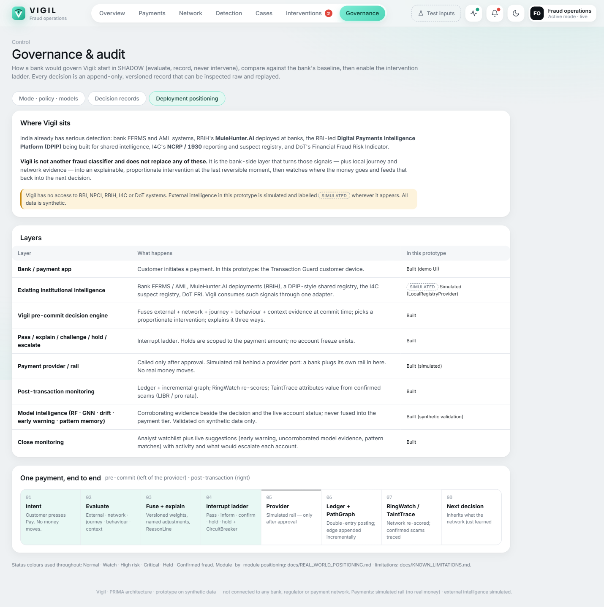

**What is real and what is simulated.**

| Part | Status in this prototype |
| --- | --- |
| Decision engine, scores, tier ladder, holds, release / reject | Real and running |
| Ledger (double-entry, money in paise, always balances to ₹0) | Real |
| Money tracing (TaintTrace, LIBR rule) | Real |
| Detectors and models (rules, RingWatch, Random Forest, GNN, drift, early warning, pattern memory) | Real, but trained and validated on synthetic data only (labelled SYNTHETIC VALIDATION) |
| Live updates (WebSocket push, no polling), audit records, replay | Real |
| Payment rail | Simulated: no real money moves, no gateway keys needed |
| External fraud registry, call / message context | Simulated and labelled SIMULATED on screen |
| Customers and all data | Synthetic (computer-generated) |

**The demo world.** 594 accounts (553 in the original world plus 40 ordinary new customers added in v10 and one international-wire sink): 519 ordinary customers, 28 shops and services (grocer, pharmacy, landlord, tiffin service …), 2 demo customers you drive yourself, and 4 external accounts (another bank, an ATM). About 30,000 past payments make up 45 days of history. A background stream adds everyday payments (about 20 a minute) so the system is always live. The two demo customers are **Ramesh Kumar** (salaried engineer, Bengaluru, pays his grocer weekly and rent monthly) and **Sunita Rao** (retired, 67). Sunita's trusted contact is **Arjun Rao**.

## 2. Words you will hear

Every term on the screens, in one place. Skim it once; come back when a word is unclear.

| Term | What it means in plain words |
| --- | --- |
| Payment intent | A payment the customer has asked for but that has not happened yet. Vigil decides on the intent; money moves only after approval. |
| Posting | One payment written into the ledger (money actually moved, in the simulation). Postings are the lines in the network. |
| Ledger | The bank's book of every posting, double-entry: every rupee out of one account goes into another, so the total is always ₹0. Amounts are stored in paise (₹1 = 100 paise). |
| Score / final score | A number from 0 to 1 the policy engine computes for a payment. Higher = riskier. It is a score, not a probability. |
| Tier | The response the score triggers. T0 pass, T1 heads-up, T2 confirm purpose, T3 scoped hold, T4 hold + trusted contact. |
| Scoped hold | Only this one payment's amount is held while the bank reviews it (30 minutes in the demo). The account keeps working. |
| CircuitBreaker | The T4 step: the customer's nominated trusted contact gets a message with facts (never accusations) so a family member can check in. |
| Dimension | One of the five kinds of evidence for a payment: External, Network, Journey (sequence), Behaviour, Context. |
| RingWatch | Vigil's transparent network rules about the recipient account (fan-in, pass-through, fast chains, circular flow …). It feeds the Network dimension of every payment. |
| TrailScore | The Journey dimension: what the sender did in the last 30 minutes (new device, payee added, limit raised). |
| ContextFlag | The Context dimension: urgency, secrecy, fear of authority, greed or "bypass your bank" cues in a call or message (simulated input). |
| TaintTrace | Follows money from a confirmed scam through the ledger and says how much each account still holds. |
| LIBR | Lowest Intermediate Balance Rule: an account can only hold as much scam money as its lowest balance since receiving it. The standard, exact way to trace mixed money. |
| Mule / mule ring | An account used to receive and pass on scam money; a group of them working together. |
| Mule role | The job an account does inside a ring: collector (gathers from many), distributor (spreads to many), entry, exit / cash-out, coordinator, pass-through. |
| Live status | Each account's current state: Normal, Idle, New account, Early warning, Flagged, Held, Confirmed fraud (see the colour table in section 4.4). |
| Detector family | One independent way of judging an account. Vigil has eight: rule engine, RingWatch, Random Forest, GNN, behavioural drift, early warning, pattern memory, external registry. |
| Rule engine | Six simple checks per account (for example "received from 4+ accounts in 72 h"), scored as points out of 12; 4 points flags. |
| Random Forest (RF) | A machine-learning model that looks at 15 numbers about an account (money in and out, counterparties, age …) and gives the probability it is a mule. |
| GNN | Graph neural network: a model that looks at the account and its neighbours two hops away, because mules are defined by who they trade with. |
| Behavioural drift | How much an account's last 72 hours differ from its own previous 45 days. |
| Early warning | Sudden behaviour change compared with everyone else (new payee bursts, inflow spikes). A warning, not proof. |
| Pattern memory | How closely an account's money-flow shape matches stored signatures of known mule patterns. Similarity, not attribution. |
| SHAP | A method that explains a model's opinion: which features pushed its score up or down. It explains the model, not the payment decision. |
| Consensus / agreement | How many independent families flag an account. One alone never sets a status; agreement does. |
| Model evidence threshold | The bar (0.45–0.85) the strongest model score must reach before an account can be "flagged". It adapts after each graded attack run. |
| Synthetic validation | Model accuracy measured on computer-generated test worlds the models never saw in training. Not real-bank accuracy. |
| Simulator ground truth | The simulator's answer key: which accounts it scripted as mules in an injected attack. Used only to grade results, never by any detector. |
| Attack run | One injected pattern, from first to last posting, graded at the end: detected, missed, false positives, time to detect. |
| False positive | An ordinary account wrongly flagged. |
| Shadow mode | Vigil decides and records its recommendation for every payment but does not intervene; the bank's own baseline decision applies. How a bank would trial Vigil safely. |
| Bank baseline | A simple stand-in for the bank's existing rule (for example "OTP step-up above ₹2,00,000"), recorded beside Vigil's decision for comparison. |
| Provenance | Where each piece of evidence came from, when it was observed, how fresh it is and which version produced it. |
| Counterfactual | "What would the decision have been if …": the policy re-run without some evidence, to show what would have made the payment safe. |
| Background (ambient) stream | Simulated everyday payments (groceries, bills) that keep the system live. Shown as "ambient" or "Everyday". |
| Vigilance | Vigil's fraud-operations assistant: raises classified alerts, writes up each case, walks the bank's procedure and answers questions. It only reads (section 5). |
| Alert (incident) | Something Vigilance raised for a person to handle, from one of nine fixed conditions (section 5.2). |
| Classification / typology | An alert's name in banking terms (for example "Mule ring forming") / the fraud or laundering pattern it belongs to ("layering through mule accounts"). |
| Respond within | The time target for an alert by severity: Critical 15 min, High 1 h, Medium 4 h, Low 24 h (a demo service level). |
| Procedure (SOP) | The bank's steps for an alert in four phases: contain, investigate, report, recover & close. Some steps are inside Vigil, some outside (section 5.5). |
| STR | Suspicious Transaction Report: filed by the bank's Principal Officer with FIU-IND (India's Financial Intelligence Unit) under PMLA, within 7 working days of concluding suspicion. |
| FMR | Fraud Monitoring Return: how banks report a fraud to RBI (within 14 days). |
| 1930 / CFCFRMS | India's cyber-fraud helpline, and I4C's Citizen Financial Cyber Fraud Reporting and Management System that banks and police use to stop the money trail. |
| Shadow credit | A provisional credit to the customer while a disputed transaction is investigated (RBI 2017 circular: within 10 working days). |
| Layering / integration | Money-laundering stages: hiding the trail by moving money through many accounts / bringing it back out as cash or assets. |
| Rail | The payment method of a posting: UPI, IMPS, NEFT, RTGS, Card, ATM, Wallet, International wire. |
| Corridor | A city-to-city route that money flows along on the money map. |
| Collection point | An account receiving from at least as many distinct senders as the fan-in rule (4 in 72 hours). |
| Cash-out cluster | 3 or more risky ATM withdrawals within 8 km and 45 minutes. |
| Mule pipeline | The funnel of accounts opened in the last 60 days: opened, funded, active, passing through, exited the bank (section 4.11). |
| Incident mode | The whole Overview focused on one alert: map, tape, network and KPIs (section 4.12). |
| Connections drawer | For one posting: who funded the payer (upstream) and where the money went next (downstream), up to 3 hops (section 4.5). |
| Gemini | Google's AI model, used optionally to word Vigilance's assessments and answers from live facts. Severity, classification and procedures never come from it. |

## 3. Before you start

**Start it with one command, then reset the world before every demo.** Everything runs on one server on port 8000.

1. Start: `powershell -ExecutionPolicy Bypass -File run_demo.ps1` (add `-Reset` for a fresh world). It builds the screens, seeds the world on first run and serves everything.
2. Open `http://localhost:8000/` full-screen, 1440–1920 px wide.
3. Before presenting: **Test inputs → Reset demo world** (5–20 seconds). Every step then gives the same result as in this guide. Resetting also clears attack runs, holds, labels and the watchlist.
4. Trusted contact phone (optional): on a phone on the same Wi-Fi, open `http://<laptop-ip>:8000/contact/arjun`, or use a second browser tab.

**Time of day matters for one result.** Vigil has an "unusual hour" signal for payments between 00:00 and 05:00 IST. At night it can lift a borderline payment one tier (section 6 shows exactly how). The scripted scenarios pin 14:00 so they give the same result at any hour.

### The top bar (on every bank screen)

| Element | What it does | Why it matters |
| --- | --- | --- |
| VIGIL logo | Back to the Overview. | |
| Overview · Payments · Network · Detection · Cases · Interventions · Governance | The seven screens. The red number on Interventions = open interventions (holds and confirmations waiting). | One menu for the whole workflow: see, decide, investigate, act, govern. |
| Test inputs (dashed button, or Alt + T) | Opens the demo drawer: make a payment, inject an attack, run the coerced journey, confirm a scam, switch mode, reset. | Demo controls are kept off the product screens, so the screens look like a real bank tool. |
| Pulse icon (green dot) | Opens System health. Green = live connection and detection layer available; amber = something is off. Hover it for mode, payment rail, policy version, background traffic. | A one-glance "is everything working" check before you present. |
| Bell (red dot) | Opens Interventions. Red dot = at least one open intervention. | |
| Moon / sun | Dark or light theme (light is the default). | |
| FO · Fraud operations | Who is using the tool, the mode (Active or Shadow) and the live state. | Shows at a glance whether Vigil is intervening (Active) or only recording (Shadow). |
| Toasts (top right) | Pop up when an account becomes flagged, held or confirmed fraud (with the reason and how many detector families agree), and when an attack run finishes ("Detected 3 of 4"). Click one to jump to the account or the run. | You never have to watch every screen; the system tells you. |
| Shadow band (yellow strip) | Appears under the top bar in Shadow mode. | A constant reminder that Vigil is not intervening. |
| Footer | States the honesty line: synthetic data, simulated payment rail, simulated external intelligence. | |
| Vigilance button (bottom right, dark) | Opens Vigilance, the fraud-operations assistant (section 5). The red badge counts open alerts; its notices appear just above it, on every page. | Vigilance names what is happening, how urgent it is and the bank's next step, wherever you are. |

## 4. Overview (operations center)

**The Overview answers three questions: what is happening right now, how serious is it, and what must I do next?** At the very top, **Vigilance** lists every open alert, classified and ranked by urgency. Below it: the money moving (KPI strip), the live network beside the live transaction tape, the money map beside the accounts that need attention, then a plain-words situation brief, money by payment rail, close monitoring and the mule pipeline. Analysis that has its own page stays there: detector families, SHAP and per-account scoring on Detection; decisions by tier on Governance.

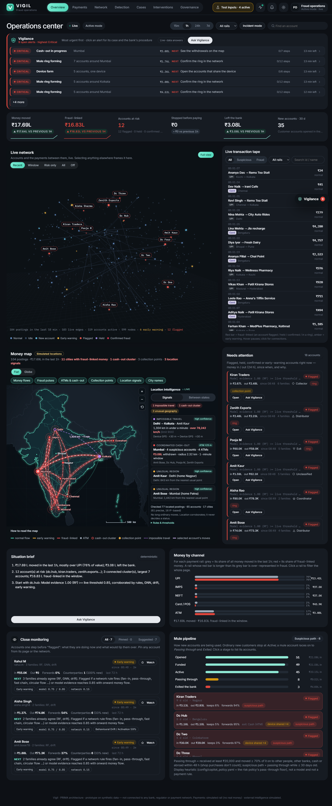

**Layout, top to bottom (wide screen):** header → **Vigilance bar** → KPI strip → **live network (left, large) | live transaction tape (right)** → **money map (left) | Needs attention (right)** → situation brief | money by channel → close monitoring | mule pipeline. The dark **Vigilance** button sits bottom right on every page. Below 1,100 px wide everything stacks into one column.

**One shared selection links the page.** Click a city on the map, a row on the tape, an account in a list or a step in Vigilance, and the map, the tape and the network all follow.

**Every location is simulated.** The bank's accounts, ATMs and the places payments are made from are generated by the simulator, from hashes of the account and payment ids (never from the answer key). Wherever a place is shown, it says how a bank would know it and how precise that is, for example "Simulated location · ATM terminal · ±25 m". No detector, score or payment tier reads a location: places are context for investigating.

### 4.1 Header

| Control | What it does |
| --- | --- |
| Live · Active mode | The realtime connection is open (every number updates by itself, no refresh needed) and whether Vigil's interventions are applied (section 13). |
| Window: 15m · 1h · 24h · 7d | The time window for the KPI strip, the money map and the channel chart. The browser remembers it. |
| All rails ▾ | Filters the whole page to one payment rail: UPI, IMPS, NEFT, RTGS, Card, ATM, Wallet, International wire. |
| Incident mode | Focuses the whole page on the most urgent open alert (section 4.12). Greyed out when nothing is open; turns red and reads "Exit incident mode" while on. |
| Find an account | Type an id or name (for example kiran.traders) and press Enter to open its investigation page. |

### 4.2 Vigilance bar: what is happening, classified, most urgent first

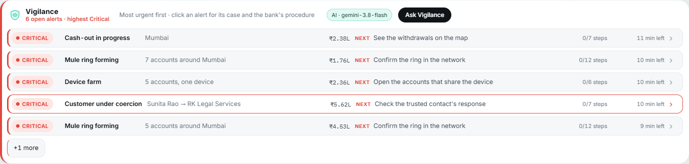

**The first thing on the page is Vigilance's list of open alerts.** Vigilance is Vigil's fraud-operations assistant (section 5). Each row is one alert, named the way a fraud analyst would name it:

| Part of the row | Example | Meaning |
| --- | --- | --- |
| Severity | CRITICAL | Critical, High, Medium or Low: how much is at stake (section 5.3). It is always written in words; colour is never the only signal. |
| Classification | Mule ring forming | What kind of situation this is, in banking terms (the nine kinds are in section 5.2). |
| Who / where | 5 accounts around Mumbai | The accounts or the payment involved. |
| ₹ at stake | ₹4.53L | The money involved. |
| Next | Confirm the ring in the network | The first step of the bank procedure that is not done yet. |
| Steps | 0/12 steps | How much of the procedure is done. |
| Time left | 13 min left | Time left against the respond-within target: Critical 15 minutes, High 1 hour, Medium 4 hours, Low 24 hours. Past it, the row reads "overdue by …" in red. |

**Click a row** and the Vigilance panel opens on that alert's case: the assessment and the step-by-step procedure (section 5.4). The heading says how many alerts are open and the highest severity, for example "6 open alerts · highest Critical"; with none open it reads "All clear · watching every payment". The chip on the right says where answers come from: "AI · gemini-3.8-flash" when the Gemini key works, "Live-data answers" otherwise. **Ask Vigilance** opens the chat. More than five alerts → a "+N more" button lists the rest.

### 4.3 KPI strip: six numbers, each against the previous window

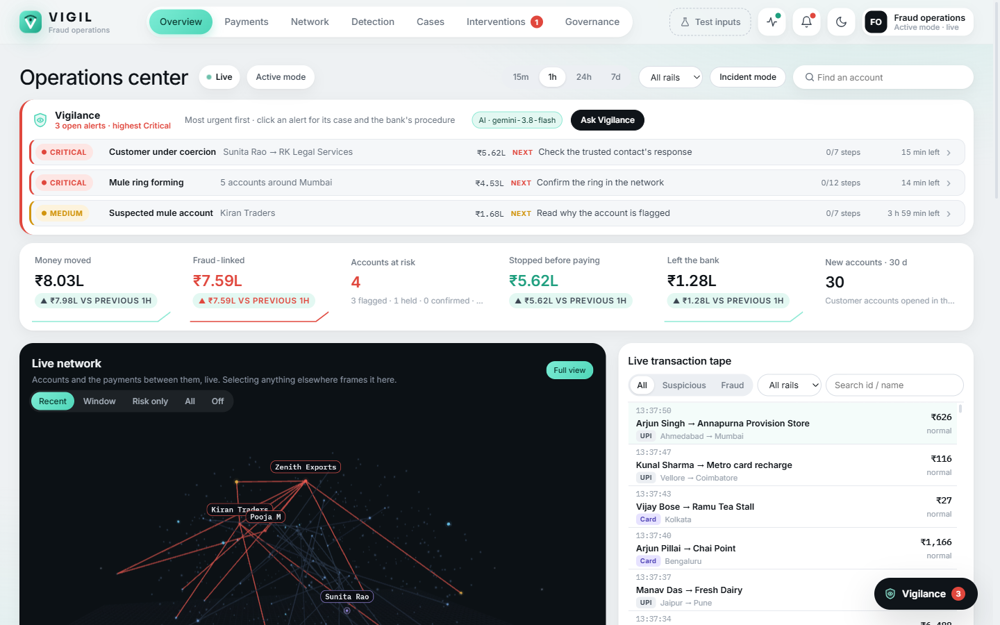

| Tile | What it shows | How to read it | Click it to |
| --- | --- | --- | --- |
| Money moved | Value of every posting in the window (transfers, cash, external). The arrow compares it with the previous window of the same length; the small line is the same value in 12 slices of the window. | A spike in a quiet window is the first sign of a burst. In the screenshot: ₹8.63L in the last hour. | Show all rails and all rows on the tape. |
| Fraud-linked | Value of postings that touch an account that is flagged, held, confirmed fraud or inside a detected ring. Red when above ₹0. | It describes the accounts as they are now: a payment made before an account was flagged turns red later. Here ₹7.59L. | Filter the tape to fraud-linked rows. |
| Accounts at risk | Flagged + held + confirmed accounts right now; the line below splits them and adds early warnings. | 0 in green = all clear. Here 4 (3 flagged, 1 held). | Scroll to Needs attention. |
| Stopped before paying | Tier 2+ payments created in the window that did not go through: held, escalated, rejected, or abandoned after a warning. | Money Vigil kept from leaving. Here ₹5.62L: Sunita's coerced payment. | Open Interventions. |
| Left the bank | Value that moved outside the bank: ATM cash, other banks, international wires. | Once money leaves, recovery is hard; read it next to Fraud-linked. Here ₹1.28L. | Filter the page to the ATM rail. |
| New accounts · 30 d | Customer accounts opened in the last 30 days (and how many in this window). | Mule accounts are usually new; the mule pipeline (section 4.11) shows what they do. | Scroll to the mule pipeline. |

In incident mode every tile says "· incident" and counts only postings that touch the alert's accounts.

### 4.4 Live network (left): every account, every payment

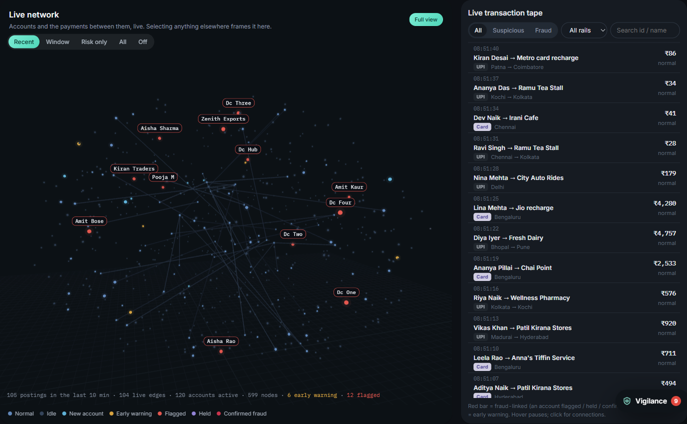

**What you see.** Every dot is one of the 594 accounts. Every line is a payment, drawn the moment it is posted, with a small particle travelling from payer to payee. The layout is fixed, not physics: ordinary customers form the sphere, shops a shell near the core, demo customers their own shell, external accounts (other bank, ATM) an outer ring. It rotates slowly by itself until you click something. Selecting anything elsewhere on the Overview (a tape row, a city on the map, an account in Needs attention, a step in Vigilance) frames those accounts here and switches the lines to Risk only.

**Colour = live status. Size grows with severity.**

| Colour | Status | Meaning |
| --- | --- | --- |
| Blue | Normal | Made or received a payment in the last 10 minutes; no detector flags it. |
| Dark grey | Idle | No payment in the last 10 minutes. |
| Light blue | New account | Opened less than 7 days ago. |
| Amber | Early warning | Behaviour changed, or two detector families agree, but not enough evidence for "flagged". Watch it. |
| Red | Flagged | Corroborated mule evidence: strong model evidence plus another family plus money moved onward; or a network rule (RingWatch) plus two families. |
| Purple | Held | One of this account's own payments is on a scoped hold. Usually the customer being protected, not a suspect. |
| Crimson | Confirmed fraud | Received a payment the bank confirmed as a scam. |

Labels appear only on accounts that need attention, the one you hover and the one you select. A ring around a dot = held, confirmed or selected.

**Edge filter (the Edges buttons):**

| Button | Shows | Use it when |
| --- | --- | --- |
| Recent (default) | Payments from the last 2 minutes, fading as they age. | Talking over live traffic. |
| Window | Every payment in the last 10 minutes. | Showing how busy the economy is. |
| Risk only | Only payments touching an account at early warning or worse, including older history; ordinary accounts dimmed. | Right after an attack: the ring stands out clearly. |
| All | Last 10 minutes plus a faint sample of older history. | Showing how the economy is connected. |
| Off | Accounts only. | Looking at colours without the clutter. |

**Buttons:** Full view (top right) opens the Network page with all its lenses (section 8). The colour legend sits under the canvas.

**Mouse:** drag to rotate, scroll to zoom, hover for a tooltip (name, status, role, network score, model score), click a dot for the drawer.

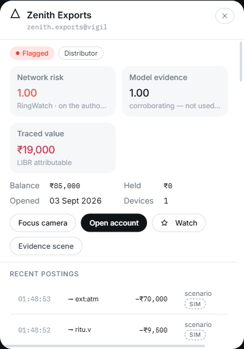

The drawer shows the status and role, **Network risk** (the RingWatch score the payment engine uses), **Model evidence** (the strongest model score; corroborating only, never used to authorise payments), **Traced value** (scam money it still holds, by LIBR), balance, held amount, opening date and devices, recent postings and the detector consensus. Buttons: Focus camera, Open account, **Watch** (adds it to Close monitoring) and Evidence scene.

**Footer line** (bottom left), for example "212 postings in the last 10 min · 203 live edges · 204 accounts active · 594 nodes · 2 early warning · 3 flagged · 1 held": live edges = distinct payer→payee pairs drawn; accounts active = accounts that moved money in the window.

### 4.5 Live transaction tape (right of the network) and the connections drawer

**Every posting as it lands, newest first:** time, payer → payee, the **rail** badge (UPI, Card, IMPS, NEFT, RTGS, ATM, Wallet, Intl wire), the cities (from → to), the amount, and the most serious status of the two parties (or the payment tier). **A red left bar and tint = fraud-linked; amber = early warning.** A "test injection" tag marks attack postings.

- **Filters:** All / Suspicious / Fraud, the rail, and a search box (id or name). A city clicked on the map, an account selected in a list, or incident mode filters it too ("Filtered to …", *clear*).
- **Hover pauses it;** new postings collect in an "N new" pill. It keeps the latest 300 rows and only draws the rows you can see, so it stays fast.
- **Click a row (or press Enter):** the map draws that payment (dashed arc, pin, accuracy circle), the network frames both accounts, and the **connections drawer** opens.

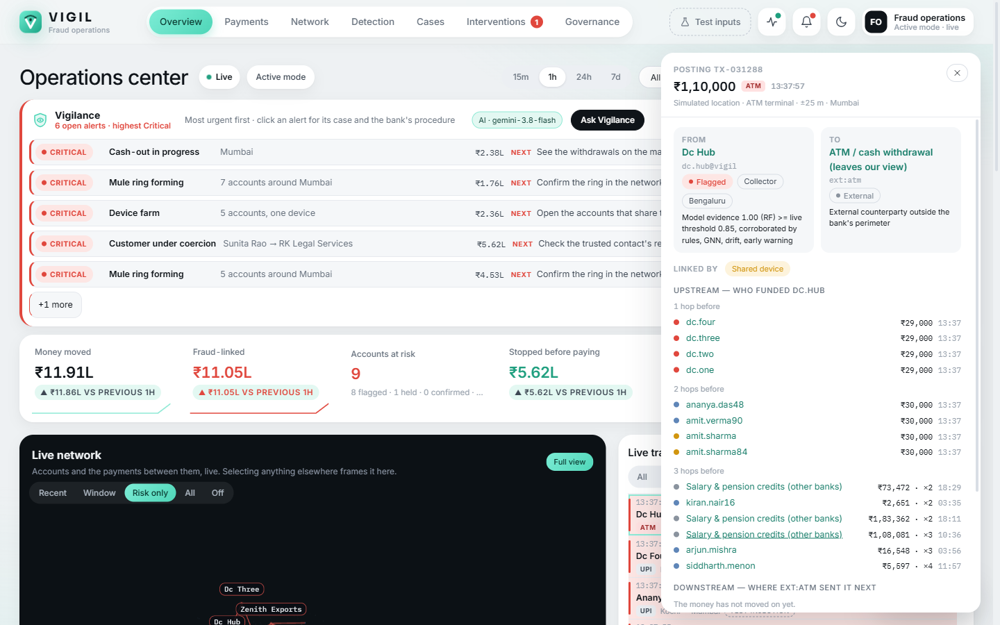

**The connections drawer** answers "who funded this, and where did the money go next?" for one posting:

| Part | Shows |
| --- | --- |
| Header | Posting id, amount, rail, time and its simulated location with basis and accuracy (screenshot: TX-031288, ₹1,10,000 ATM cash withdrawal, "ATM terminal · ±25 m · Mumbai"). |
| From / To cards | Name and id, live status, role (collector, distributor, exit …), home city, and the detectors' one-line reason. |
| Linked by | Why the two sides are connected beyond this payment: Shared device, Fan-in (the payee receives from many distinct senders), Fan-out (the payer pays many), Same ring, Same payee. |
| Upstream | Who funded the payer, up to 3 hops back, with amounts and times. An account that appears several times in one hop is shown once with the total and "× n". |
| Downstream | Where the payee sent the money next, up to 3 hops on ("The money has not moved on yet" when it has not). |
| Buttons | Show on map, Show in network, Open recipient, **Ask Vigilance about this**. Esc closes it. |

**Example (screenshot).** Dc Hub withdrew ₹1,10,000 at a Mumbai ATM. One hop back it was funded by dc.one, dc.two, dc.three and dc.four (₹29,000 each, 13:37), all **flagged** and linked by a **shared device**: the device-farm attack in one picture. Two hops back are ordinary customers, the victims.

### 4.6 Money map (left, below the network)

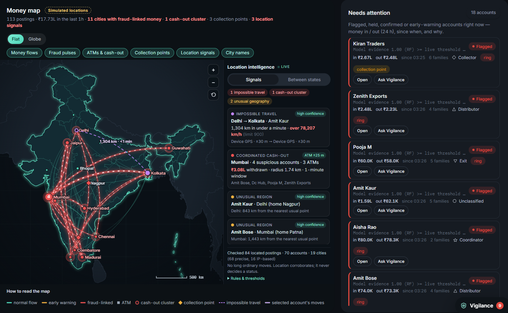

**Where money is moving in India right now, and where it turns risky.** The line under the title counts it, for example "134 postings · ₹8.95L in the last 1h · 5 cities with fraud-linked money · 2 collection points" (plus cash-out clusters when there are any).

**What you see.** India (its boundary as India depicts it, from Natural Earth's India point-of-view data, bundled so it works offline) with its states, glowing on a dark background; neighbouring countries in grey; four international destinations for wires (Dubai, Singapore, London, Hong Kong).

| Mark | Means |
| --- | --- |
| Dot | A city; size = money moved there in the window. Mint = normal, amber = postings touching early-warning accounts, red = fraud-linked money. A red ring pulsing around a dot = fraud-linked money there. |
| Line between cities | Money moving from one city to another; thicker = more value. Mint = normal, amber = early warning, red = an account involved is flagged, held, confirmed or in a ring. **Risky lines glow and carry moving dashes that run the way the money flows.** Destinations off the map show as "→ Dubai" at the edge. |
| Moving spark | One posting arriving right now (red for a test injection). An ATM withdrawal shows as a ring growing on the spot. |
| Small square | An ATM terminal that was used (red = used by a risky account). Zoom in to see every terminal. |
| Red circle with a number | A **cash-out cluster**: 3 or more risky withdrawals close together in time and place. |
| Diamond | A **collection point**: an account receiving from at least as many distinct senders as the risk policy's fan-in rule (4 in 72 hours). Red when flagged. |
| Dashed circle + white pin | The selected payment's location and its accuracy (±25 m at an ATM, ±3–15 km for an IP address). |
| Scale bar | The distance at the current zoom, for example "1000 km" or "50 km". |

**Top corridors (live), top left.** The four busiest city-to-city routes in the window, with their value, red when fraud-linked. In the screenshot every top corridor ends in Mumbai (Kolkata → Mumbai ₹56.5K, Hyderabad → Mumbai ₹48.0K, Pune → Mumbai ₹45.6K, Guwahati → Mumbai ₹38.0K): the shape of a mule ring collecting victims' money in one city. ▾ folds the panel. **Click a corridor** to frame both cities and open the origin city's card.

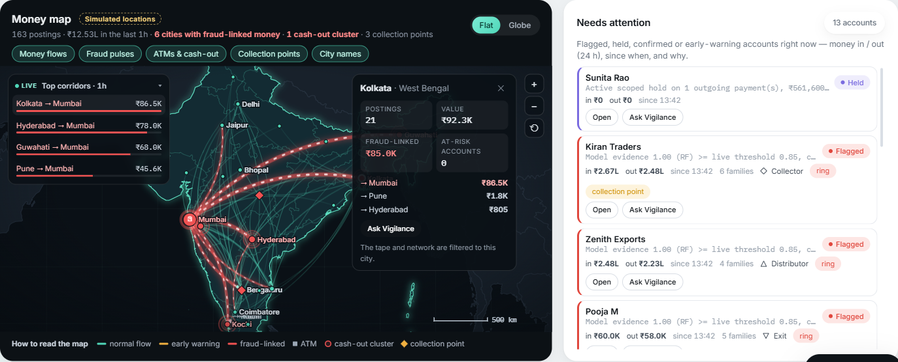

**City card (top right)**, when a city is selected: postings, value, fraud-linked value, at-risk accounts, its biggest flows in and out, and **Ask Vigilance** ("What is happening in Kolkata right now?"). The tape and the network filter to that city; ✕ clears it.

**Controls.** Layer chips: Money flows, Fraud pulses, ATMs & cash-out, Collection points, City names. Scroll or + / − to zoom (country → region → city → street level for ATMs), drag to pan, double-click or ⟲ to reset; with the map focused the keyboard works too (+, −, 0, arrows). Hover a city or a line for its numbers (a line shows its postings, value, risk and the rails used). **How to read the map** at the bottom is the legend. **Flat | Globe** switches to the 3D globe; the browser remembers the choice.

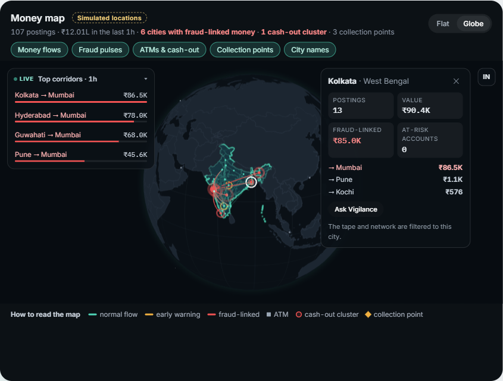

**Globe.** The same data on a rotating Earth: lines follow great circles, lifted higher the further they go; red pulse rings on fraud-linked cities; sparks for new postings. Drag to rotate, scroll to zoom, click a city; **IN** flies back to India. It pauses when the tab is hidden or scrolled away.

**How a bank would know each location (all simulated here):**

| Basis | When | Accuracy shown |
| --- | --- | --- |
| ATM terminal | Cash withdrawal | ±25 m |
| Device GPS | Payment from a known phone | ±30 m |
| Merchant POS | Card payment (the shop's location) | ±2 km |
| IP address | Older postings with no device | ±3–15 km |
| KYC home address | Money arriving from outside the bank | city level |
| Branch | Assisted account opening | ±100 m |

**Why it matters.** Scam money moves geographically: victims all over the country, collection in one city, cash-out at a few ATMs there, or a wire abroad. The map shows that shape at a glance.

### 4.7 Needs attention (right of the map): the to-do list

**Every account that is confirmed fraud, held, flagged or at early warning, most serious first** (13 in the screenshot after the attacks). The card is as tall as the map and scrolls inside. Each account card:

| Part | Meaning |
| --- | --- |
| Name · status pill | Live status: Confirmed fraud, Held, Flagged or Early warning. |
| Grey line | The detectors' one-line reason for that status. |
| in / out | Money in and out in the last 24 hours. |
| since | When it got this status. |
| N families | How many independent detector families flag it right now. One alone never sets a status. |
| Role | Its job inside flagged structure: ◇ Collector, △ Distributor, ▽ Exit and so on. |
| ring · collection point | Inside a detected cluster of risky accounts; receives from at least as many distinct senders as the fan-in rule. |
| Buttons | **Open** (its investigation page) and **Ask Vigilance** ("why is it flagged and where did its money go?"). Clicking the card selects it everywhere: map, tape and network. |

Reading the screenshot:

- **Sunita Rao · Held**: "Active scoped hold on 1 outgoing payment(s), ₹5,61,600 held for review". Sunita is not a suspect: her own payment is held to protect her.
- **Kiran Traders · Flagged**: in ₹2.67L, out ₹2.48L in 24 hours, 6 families agree, Collector, ring, collection point. It gathers money from many senders and passes it straight on.
- **Zenith Exports · Flagged** (Distributor) and **Pooja M · Flagged** (Exit): they spread the money and cash it out.

Payments waiting for a bank decision are on Interventions (section 12).

### 4.8 Situation brief (below, left): the moment in three lines

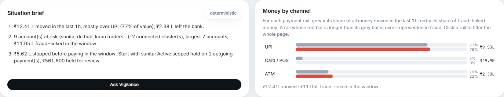

**Three numbered lines written from live data by fixed rules (marked "deterministic": no AI).** In the screenshot:

1. "₹8.63 L moved in the last 1h, mostly over UPI (81% of value); ₹1.28 L left the bank."
2. "4 account(s) at risk (sunita, kiran.traders, zenith.exports …); 1 connected cluster(s), largest 5 accounts; ₹7.59 L fraud-linked in the window."
3. "₹5.62 L stopped before paying in the window. Start with sunita: Active scoped hold on 1 outgoing payment(s), ₹561,600 held for review."

Line 1 is the money, line 2 the risk, line 3 what was stopped and **where to start**. **Ask Vigilance** opens the chat with "Give me a situation summary and what to look at first."

### 4.9 Money by channel (below, right): which payment rail carries the fraud

For each rail used in the window, two bars: **grey = its share of all money moved, red = its share of fraud-linked money**, then the rupee value. **A rail whose red bar is longer than its grey bar is over-represented in fraud.** In the screenshot: UPI 81% of all money but 83% of fraud-linked money (₹7.01L); Card / POS 4% and 0%; ATM 15% and 17% (₹1.28L): the cash-out leg. Click a rail to filter the whole page to it (click again or ✕ to clear). Background payments use UPI or card (one habit per customer); the phone can pay by UPI, IMPS, NEFT, RTGS, card or wallet; attacks add IMPS, NEFT, card and ATM cash.

### 4.10 Close monitoring (bottom, left): accounts one step before "flagged"

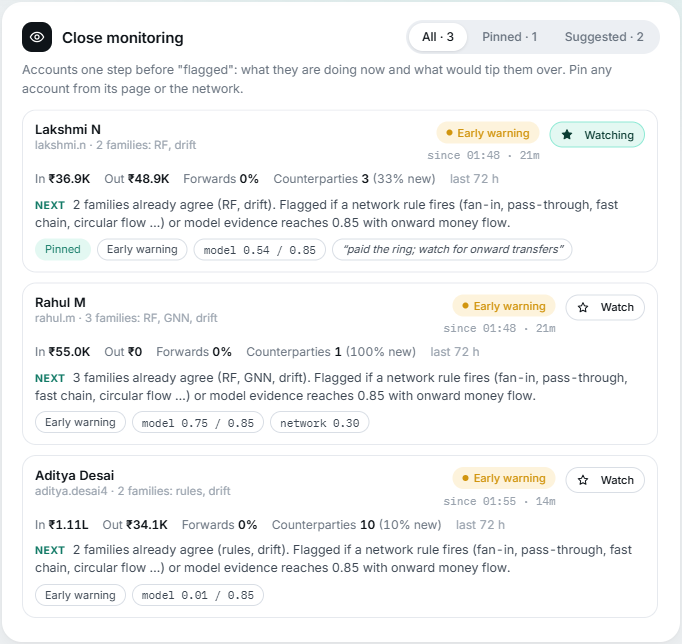

**Who appears.**

- **Pinned** by an analyst: the Watch button on an account page or in the network drawer, with an optional note. Pinned accounts stay whatever their status.
- **Suggested** automatically: Early warning accounts; Model only (model evidence above the threshold but nothing corroborates it yet); Pattern match (looks like a stored mule signature).
- Accounts already flagged, held or confirmed are not suggested: they are in Needs attention.

**Each card.**

- Name, and which detector families flag it. Status and "since 01:48 · 20m". Watch / Watching toggle.
- **Activity, last 72 hours**: In, Out, **Forwards %** (share of received money sent on within 60 minutes; mules forward fast, ordinary people keep their money) and Counterparties (and how many are new).
- **NEXT**: exactly what would change its status, for example "Flagged if a network rule fires (fan-in, pass-through, fast chain, circular flow …) or model evidence reaches 0.85 with onward money flow."
- Tags: why it is here (Pinned, Early warning, Model only, Pattern match), model score / threshold, network score, the analyst's note.

Tabs All / Pinned / Suggested filter the list. It refreshes itself when a status changes or a watched account moves money.

**Why it matters.** It catches accounts before they become mules. In the screenshot, Lakshmi N (who paid the ring) is pinned with the note "paid the ring; watch for onward transfers". If she starts forwarding money, she may have been recruited, and the card shows it at once.

### 4.11 Mule pipeline (bottom, right): how new accounts are being used

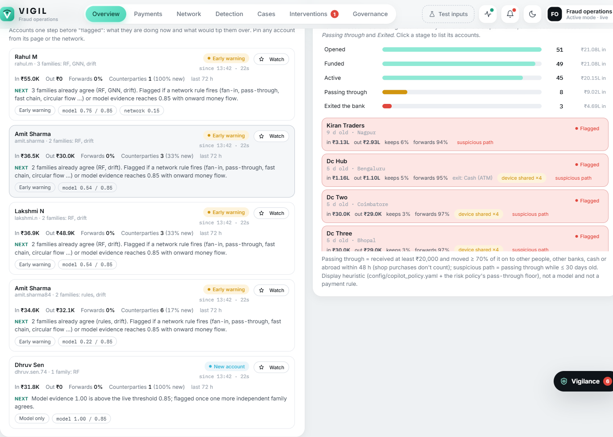

**Every account opened in the last 60 days, as a funnel.** It replaces the old "New accounts" list with what those accounts do.

| Stage | Means | Screenshot |
| --- | --- | --- |
| Opened | The account exists. | 46 accounts |
| Funded | It received its first money. | 44 |
| Active | It has also sent money out. | 40 |
| Passing through | It received at least ₹20,000 and moved 70% or more of it on to other people, other banks, cash or abroad within 48 hours (shop purchases do not count). | 3 |
| Exited the bank | … and some of that money left the bank (cash, other banks, international). | 2 |

Bars = how many accounts reached each stage, with the money that came into them. **Ordinary new customers stop at Active**: the demo world includes 40 legitimate new accounts (students, salaried people, freelancers, shop owners, including a freelancer paid by many clients who keeps the money, and a new shop with fast but honest turnover). A mule races on to Passing through and Exited.

**Suspicious path** = passing through while 30 days old or younger; the chip at the top counts them and lists only those. Click a stage to list its accounts. Each row: age, how and where it was opened (app, branch, agent, kiosk), money in and out, how much it keeps and forwards, its exits, device sharing (two accounts with no risk signals are tagged "family / shop pattern") and status. In the screenshot **Kiran Traders**, 9 days old, received ₹3.13L, sent ₹2.93L on, keeps 6%, forwards 94%: suspicious path. **Arnav Bhat**, 43 days old, keeps 89%: an ordinary customer. The rule is a display heuristic (in `config/copilot_policy.yaml`); it never sets a status.

### 4.12 Incident mode: the whole page on one alert

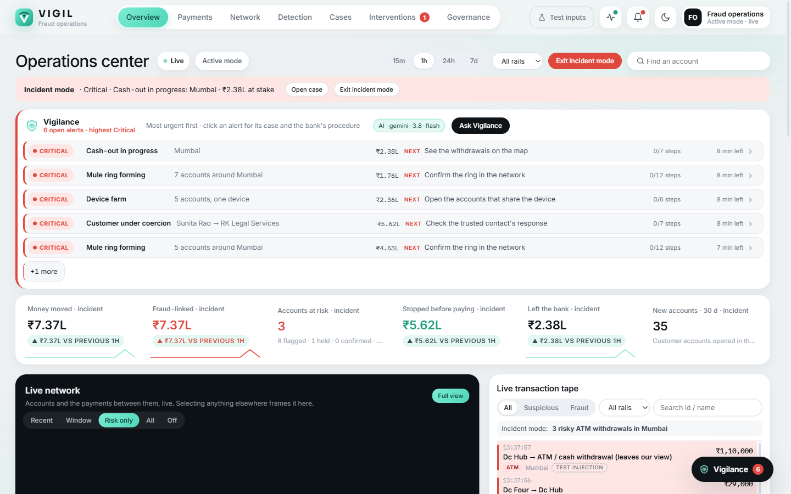

Press **Incident mode** in the header (it takes the most urgent alert) or in any Vigilance case (it takes that alert, from any page). A banner names it, for example "Incident mode · Critical · Cash-out in progress: Mumbai · ₹2.38L at stake", with **Open case** and **Exit incident mode**. Everything focuses on it: the map flies there, the tape shows only its accounts ("Incident mode: 3 risky ATM withdrawals in Mumbai"), the network frames them on Risk only, and the KPI tiles count only postings that touch them ("· incident"). The header button turns red and reads "Exit incident mode". It also ends by itself when the alert closes.

### 4.13 How to show the Overview (about 2 minutes)

1. Right after a reset: "This is the bank's fraud operations view. On top, Vigilance: right now one medium alert (Kiran Traders, a suspected mule)." Point at the KPI strip, the network and the tape ("every location is simulated and says how it would be known").
2. Test inputs → Inject → Money-mule network. Within seconds a notice appears bottom right: "Vigilance raised an alert · CRITICAL · Mule ring forming". The bar ranks it on top, red rows run down the tape, and on the map the red lines converge on Mumbai.
3. Click the alert: "This is the case. What happened in rupees, the red flags, what happens if nobody acts, Vigilance's recommendation, and the bank's procedure with owners and deadlines. Vigilance only reads: people act." (section 5)
4. Press **Show in network** on the first step, then **Watch** on the second (you confirm). The steps tick themselves when Vigil sees them done.
5. Ask Vigilance: "What needs my attention now?" The answer starts with the classification, then the facts and the next steps.
6. On the tape, click a red ATM row: the connections drawer shows the cash-out leg and who funded it.
7. Point at the mule pipeline: "Ordinary new customers stop at Active; Kiran Traders, 9 days old, forwarded 94% and is on the suspicious path."

## 5. Vigilance: the fraud-operations assistant

**Vigilance watches every payment and account, raises an alert by itself when something needs a person, says exactly what kind of situation it is and how urgent, walks you through the bank's procedure step by step, and answers any question about what you see.** It only reads: it never freezes, holds, releases, files a report or calls anyone. People do that. (Before v11 it was called "Copilot"; the code and the API still use the name `copilot`.)

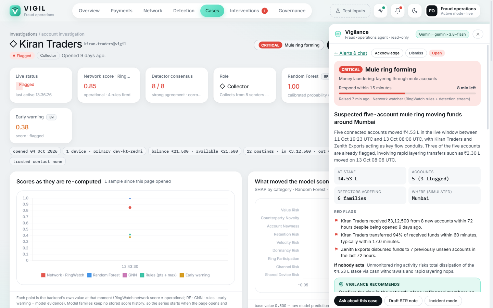

### 5.1 Where you meet it

| Place | What it does |
| --- | --- |
| Vigilance bar (top of the Overview) | The ranked list of open alerts (section 4.2). Click one to open its case. |
| Notice (bottom right, any page) | When Vigilance raises a new alert, or escalates one to a higher severity, a notice says so in one sentence with the numbers: severity, classification, what is happening, "Respond within …" and **Open case**. It disappears after 12 seconds; ✕ closes it; opening the panel clears all notices. |
| Vigilance button (bottom right, every page) | Opens the panel. The red badge counts open alerts. Esc closes the panel; drag its left edge to make it wider. |
| Ask Vigilance buttons | On Needs attention rows, the situation brief, the map's city card, the connections drawer, the account page and the case page. Each opens the chat with a question about what you are looking at. On an account or case page, a second button names the open alert that involves it (for example "CRITICAL · Mule ring forming") and opens that case. |

**The panel follows you across pages.** A procedure step that opens the case page or an account page keeps the case open beside it. A step that shows something on the map or in the network takes you back to the Overview and does it there.

### 5.2 How an alert is raised and classified (nine kinds)

**Alerts come from a deterministic incident engine, not from AI.** It watches the same live events as the rest of the console and checks nine conditions every time something changes. Each kind has a banking **classification** (what it is), a **typology** (which fraud or laundering pattern it belongs to) and the engine that raised it:

| Classification | Typology | Raised when | Raised by |
| --- | --- | --- | --- |
| Customer under coercion | Social engineering: "digital arrest" style scam | An open Tier 4 hold with the trusted contact alerted | Payment gate (PRIMA decision) + CircuitBreaker |
| Stolen money traced | Recovery opportunity | Value from a bank-confirmed scam sits in accounts | TaintTrace |
| Mule ring forming | Money laundering: layering through mule accounts | 3 or more risky accounts connected by payments in the live window, at least one flagged | Network watcher (RingWatch rules + detection stream) |
| Cash-out in progress | Money laundering: integration through ATM cash | 3 or more ATM withdrawals by flagged or ring accounts within 8 km and 45 minutes | Simulated ATM locations |
| Device farm | Controlled or synthetic accounts on one device | 3 or more accounts on one device, at least one watched or flagged | Device graph |
| Payment held for review | Authorised push payment risk | An open Tier 3 hold | Payment gate (PRIMA decision) |
| New account passing money through | Mule onboarding | An account 30 days old or younger moved 70% or more of what it received (at least ₹20,000) on within 48 hours | Mule pipeline heuristic |
| Possible account takeover | Account takeover (one account, two distant places) | The same account's phone paid from two places further apart than 900 km/h allows | Simulated device locations |
| Suspected mule account | Money-mule activity | An account is flagged and not already inside a ring alert | Detection stream |

*Layering* and *integration* are the second and third classic stages of money laundering: hiding the trail by moving money through many accounts, then bringing it back out as cash or assets. *Authorised push payment* fraud is when the customer is tricked into sending the money themselves.

**One finding, one alert.** A ring that grows stays one alert; its row updates, and if its severity rises Vigilance says it "escalated it from High". Suspected-mule, account-takeover and new-account alerts close by themselves 10 minutes after their condition is gone; the others stay until someone acknowledges or dismisses them. At most five show in the bar; the rest are behind "+N more".

### 5.3 Severity, time to respond, and confidence

**Severity = how much is at stake.** A hand-set, explainable score out of 100 (in `config/copilot_policy.yaml`; not validated on real data):

| Component | Points |
| --- | --- |
| Base by kind | Customer under coercion 70, Stolen money traced 70, Mule ring forming 65, Cash-out in progress 65, Device farm 55, Payment held 50, New account passing money through 45, Possible account takeover 40, Suspected mule account 35 |
| Money at stake | 0 below ₹10,000; +5 below ₹50,000; +10 below ₹2,00,000; +15 below ₹10,00,000; +20 above |
| Accounts involved | 0 for 1; +4 up to 3; +7 up to 6; +10 for more |
| Bank-confirmed scam | +10 |
| Fresh evidence | +10 when the newest evidence is under 5 minutes old, falling to 0 at 60 minutes |
| Already contained | −10 when every account involved is already held or confirmed |

**80 or more = Critical, 60–79 = High, 40–59 = Medium, below 40 = Low.** Worked example from the screenshots: the ring around Mumbai scored 97 (65 base + 15 for ₹4.53L + 7 for 5 accounts + 10 fresh), so Critical. In any case, **Why critical? Score 97/100** opens the same breakdown.

**Respond within** (an operational target for this demo, not a regulation): Critical 15 minutes, High 1 hour, Medium 4 hours, Low 24 hours, counted from when the alert was raised. The case shows the time left and a bar of the time used; past it, "overdue by …" in red.

**Confidence = how sure the evidence is**, separate from severity. High when the bank confirmed it or three or more detector families agree; medium for rules plus a model; low for one signal or a heuristic. The case states it with its reason.

### 5.4 The case: Vigilance's assessment

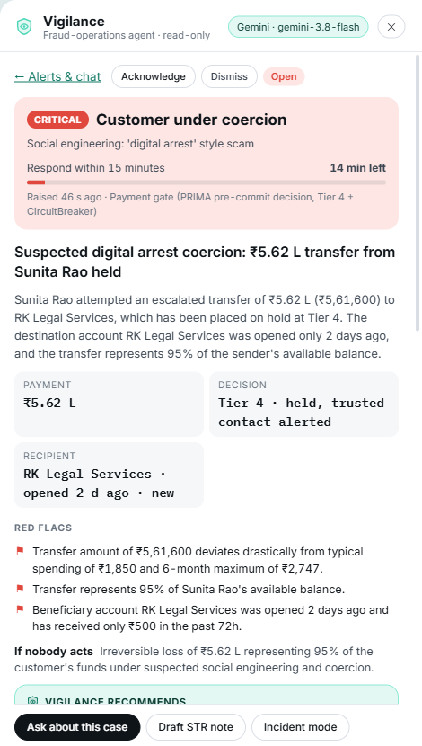

**Click an alert and Vigilance writes up the case like a fraud analyst would.** Top to bottom:

| Part | What it says | Example: Sunita's coerced payment |
| --- | --- | --- |
| Top line | ← Alerts & chat; **Acknowledge** (keep it on record, off the open list); **Dismiss** (not a real issue); **Reopen**; the status. | Open |
| Classification block | Severity and classification, the typology, "Respond within" with the time left and a bar of the time used, when it was raised and by which engine. | CRITICAL · Customer under coercion · Social engineering: 'digital arrest' style scam · 14 min left · Payment gate (Tier 4 + CircuitBreaker) |
| Headline and summary | One line, then one or two sentences with the exact amounts. | "Suspected digital arrest coercion: ₹5.62 L transfer from Sunita Rao held" |
| Key facts | Three or four tiles. | Payment ₹5.62 L · Decision: Tier 4, held, trusted contact alerted · Recipient: RK Legal Services, opened 2 d ago |
| Red flags | The indicators behind the alert, each with its number, taken from the detectors and the payment decision. | ₹5,61,600 against a typical ₹1,850 (largest in 6 months ₹2,747); 95% of the available balance; the payee opened 2 days ago; someone claiming to be police and threatening arrest (simulated call context) |
| If nobody acts | One sentence on the consequence. | "Irreversible loss of ₹5.62 L, 95% of the customer's funds, under suspected coercion." |
| Vigilance recommends | One instruction, with a confidence level and its reason. | "Check the trusted contact's response, call the customer on the registered number, and keep the hold until the customer confirms they are safe, then decide." Confidence high. |
| Source line | Who wrote the words. | "Assessment written by Gemini from live facts · verify before acting · severity, classification and procedure are computed by Vigil" |
| Procedure | The bank's steps (section 5.5). | 0 of 7 steps done |
| Why critical? | The severity breakdown (section 5.3). | Score 89/100 |
| Evidence | Account and posting chips: click to select the account or open the posting's connections. | rk.legal.services, sunita |
| Buttons | **Ask about this case** (the chat, about this alert), **Draft STR note** (section 5.6), **Incident mode** (section 4.12). | |

**How the assessment is written.** The panel opens at once with an assessment built from live data by fixed rules. When the Gemini key works, Vigilance then asks Gemini to rewrite the headline, summary, red flags, risk and recommendation from the same facts ("refining with AI…" while it works). Gemini's reply is checked: a reply that names an account or posting outside the alert is rejected, and severity, classification and the procedure never come from the model. The result is kept until the alert changes.

### 5.5 The procedure: what the bank does next

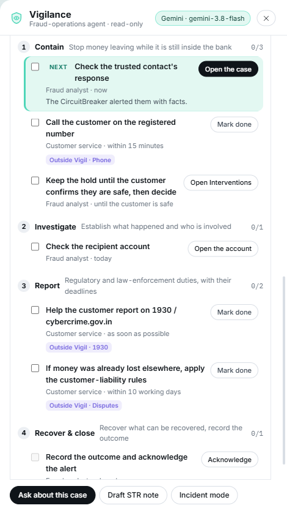

**Every alert carries the bank's step-by-step procedure, in four phases.**

| Phase | Goal |
| --- | --- |
| 1 Contain | Stop money leaving while it is still inside the bank. |
| 2 Investigate | Establish what happened and who is involved. |
| 3 Report | Regulatory and law-enforcement duties, with their deadlines. |
| 4 Recover & close | Recover what can be recovered; record the outcome. |

**Each step** shows a checkbox, the title, **who** does it and **by when**, a short explanation (open for the next step; click a title to open any other), and either a button or an "Outside Vigil" tag. **NEXT** marks the first step not yet done. The progress ("0 of 7 steps done") also shows in the bar and on the alert card.

| Kind of step | What you press | Example |
| --- | --- | --- |
| Inside Vigil | Its button: Show in network, Watch …, Open Interventions, Open the case, Open the account, Trace the money, Show on the map, Acknowledge. | "Confirm the ring in the network" → **Show in network** |
| Outside Vigil | **Mark done** (or the checkbox) once it is done in the bank's other systems. It records who and when; untick to undo. | "Call the customer on the registered number" · Customer service · within 15 minutes · Outside Vigil · Phone |
| Done by itself | Nothing: Vigil sees it happen and ticks it ("Vigil saw: …"). | "Put members on close monitoring" ticks once a member is on the watchlist; "Keep the hold until the customer is safe, then decide" ticks once the bank releases or rejects the payment; others tick when the trusted contact answers, a scam is confirmed, or the alert is acknowledged. |

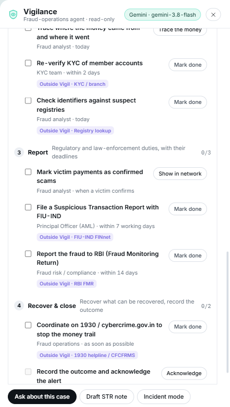

**The Indian rules behind the outside steps** (illustrative, modelled on Indian requirements; not legal advice):

| Step | Who | Deadline | Rule |
| --- | --- | --- | --- |
| File a Suspicious Transaction Report (STR) with FIU-IND through FINnet | Principal Officer (AML) | within 7 working days of concluding the transactions are suspicious | PMLA rules (Prevention of Money Laundering Act) |
| Report the fraud to RBI (Fraud Monitoring Return, FMR) | Fraud risk / compliance | within 14 days | RBI Master Directions on Fraud Risk Management (2024) |
| Coordinate on 1930 / cybercrime.gov.in to stop the money trail | Fraud operations | as soon as possible | I4C's Citizen Financial Cyber Fraud Reporting and Management System (CFCFRMS) |
| Apply the customer-liability rules if money was lost | Customer service / disputes | within 10 working days (shadow credit) | RBI circular of 6 July 2017: zero liability when a third-party breach is reported within 3 working days |
| Request a debit freeze or lien on member accounts | Branch / operations | per bank policy | Core banking. Vigil itself has no freeze function. |
| Re-verify KYC; check identifiers against suspect registries | KYC team; fraud analyst | within 2 days; today | Bank KYC policy |

**Example, Customer under coercion (7 steps).** Contain: check the trusted contact's response (**Open the case**); call the customer on the registered number (Customer service, within 15 minutes, outside Vigil); keep the hold until the customer confirms they are safe, then decide (**Open Interventions**). Investigate: check the recipient account (**Open the account**). Report: help the customer report on 1930 / cybercrime.gov.in; if money was already lost elsewhere, apply the customer-liability rules (within 10 working days). Recover & close: record the outcome and **Acknowledge**.

**Example, Mule ring forming (12 steps).** Contain: confirm the ring in the network; put members that are not yet flagged on close monitoring; review their pending payments; request a debit freeze or lien (outside). Investigate: trace the money; re-verify KYC (outside); check suspect registries (outside). Report: mark victim payments as confirmed scams; file the STR (7 working days); report to RBI by FMR (14 days). Recover & close: coordinate on 1930 / CFCFRMS; record the outcome and acknowledge.

A demo reset clears every tick.

### 5.6 The chat: alerts and answers in one place

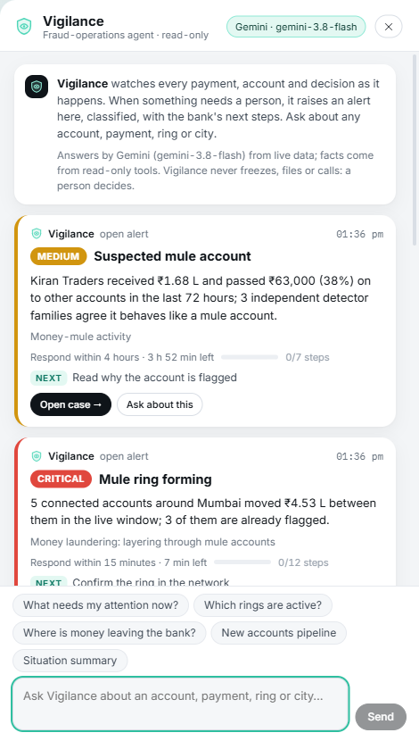

**The panel is one chat box.** Vigilance posts its alerts there as cards ("open alert", "raised a new alert", "escalated it from High") with the severity, classification, what is happening in rupees, the typology, time left, procedure progress and the **Next** step, plus **Open case →** and **Ask about this**. Your questions and its answers sit in the same stream, newest at the bottom.

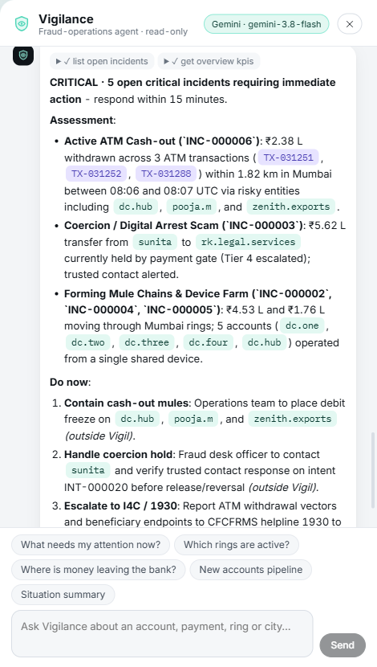

**Every answer has the same shape:** first the classification line (for example "**CRITICAL** · 5 open critical incidents requiring immediate action – respond within 15 minutes"), then the assessment with the exact numbers, then the steps ("Do now": who, when, and whether it is outside Vigil), then what to watch for. Answers stay under about 250 words unless you ask for more.

- **Look-ups are shown.** Each look-up Vigilance made appears as a small chip above the answer ("✓ list open incidents", "✓ get overview kpis"); open one to see exactly what it asked and what it got back.
- **Names are clickable.** Account and posting names in an answer select the account or open the posting's connections.
- **Ask about an alert.** "Ask about this" puts "About: Mule ring forming" above the box, and the question goes with that alert's facts. Suggestions then become: What should I do first? · Trace the money · Is this a false positive? · Draft the STR grounds. Without an alert: What needs my attention now? · Which rings are active? · Where is money leaving the bank? · New accounts pipeline · Situation summary.
- **Stop** cancels an answer; **Copy** copies it; **Retry** repeats a failed one. The line under each answer says "Gemini · from live data · verify before acting" or "From live data (no AI)".

**What it can look up (19 read-only tools):** overview KPIs, the situation brief, open incidents and one incident, the procedure, the STR draft, an account, a posting, a posting's connections, money traced up to 4 hops (last 7 days), rings, new accounts and pipeline stages, a city's activity, the channel mix, where money leaves the bank, collection points, recent payment-gate alerts, and account search. None of them can change anything.

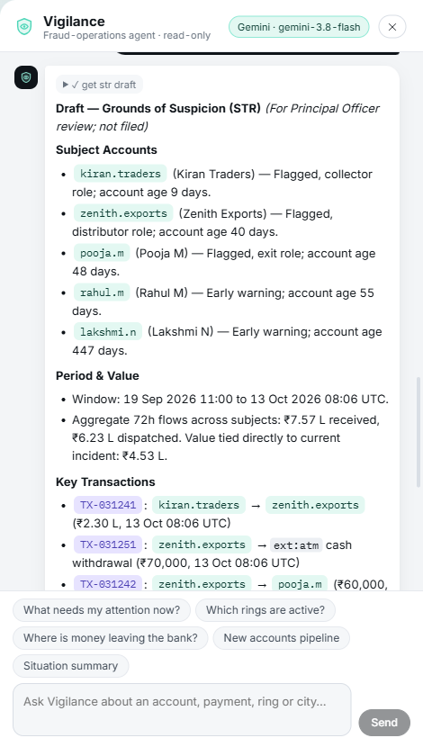

**Draft STR note** (in a case) writes the grounds of suspicion for the Principal Officer: the subject accounts with status, role and age; the period and value; the key postings with ids, amounts and times; the grounds (here: layering and velocity, unusual inflows into a 9-day-old account, dispersion and ATM cash drain); the typology; and the action taken. It is marked "for Principal Officer review; not filed". Filing the STR on FINnet stays a human step in the procedure.

### 5.7 With AI or without, and the free Gemini key

| Setup | What you get |
| --- | --- |
| Gemini key in `.env` (`GEMINI_API`, `GEMINI_API_KEY` or `GOOGLE_API_KEY`, in the project folder or in `backend/`) | Answers and assessments written by Google's Gemini (`gemini-3.8-flash`) from live facts. The chip reads "Gemini · gemini-3.8-flash". In this run a case assessment took a few seconds and a chat answer about 10–20 seconds. |
| Free-tier limit reached | The answer still comes, from live data, with the note "the free Gemini tier's rate limit was reached; try again in a minute". To stay inside the free tier, each answer uses at most 4 look-ups and short thinking. |
| No key | Everything still works: alerts, severity, classification, procedure, assessments written from live data by fixed rules, and chat answers to the common questions with the same tools ("Live-data answers"). |

The key is never shown in the app, never sent to the browser, and anything that looks like a key is removed from answers.

### 5.8 What Vigilance can never do, and why

- **It never acts on the bank.** It cannot hold, release, freeze, approve, reject, label, file or call. Its only writes are its own records: an alert's status (acknowledge, dismiss, reopen), procedure ticks and chats.
- **Watch is a proposal.** A step such as "Watch lakshmi.n" opens a confirmation ("You are making this change, not Vigilance"); you add the account.
- **Buttons only navigate or select.** Seven whitelisted actions (select, open a page, show on map, show in network, open connections, filter the tape, propose watch); anything else is ignored.
- **Others' words are data.** Names and payment notes written by other people are passed to the model labelled as untrusted text, so instructions hidden in a payment note are ignored (this is tested).
- **No answer key.** It never reads the simulator's ground truth.
- **Why:** freezing, reporting and calling a customer are decisions for named people at the bank under PMLA and RBI rules, and a language model can be wrong or manipulated. So Vigilance explains and proposes; people act; and every payment decision stays with the transparent policy engine (section 6).

### 5.9 How to show Vigilance (about 2 minutes)

1. Test inputs → Run journey (coerced). A notice appears: "Vigilance raised an alert · CRITICAL · Customer under coercion".
2. Open the case: read the classification, the red flags and the recommendation. "Severity, classification and the procedure are Vigil's own rules; the wording is Gemini's, from the same facts."
3. In the procedure, press **Open the case**: the case page opens and the panel stays beside it. Mark "Call the customer" done. On Interventions, reject the held payment: "Keep the hold … then decide" ticks itself.
4. Open the Mule ring forming alert → **Draft STR note**.
5. Ask: "What needs my attention now?"

## 6. Payments (Transaction guard)

**This page is the heart of PRIMA: the customer's phone on the left, and on the right the bank's full assessment of the same payment, made before any money moves.** The customer sees one calm, proportionate message; the bank sees every reason.

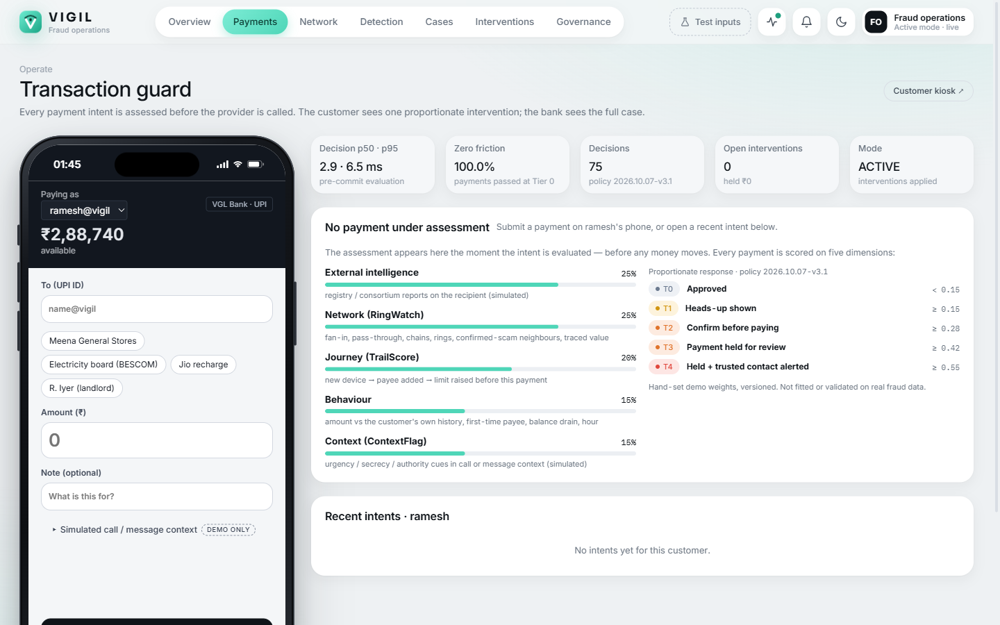

### 6.1 The phone (customer device)

- **Paying as**: switch between the two demo customers (Ramesh, Sunita). Their balance shows underneath, including any amount on hold.
- **To (UPI id)** with quick-pick payees, **Amount**, **Note**.
- **Simulated call / message context (DEMO ONLY)**: type what a scam caller said (for example "police, keep it secret, transfer now"). Vigil's ContextFlag reads it. In a real bank this would come from call or message signals; here it is simulated and labelled.
- **Pay**: sends the payment intent. The phone shows "Vigil is checking this payment" for a moment, then one of the screens below.

| Tier | What the customer sees | What the customer can do |
| --- | --- | --- |
| T0 Pass | "Paid ₹500" with a tick and "Simulated payment — no real money moved". | Nothing to do. |
| T1 Heads-up | A short note about what looks unusual. | Continue or Cancel. |
| T2 Confirm purpose | "Please confirm before you pay", why we are interrupting, and a box: What is this payment for? | Confirm & pay (after typing a purpose) or Don't send. |
| T3 Scoped hold | "We're holding this payment while the bank checks the recipient." Only this amount is held; the account works normally; review within 30 minutes. A hold reference (HLD-…). | Cancel this payment, or wait for the bank. If the bank releases it: "Bank released this payment — complete it". |
| T4 Hold + trusted contact | As T3, plus the trusted contact is notified. The contact's responses appear on the phone. | Cancel, or wait. |
| Rejected / cancelled | "Nothing was sent. Your account works normally." | New payment. |

The customer text is generated from facts only and never contains accusing words (there is a banned-word list in the code). Below the message: **What changed** (recent account changes), **Why we are interrupting** (the facts) and **What action is being taken**.

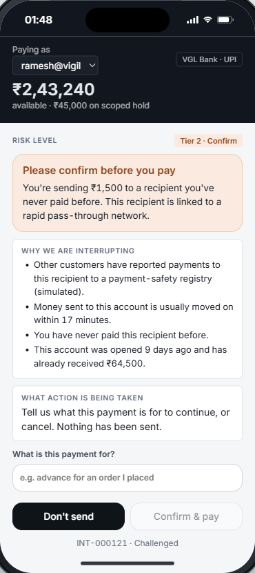

**Pay via** (added in v10): UPI, IMPS, NEFT, RTGS, card or wallet. The rail is recorded on the payment and shown on the Overview's tape, map and channel chart; it does not change the risk score.

### 6.2 The tiles above the assessment

- **Decision p50 · p95**: how long Vigil takes to decide. p50 = the typical (median) payment, p95 = 95% of payments are faster than this. About 3 ms and 7 ms.
- **Zero friction**: share of payments passed at Tier 0 (about 99%). Proof that Vigil is not a nag.
- **Decisions**: number of payments assessed, and the policy version.
- **Open interventions**: payments waiting, and the money held.
- **Mode**: ACTIVE (interventions applied) or SHADOW (recommend only).

### 6.3 How the score is built (the most important idea)

Every payment is scored on **five dimensions**. Each dimension is the sum of the rules that fired in it (capped at 1.0). The weights come from the versioned policy file `config/risk_policy.yaml`:

| Dimension | Weight | What it looks at | Example rules (points added) |
| --- | --- | --- | --- |
| External intelligence (SIMULATED) | 25% | Fraud registry reports about the recipient | reported 0.65, confirmed mule 1.00 |
| Network (RingWatch) | 25% | The recipient's money-flow structure in the last 72 h | many first-time senders 0.25, rapid pass-through 0.30, circular flow 0.25, received a confirmed scam 0.45, holds traced scam money 0.40 |
| Journey (TrailScore) | 20% | What the sender did in the last 30 minutes | new device 0.20, payee added 0.15, limit raised 0.20, takeover sequence 0.25 |
| Behaviour | 15% | This payment vs the sender's own 180-day history | unusually large 0.30, first payment to this payee 0.15, most of the balance 0.30, unusual hour 0.05 |
| Context (ContextFlag, SIMULATED) | 15% | Pressure cues in the call or message | urgency 0.25, secrecy 0.30, fear of authority 0.35, bypass approval 0.30 |

Then four steps:

1. **Base score** = each dimension score × its weight, added up.
2. **Corroboration bonus**: every *extra* dimension at 0.5 or above adds +0.10. Independent evidence agreeing counts more than one loud signal.
3. **Named adjustments** (each recorded by name on the decision): *floors* (recipient confirmed as a mule, or holding ₹10,000+ of traced scam money → at least Tier 3); *friction guard* (an established, clean relationship with 3+ past payments → at most Tier 1); *CircuitBreaker needs sender evidence* (Tier 4 only when the journey or context shows the sender may be compromised or coerced; otherwise at most Tier 3).
4. **The ladder** turns the final score into a tier:

| Final score | Tier | Action |
| --- | --- | --- |
| below 0.15 | T0 | Approved |
| 0.15 to 0.28 | T1 | Heads-up shown |
| 0.28 to 0.42 | T2 | Confirm before paying |
| 0.42 to 0.55 | T3 | Payment held for review (scoped hold) |
| 0.55 and above | T4 | Held + trusted contact alerted |

These numbers are hand-set, explainable demo values, not fitted to real fraud data. Machine-learning models never change the tier; they appear only as corroborating evidence.

### 6.4 The assessment, row by row

| Row | What it shows |
| --- | --- |
| Sender | Who pays: account age, available and held money, daily limit, trusted contact, a one-line persona. |
| Recipient | Who receives: age, kind, balance (or "outside the bank's view" for other banks). |
| Amount | The amount, its share of the available balance, the note, the sender's median payment and the **robust z** (how unusual this amount is for this sender; median-based so one old big payment does not distort it; 3.5+ = outlier). |
| Relationship | First payment, or established ("paid 13 times before, typically ₹700"). |
| Device | Which device sent it: primary, secondary, or unknown. |
| Behaviour · Network · External · Journey · Context | One line per rule that fired: name and rule id, a plain reason, the evidence values as chips, the provenance (computed live / SIMULATED, and how old) and the points added. On the right: dimension score × weight = contribution. "No rule fired in this family" when clean. |
| Model evidence | Random Forest, GNN, rule engine, early warning, drift and pattern memory for the recipient, each with its value and whether it flags. Corroborating only. |
| Final decision | The score bar with the tier thresholds as ticks, base + policy adjustments, each adjustment by name, the tier, the intent's state, the intervention, the bank action, and the mode / recommended / applied tier / bank baseline. |

Below the table: the case id, **Investigate**, **Replay decision** and **Decision record** links; **Exactly what the customer was shown**; and **Provider · ledger · monitoring** with the intent's lifecycle (Created → Risk evaluated → Approved → Payment initiated → Payment succeeded → Monitored, or Held / Escalated / Rejected / Cancelled). "No money has moved" is stated whenever the payment is not approved yet. **Recent intents** lists this customer's past payments; click one to load its assessment. **Customer kiosk ↗** opens the phone alone, for a second screen. On a held payment, **Release hold** and **Reject payment** appear at the top of the assessment.

### 6.5 Worked examples from the demo run (real numbers)

| Payment | What fired | Maths | Result |
| --- | --- | --- | --- |
| Ramesh → Meena General Stores, ₹500, 01:46 | Only "unusual hour" (behaviour 0.05). Paid this grocer 13 times. | 0.05 × 0.15 = 0.007 | **T0**, paid in 1.8 ms |
| Ramesh → Kiran Traders, ₹1,500, 01:48 | Behaviour 0.20 (first payee, unusual hour); network 0.45 (rapid pass-through 98%, new account with large inflow); external 0.65 (registry: reported) | 0.030 + 0.113 + 0.163 = 0.305; only one dimension ≥ 0.5, no bonus | **T2**, confirm purpose |
| Ramesh → Kiran Traders, ₹45,000, 01:47 | Behaviour 0.50 (unusually large: robust z 99, first payee, unusual hour); network 0.45; external 0.65 | 0.075 + 0.113 + 0.163 = 0.350, + 0.10 (external and behaviour both ≥ 0.5) = 0.450 | **T3**, scoped hold |
| Same payment after the scam was confirmed | Network rises to 1.00 (received a confirmed scam +0.45, holds traced money +0.40, many first-time senders +0.25 …) | base 0.487 + 0.20 (three dimensions agree) = 0.688, which is T4 territory, but **capped at T3**: nothing shows Ramesh himself is coerced | **T3**, adjustment CAP_NO_SENDER_EVIDENCE |
| Sunita → RK Legal Services, ₹5,61,600 (coerced journey) | Journey 0.90 (new device, payee added, limit raised, takeover sequence, large transfer after changes); behaviour 0.75; context 1.00 (urgency, secrecy, fear of authority, bypass) | 0.180 + 0.113 + 0.150 = 0.443, + 0.20 = 0.642 | **T4**, hold + Arjun alerted |

**Why the ₹45,000 payment is T3 at night but T2 by day.** At night the "unusual hour" signal (+0.05) lifts behaviour from 0.45 to 0.50. That crosses the 0.5 line, so behaviour starts to count as a second agreeing dimension and the +0.10 bonus applies (0.343 → 0.450). By day the same payment scores about 0.343, which is Tier 2. The case page's counterfactuals show this.

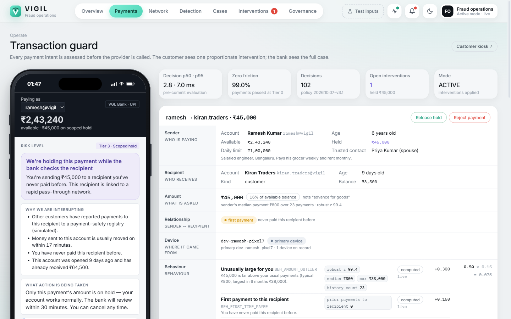

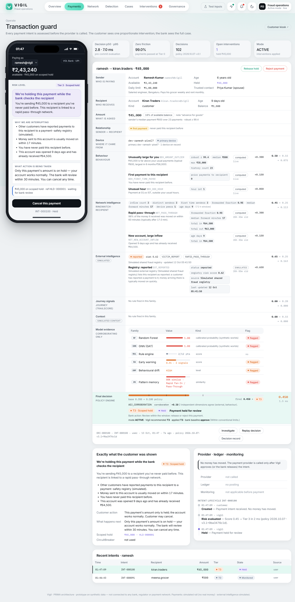

### 6.6 How to show Payments (3 minutes)

1. Test inputs → *Everyday · grocer ₹500* → **Open on customer device** → **Pay**. "Most payments pass silently, in milliseconds." Point at the T0 assessment: everything clean except a tiny unusual-hour note.
2. Test inputs → *Risky recipient · ₹45,000* → Open on customer device → Pay. Read the phone message aloud, then walk the right-hand rows: first payee, outlier amount, rapid pass-through, registry report. "The customer sees facts, the bank sees the evidence and the maths."
3. After the scam is confirmed (section 16 step 5), pay again: network jumps to 1.00 and the score to 0.688, but it stays a scoped hold because there is no sign Ramesh himself is under pressure.

## 7. Trusted contact phone (CircuitBreaker)

**On a Tier 4 hold, the person the customer nominated (here Arjun, for Sunita) gets facts on their phone and can act in one tap.** It opens at `/contact/arjun` and updates live.

| Before Arjun responds | After "I'm calling them now" |
| --- | --- |
|  | 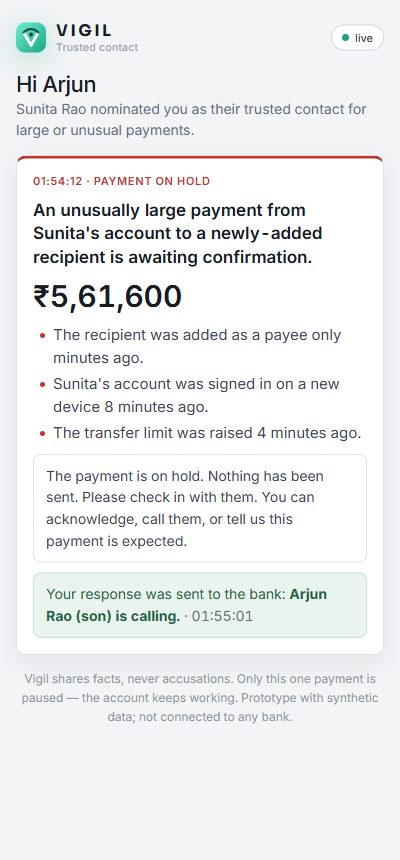 |

- **The card**: time, "PAYMENT ON HOLD", one plain sentence (an unusually large payment to a newly added recipient), the amount (₹5,61,600) and the facts: payee added minutes ago, signed in on a new device 8 minutes ago, transfer limit raised 4 minutes ago.
- **It never accuses anyone.** No "fraud", no "scam": facts only, and "Only this one payment is paused — the account keeps working."
- **Three buttons**: *I'm calling them now*, *Acknowledge*, *This payment is expected*. The response is recorded on the decision, shown on Sunita's phone ("Trusted contact: …"), in the bank's case (CircuitBreaker column in Interventions) and in the decision replay as its last frame.

**Why it matters.** In a "digital arrest" scam the victim is told to tell no one. A family member who hears the facts at the right moment breaks the isolation. That is the purpose of the CircuitBreaker.

**How to show it.** Open it on a phone (same Wi-Fi) or a second tab before running the coerced journey. When the T4 hold lands, show Arjun's card and tap *I'm calling them now*.

## 8. Network

**The Network page is the full workbench for the money-flow picture: the same live network as the Overview, plus five colour lenses, the live feeds, and a frozen "evidence scene" for investigating one ring.** Two tabs at the top right: **Live universe** and **Evidence scene**.

### 8.1 Live universe and its lenses

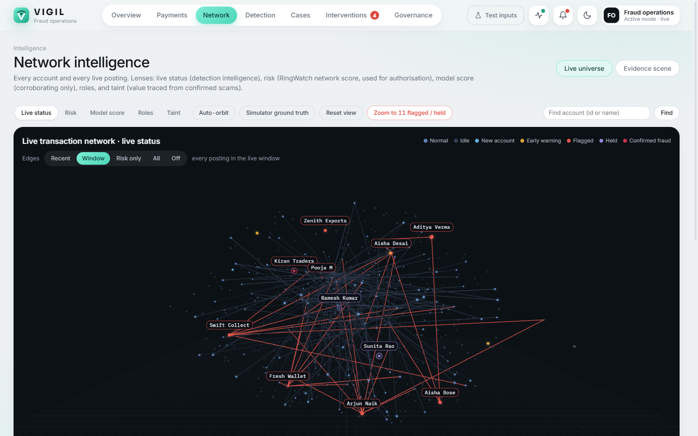

The toolbar changes what the colour of each dot means (a **lens**):

| Lens | Colour means | Use it to |
| --- | --- | --- |
| Live status (default) | The account's live status (same colours as the Overview, section 4.4). | See who is flagged, held, warned right now. |
| Risk | The RingWatch network score: blue below 0.30, amber 0.30–0.50, orange 0.50–0.75, red 0.75+. This is the score the payment engine uses. | Show what the payment decisions "see" about each recipient. |
| Model score | The strongest model evidence (Random Forest or GNN), same colour bands; dark = not scored. Labelled SYNTHETIC VALIDATION, corroborating only. | Compare the models' opinion with the rules. |
| Roles | Bright = the account has a mule role inside flagged structure; dark = no role. | Show the shape of a ring (collector, distributor, exit). |
| Taint | Red = holds value traced from a confirmed scam; dot size grows with the amount. Dark = untainted. | After confirming a scam: show where the stolen money sits now. |

| Risk lens | Model score lens |
| --- | --- |
| 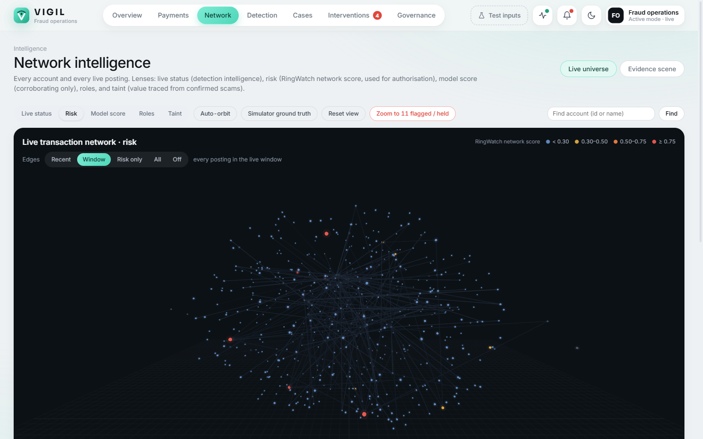 | 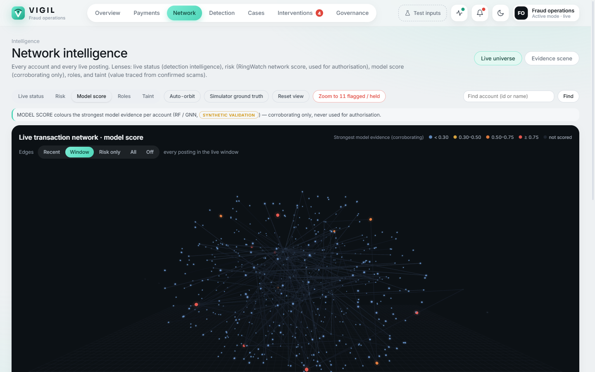 |

| Roles lens | Taint lens (after the scam was confirmed) |
| --- | --- |
| 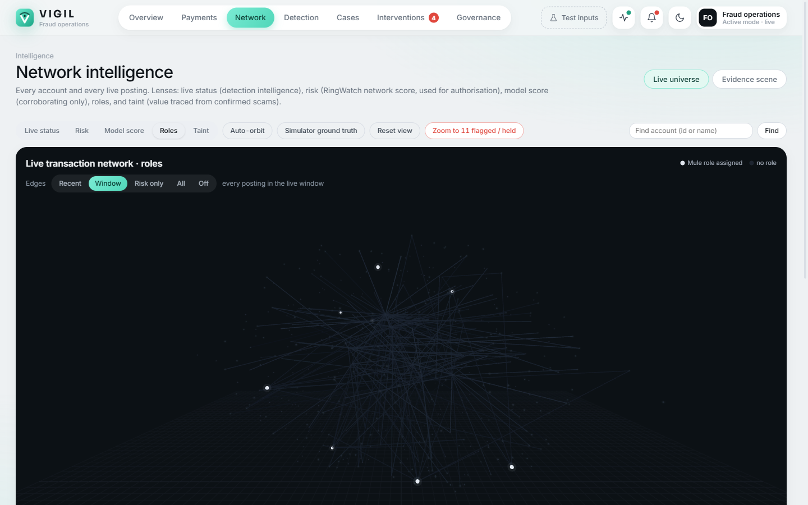 |  |

Other controls:

- **Auto-orbit**: slow automatic rotation on or off.
- **Simulator ground truth**: colours the payments the simulator tagged as injected (magenta). This is the answer key, shown only for evaluation; no detector ever reads it. Use it to prove the detection did not cheat: the red (flagged) accounts were found without this tag.
- **Reset view** and **Zoom to N flagged / held**.
- **Find account**: type part of an id or name and press Find; the camera flies to it and opens the drawer (section 4.4).
- **Edges** filter: the same five buttons as on the Overview.

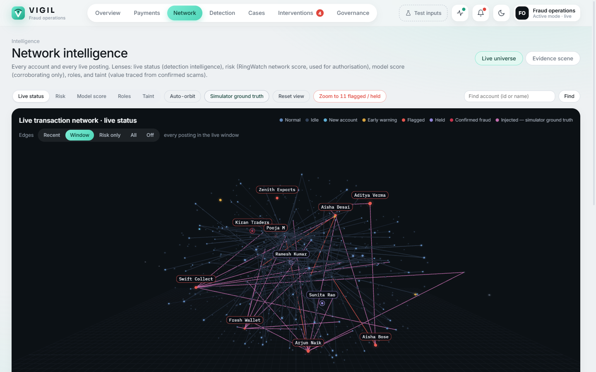

### 8.2 Live activity (below the network)

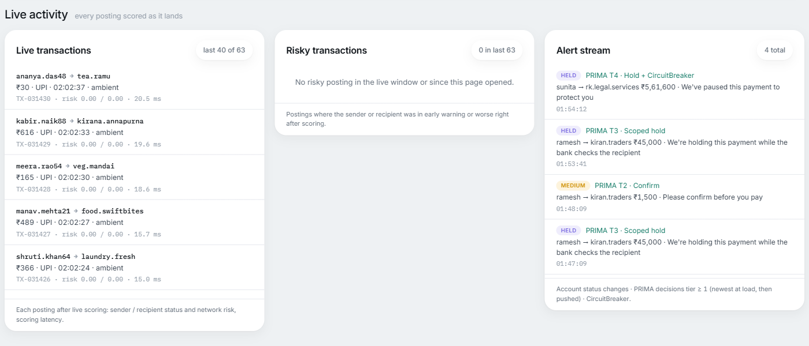

| Feed | Shows |
| --- | --- |
| Live transactions | Every payment after it is scored: payer → payee, amount, channel, time, origin (ambient = background, user = phone, scenario = test input), the transaction id, the payer and payee network scores and how long scoring took (about 15–20 ms). |
| Risky transactions | Only payments where the payer or payee was at early warning or worse right after scoring. Empty when the network is calm. |
| Alert stream | Every payment decision at Tier 1 or above (HELD, MEDIUM … with the tier and the customer message), plus account status changes and CircuitBreaker events. |

### 8.3 Evidence scene (second tab)

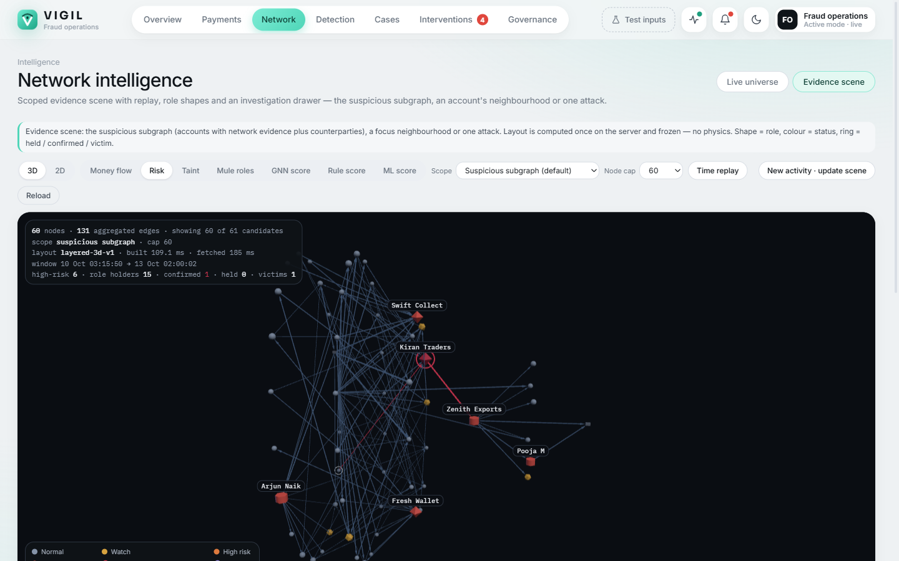

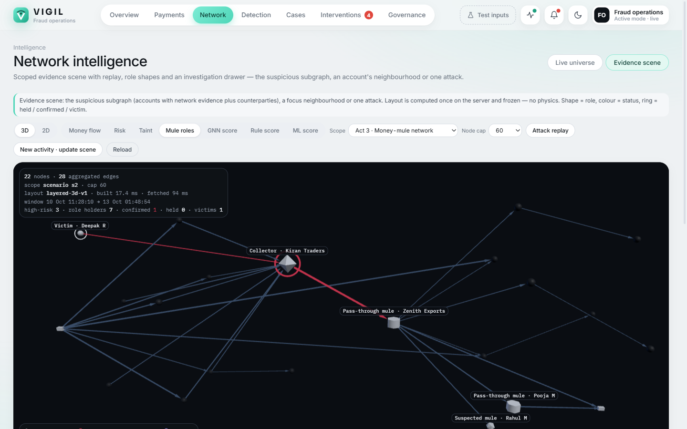

A smaller, frozen picture for investigating: only the suspicious accounts and their counterparties (default), one account's neighbourhood, or one attack. The layout is computed once on the server, so nothing moves while you talk.

- **Shape = role**: sphere = ordinary account (white ring = victim), diamond = collector, cone = distributor, hexagon = pass-through mule, pentagon-like = suspected mule, four-sided point = exit / cash-out, star = coordinator, cylinder = entry, box = external account.
- **Colour = status / score** for the chosen mode; **ring** = held, confirmed fraud or victim.
- **Modes**: Money flow, Risk, Taint, Mule roles, GNN score, Rule score, ML score.
- **3D / 2D**: switch to a flat graph if the 3D view is hard to read on a projector.
- **Scope**: Suspicious subgraph (default), a focus account (1 or 2 hops), or any attack or demo scenario.
- **Node cap**: how many accounts to show (60 by default).
- **Time replay / Attack replay**: plays the payments in this scene in the order they happened, with Play, Pause and step buttons.
- **Info box** (top left): nodes and edges shown, scope, build time, the time window, and counts of high-risk accounts, role holders, confirmed, held and victims.
- **Click a node**: drawer with Expand 1-hop / 2-hop, the account intelligence and, on an incoming payment from a victim, **Confirm scam** (the same as Test inputs → Report a confirmed scam). Click a line: the payments it aggregates.
- Below the scene: **TaintTrace** (value traced from confirmed scams, LIBR and pro rata side by side) and **Accounts with network evidence** (RingWatch list).

**How to show it.** After injecting the money-mule network, open Evidence scene → Scope = *Act 3 · Money-mule network*, mode *Mule roles*, and press **Attack replay**: the victims pay Kiran Traders (collector), money hops to Zenith Exports and Pooja M (pass-through) and out to an ATM (exit).

## 9. Detection & models

**Detection explains how Vigil finds mule accounts, read top to bottom in four numbered sections.** Every chart carries the same three-line caption: **Shows** (what it is), **How to read** and **Right now** (what it says this minute, computed live).

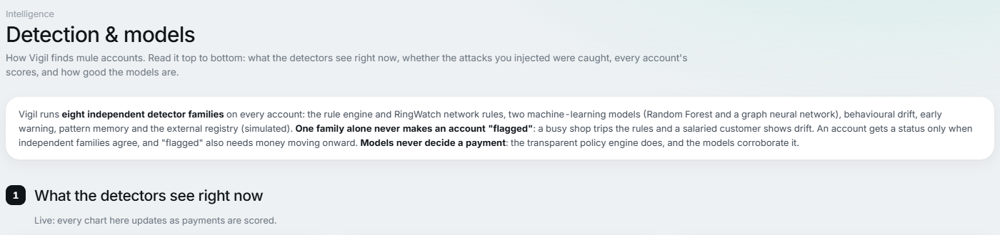

**The one idea to remember.** Vigil runs eight independent detector families on every account. One family alone never makes an account "flagged": a busy shop trips the rules, a salaried customer shows drift, a scam victim looks like a sudden change. An account gets a status only when independent families agree, and "flagged" also needs money moving onward. And no model ever decides a payment; the transparent policy engine does (section 6).

### 9.1 Section 1 · What the detectors see right now (live)

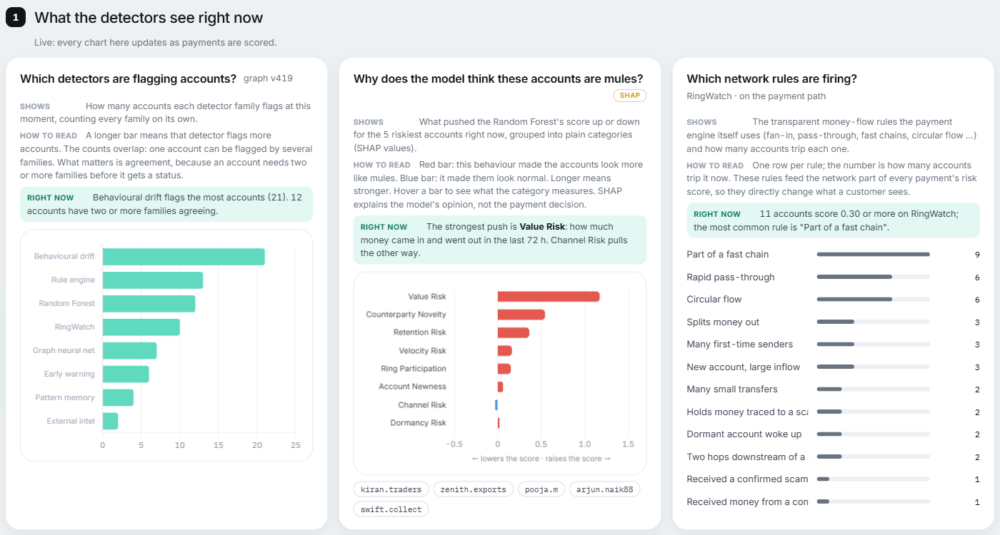

**Which detectors are flagging accounts?** One bar per family; the length is how many accounts that family flags on its own. The counts overlap (one account can be in several bars). In the screenshot drift flags 21 accounts and the rule engine 13, yet only 12 accounts have two or more families agreeing, and only those can be at early warning or flagged. That gap is the whole point: single signals are noisy, agreement is evidence.

**Why does the model think these accounts are mules?** SHAP for the Random Forest, summed over the five riskiest accounts right now (listed under the chart). Each bar is a category of behaviour. Red = it made the accounts look more like mules; blue = it made them look normal; longer = stronger. Hover a bar to see what it measures:

| Category | Measures |
| --- | --- |
| Value Risk | How much money came in and went out in 72 h |
| Counterparty Novelty | How many counterparties are new to the account |
| Retention Risk | How little of the received money it keeps (fast forwarding) |
| Velocity Risk | How many payments vs its usual rate |
| Ring Participation | How many different accounts it pays and is paid by |
| Account Newness | How recently it was opened |
| Dormancy Risk | How long it was quiet before |
| Channel Risk | How many rails (UPI, IMPS, NEFT) it uses |
| Shared Device Risk | How many accounts share its device |
| Structuring Risk | Payments just below the ₹10,000 band |

In the screenshot Value Risk dominates, followed by Counterparty Novelty and Retention Risk: big sums, from strangers, passed straight on. SHAP explains the model's opinion, never the payment decision.

**Which network rules are firing?** The RingWatch rules the payment engine itself uses, with how many accounts trip each one now: part of a fast chain 9, rapid pass-through 6, circular flow 6, splits money out 3, many first-time senders 3, and so on. These rules feed the network part of every payment's score, so they change what customers see.

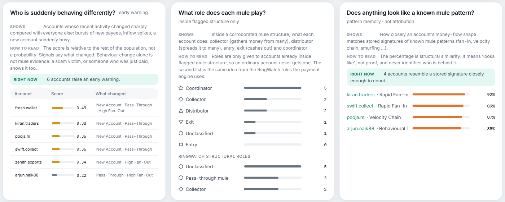

**Who is suddenly behaving differently?** (early warning) Accounts whose recent activity changed sharply compared with everyone else, with a score (relative to the population, not a probability) and what changed: New Account, Pass-Through, High Fan-Out. A warning, not proof: a victim or someone just paid shows it too.

**What role does each mule play?** Counts by role inside flagged structure: coordinator, collector (gathers from many), distributor (spreads to many), exit (cashes out), entry. Ordinary accounts never get a role. The second list is the same idea from the RingWatch rules.

**Does anything look like a known mule pattern?** (pattern memory) How closely an account's money-flow shape matches a stored signature: kiran.traders 92% Rapid Fan-In, swift.collect 89%, pooja.m 87% Velocity Chain. Similarity means "looks like", never "is".

### 9.2 Section 2 · Did we catch the attacks you injected?

When you inject a pattern, the simulator knows which accounts are the mules (the **answer key**, "simulator ground truth"). Vigil never sees that list. It scores payments as they arrive; when the run ends, it is graded.

- **Last attack result**: mules injected, detected, missed, time to first warning, time to detection, false positives, and the account names as clickable tokens (detected in red, missed in amber, warned, false positives). Precision and recall below.
- **Attack history**: one row per run: pattern, start time, payments, mules detected / injected, first warning, detection time, precision, recall, the model threshold at that time, status.

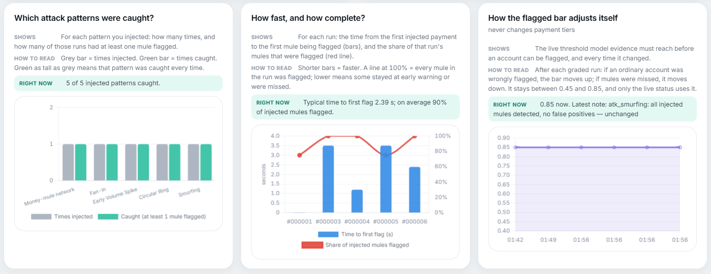

| Chart | How to read it | In the screenshot |
| --- | --- | --- |
| Which attack patterns were caught? | Grey = times injected, green = times at least one mule was flagged. Green as tall as grey = caught every time. | 5 of 5 patterns caught. |
| How fast, and how complete? | Blue bars = seconds from the first injected payment to the first flag (shorter = faster). Red line = share of that run's mules flagged (100% = all). | Typical 2.4 s to first flag; on average 90% of injected mules flagged. |
| How the flagged bar adjusts itself | The live threshold model evidence must reach before an account can be flagged. After each graded run it moves up if an ordinary account was wrongly flagged, down if mules were missed, always between 0.45 and 0.85. It never changes a payment tier. | Flat at 0.85: no false positives, and the missed mules were not near misses. |

### 9.3 Section 3 · Every account, every detector

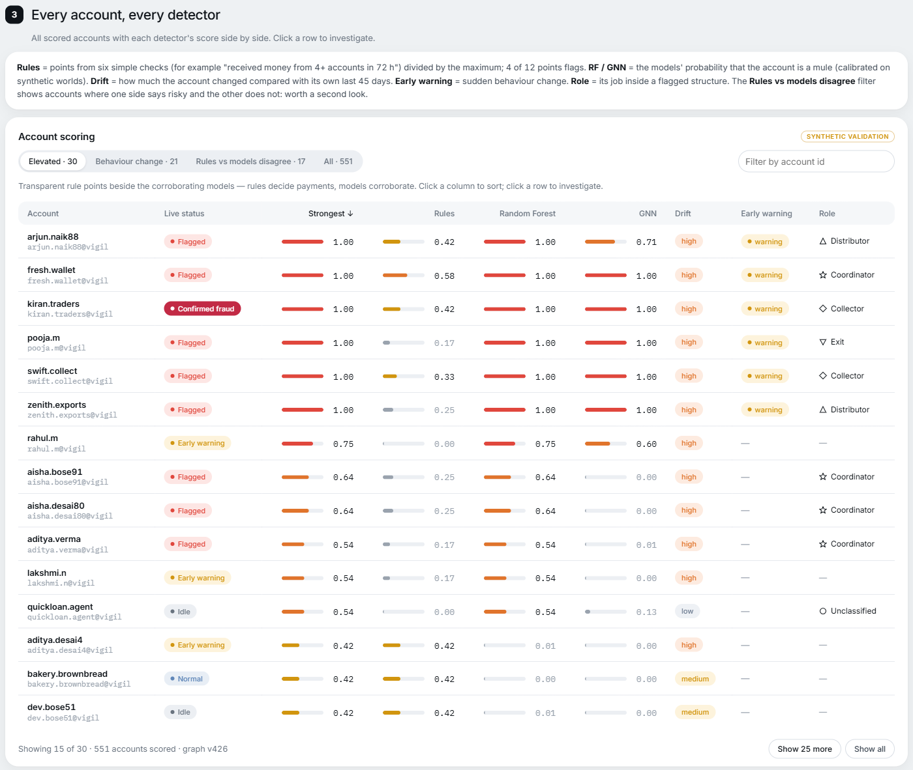

All 549 scored customer accounts, each detector's score side by side; click a row to investigate, click a column header to sort.

| Column | Meaning |
| --- | --- |
| Live status | As on the Overview. |
| Strongest | The highest of rules, RF and GNN. |
| Rules | Points from six simple checks (received from 4+ accounts, sent to 4+ accounts, kept under 20% of ₹10,000+ received, device shared by 3+ accounts, 3+ payment rails, 8+ payments in 72 h) divided by 12. 4 points (0.33) flags. A score, not a probability. |
| Random Forest / GNN | The models' probability the account is a mule (calibrated on synthetic worlds). |
| Drift | low / medium / high change versus its own last 45 days. |
| Early warning | Whether early warning flags it. |
| Role | Its role, if inside flagged structure. |

Filters: **Elevated** (any score 0.30+, early warning, high drift or a role), **Behaviour change** (early warning or high drift), **Rules vs models disagree** (one side says risky, the other does not: worth a second look), **All**. Many "Elevated" rows are idle shops with rules 0.42 and models near 0: busy accounts trip simple rules, which is exactly why rules alone never set a status.

### 9.4 Section 4 · How good are the models? (synthetic validation)

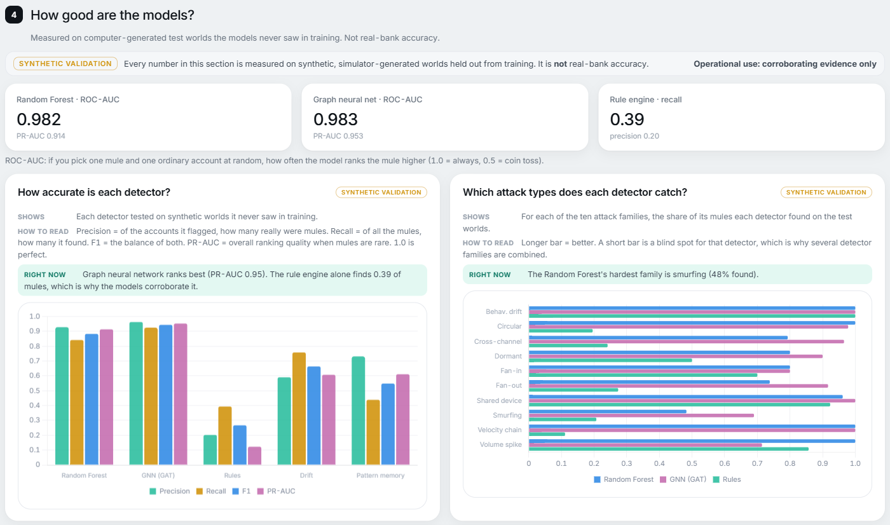

Every number here is measured on computer-generated test worlds the models never saw in training (90 training worlds, 30 validation, 30 test, split by world). It is **not** real-bank accuracy, and the page says so.

- **Random Forest ROC-AUC 0.982, PR-AUC 0.914; GNN ROC-AUC 0.983, PR-AUC 0.953; rule engine recall 0.39 (precision 0.20).**
- **ROC-AUC**: pick one mule and one ordinary account at random; how often does the model rank the mule higher? 1.0 = always, 0.5 = coin toss.
- **How accurate is each detector?** Precision (of the accounts it flagged, how many were mules), Recall (of all mules, how many it found), F1 (the balance) and PR-AUC (ranking quality when mules are rare) for each detector. The GNN ranks best; the rule engine alone finds only 39% of mules, which is why the models corroborate it.
- **Which attack types does each detector catch?** For each of the ten attack families, the share of its mules found by RF (blue), GNN (pink) and rules (green). A short bar is a blind spot, for example the Random Forest finds 48% of smurfing mules. That is why several families are combined.

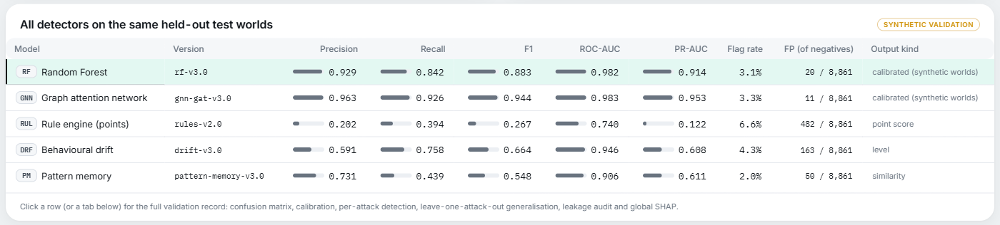

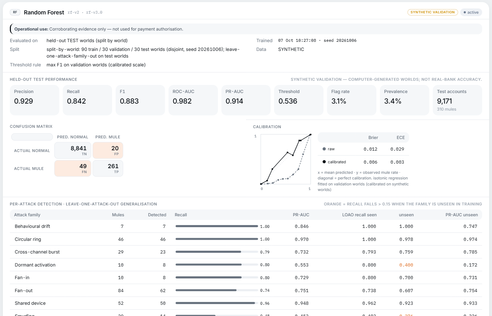

The **model registry** compares all five registered detectors on the same test worlds; click a row or a tab for its **model card**:

- **Held-out test performance**: precision 0.929, recall 0.842, threshold 0.536, flag rate 3.1%, prevalence 3.4%, 9,171 test accounts of which 310 mules.
- **Confusion matrix**: of 8,861 ordinary accounts, 20 wrongly flagged (FP); of 310 mules, 261 caught (TP) and 49 missed (FN).
- **Calibration**: does a score of 0.8 really mean 80%? The dots after calibration (isotonic regression) sit near the diagonal; Brier and ECE errors drop from 0.012 / 0.029 to 0.006 / 0.003.
- **Per-attack detection and leave-one-attack-out**: recall per attack family, and recall when that family was hidden from training. Orange = recall falls more than 0.15 on an unseen family (an honest weakness, for example dormant activation 0.80 → 0.40).
- Further down: a leakage audit, global SHAP by category, false positives by persona, training details.

**How to show Detection (1 minute).** Point at section 1's first chart: "lots of single signals, few agreements; only agreement counts." Scroll to section 2 after your attacks: "every pattern caught, no false positives, in about two seconds." End on the SYNTHETIC VALIDATION banner: "rules decide the payment, models corroborate."

## 10. Cases: the case list and the account investigation page

**Cases is where an analyst investigates: every intervention is a case, and every account has an investigation page.** There are two entry points: a payment (the case list) and an account (search or the network list).

### 10.1 The case list

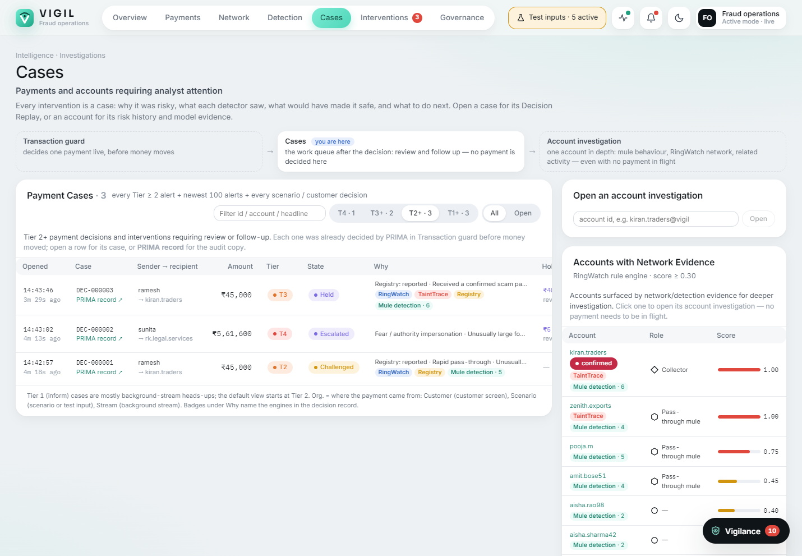

- **Cases table**: every payment at Tier 2 or above, plus every scenario and customer decision. Columns: opened (and how long ago), case id, sender → recipient, amount, tier, state (Escalated, Held, Challenged …), **Why** (the reason labels: "Fear / authority impersonation · Unusually large for you …"), hold amount and review clock, trusted-contact response, and origin (CUS = customer device, SCN = scenario, STR = background stream).
- **Filters**: free text, tier buttons (T4, T3+, T2+, T1+; T2+ is the default because Tier 1 heads-ups are mostly background traffic) and All / Open.
- **Open an account investigation**: type any account id.
- **Accounts with network evidence**: every account with a RingWatch score of 0.30 or more, with its structural role (collector, pass-through mule …) and score bar; a red "confirmed" tag marks accounts that received a confirmed scam.

### 10.2 The account investigation page (Kiran Traders)

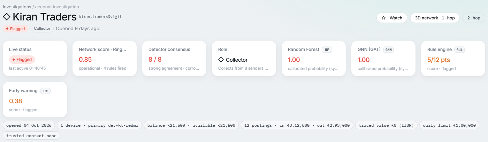

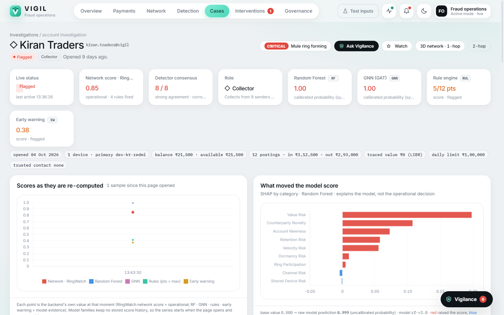

**Vigilance buttons (v11).** When an open alert involves this account, a button names it (here "CRITICAL · Mule ring forming") and opens that case in the Vigilance panel beside the page. **Ask Vigilance** asks: is it behaving like a mule, where did its money come from and go, and what should I do?

**Header**: name and id, live status, role, age. Buttons: **Watch** (adds it to Close monitoring, with an optional note; it then reads Watching and an "on watchlist" tag appears), **3D network · 1-hop / 2-hop** (the Network page focused on this account) and, for demo customers, Transaction Guard.

**Tiles** (top row = operational, second row = model evidence):

| Tile | Kiran's value | Meaning |
| --- | --- | --- |
| Live status | Flagged | Status now, and when it was last active. |
| Network score · RingWatch | 0.85, 4 rules fired | The score payments to this account carry (operational). |
| Detector consensus | 8 / 8, strong agreement | How many of the evaluated families flag it. |
| Role | Collector | "Collects from 8 senders and moves 94% of it on." |
| Random Forest / GNN | 1.00 / 1.00 | Model probabilities (calibrated on synthetic worlds). |
| Rule engine | 5/12 pts, flagged | The simple-checks score. |
| Early warning | 0.38, flagged | Behaviour-change score. |

The chip line under the tiles: opening date, devices, balance, number of postings with total in and out, traced value (LIBR), daily limit, trusted contact.

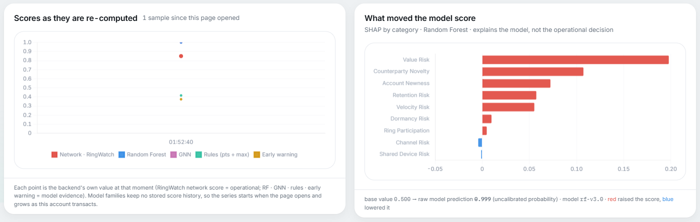

- **Scores as they are re-computed**: each dot is the backend's value at that moment (network, RF, GNN, rules, early warning). The models keep no score history, so the series starts when you open the page and grows as the account transacts.
- **What moved the model score**: SHAP by category for this one account. Base value 0.500 → the model's raw prediction 0.999. Value Risk, Counterparty Novelty and Account Newness pushed it up; Channel Risk pulled it down a little.

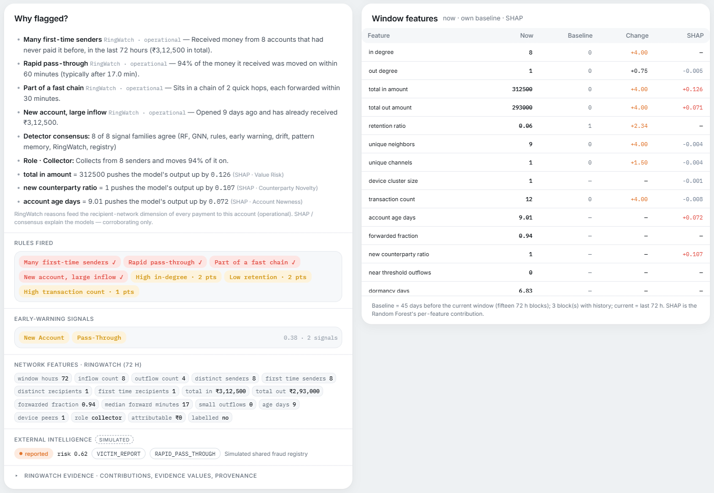

- **Why flagged?** (or "Why it is not flagged"): plain-language bullets, operational first (RingWatch: many first-time senders, rapid pass-through 94% within 60 minutes, part of a fast chain, new account with large inflow), then consensus, role and the three biggest SHAP features. **Rules fired** (red = RingWatch, operational; amber = rule-engine points), **Early-warning signals**, **Network features (72 h)** as chips, **External intelligence** (SIMULATED registry: reported, risk 0.62), and a collapsible list of RingWatch evidence with contributions and provenance.
- **Window features**: the 15 numbers the models see, "now" (last 72 h) beside the account's own baseline (the 45 days before), the change and each feature's SHAP. Kiran: 8 senders now vs 0 before, ₹3,12,500 in vs 0, retention 0.06 (keeps only 6%).

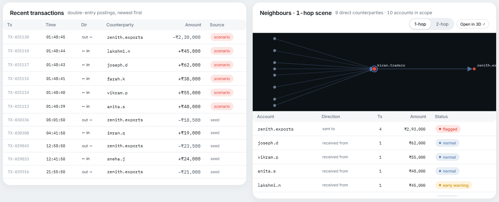

- **Recent transactions**: the ledger postings, newest first: id, time, direction (in / out), counterparty, amount, source (scenario postings carry a red "scenario" tag = simulator ground truth).
- **Neighbours · 1-hop scene**: a small frozen graph of direct counterparties (switch to 2-hop or open in 3D) and a table: account, direction, number of payments, amount, status.

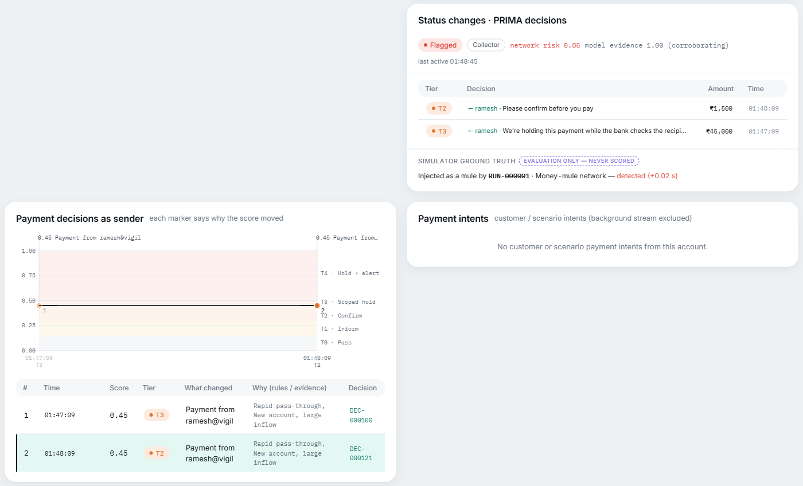

- **Status changes · PRIMA decisions**: the current status line (network risk, model evidence) and every payment decision involving the account (T2 ₹1,500, T3 ₹45,000 from Ramesh).
- **Simulator ground truth** (labelled "evaluation only — never scored"): "Injected as a mule by RUN-000001 · Money-mule network — detected (+0.02 s)". The answer key, shown for honesty, never used by detectors.
- **Risk evolution chart**: for an account that sends payments, its latest decision replayed frame by frame ("Payment decisions as sender"). For an account that receives (like Kiran), the network score at each decision about payments to it (the title now reads "Payments to this account · network score at each decision"). Each marker says why the score moved. **Payment intents**: payments this account started itself.

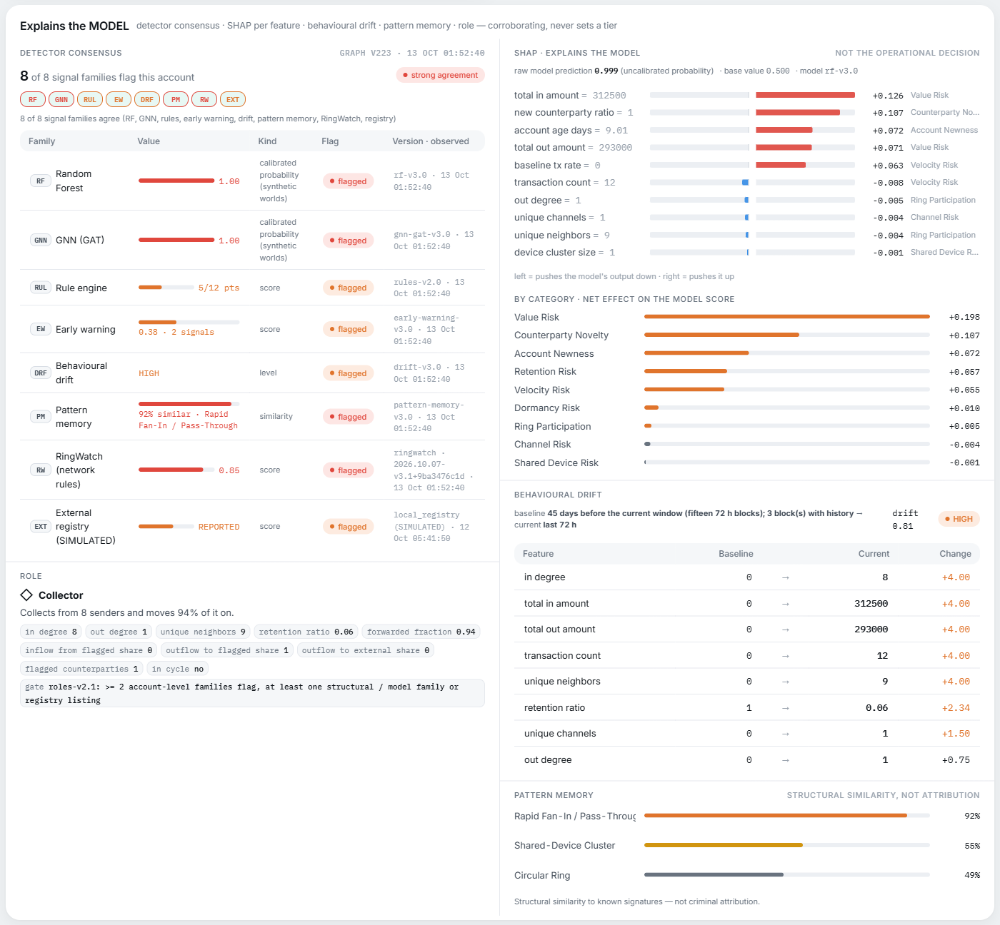

- **Explains the MODEL** (corroborating evidence, never sets the tier): the **detector consensus table** (each of the ten families: value, kind, flagged or not, version and time), **SHAP per feature** and by category, **behavioural drift** (baseline vs current per feature, drift score and level), **pattern memory** (similarity to Rapid Fan-In 92%, Shared-Device Cluster, Circular Ring) and the **role** assessment with its evidence and the gate it passed.

- **Account record**: kind, persona, devices, payees, primary device, trusted contact, opening date and the scene flags.

**How to show it (1.5 minutes).** From Needs attention, click Kiran Traders. Read the tiles left to right ("flagged, 8 of 8 families agree, collector"), then "Why flagged?": "received from 8 accounts that had never paid it, moved 94% on within an hour." Point at SHAP: "this explains the model; the payment decision is explained by the rules." Optionally press **Watch** on a victim (Lakshmi N) to show close monitoring.

## 11. Case page: replay, counterfactuals, provenance

**One case page per payment decision answers: why was this payment risky, how did the risk build up, what would have made it safe, and what should the investigator do next?** Open it from the case list, Needs attention → Payments, Interventions (Case →) or a toast. The example is Sunita's coerced payment (DEC-000242).

**Vigilance buttons (v11).** As on the account page: the open alert that involves the sender or recipient (for Sunita's payment, "CRITICAL · Customer under coercion"), and **Ask Vigilance**, which asks why the payment got its tier, who the recipient is and what to do next. A procedure step "Open the case" in Vigilance lands on this page with the case still open beside it.

**Header**: tier, sender → recipient, amount, and one plain sentence ("Final score 0.64 → Tier 4. Main drivers: your recent account activity, the conversation context."). Buttons: **Release hold**, **Reject payment** (the same actions as Interventions), **Decision record**, **Recipient network**. Tiles: final score (base + adjustments), intervention, state, scoped hold and its review deadline, the trusted contact's response, evidence count (12 signals, 3 of 5 dimensions fired), mode and the bank baseline, and how long the evaluation took (3.6 ms).

### 11.1 Decision Replay: watch the risk build up

Press **Replay** (or step with prev / next or the slider). Each frame re-scores the evidence known at that moment with the same policy engine:

| Time | Event | Score | Tier |
| --- | --- | --- | --- |
| 01:45 | Baseline, account behaving normally | 0.00 | T0 |
| 01:46 | Login from a new device | 0.04 | T0 |
| 01:48 | Payee added | 0.07 | T0 |
| 01:50 | Transfer limit increased | 0.11 | T0 |
| 01:52 | Suspicious call context captured (SIMULATED) | 0.36 | T2 |
| 01:54 | ₹5,61,600 transfer attempted | 0.64 | T4 |
| 01:54 | Held + Arjun alerted; scoped hold created | 0.64 | T4 |
| 01:55 | Trusted contact: calling user | 0.64 | T4 |

On the right: the score at this frame with the tier thresholds as ticks, the five dimension sub-scores (journey 0.90, behaviour 0.75, context 1.00) and a small step chart. **Each step was ordinary on its own; the sequence was not.** That is why journey (TrailScore) exists.

### 11.2 Risk over time and the counterfactual ladder

- **Risk over time** (Sender / Recipient toggle): the same story as a chart with the tier bands shaded and labels where the score moved, and a table: time, score (and the jump), tier, what changed, and the rule ids behind it.
- **Counterfactual ladder**: the policy re-run without certain evidence, to show what would have made the payment safe. With an established recipient: still T4 (0.590). With a normal amount: T3 (0.432). Without the pressure context: T2 (0.393). With an established recipient, a normal amount and no journey or context signals: T0 (0.000). Generated by re-running the same versioned engine; no language model is involved.

### 11.3 Two explanations, kept apart on purpose

| Explains the OPERATIONAL DECISION | Explains the MODEL |
| --- | --- |
|  |  |

- **ReasonLine (left)** explains the decision: the score bar, each dimension's score × weight = contribution, every fired rule with its plain reason, evidence and points, and the named policy adjustments (here +0.20 corroboration). This is the only thing on the authorisation path.
- **Model side (right)** explains the models' opinion: families on the authorisation path for this decision, the model evidence recorded on it, and the account intelligence (consensus, SHAP, drift, pattern memory, role) for the recipient or sender. It never sets the tier.

### 11.4 Provenance: where every signal came from

One row per signal: name and rule id, dimension, value (evidence), contribution, source ("Account journey events", "Sender payment history (180 d, robust statistics)", "Simulated call/message context"), when it was observed, how fresh it was, the rule and policy version, status (SIMULATED / observed / computed) and confidence. A regulator or auditor can see exactly what the decision rested on.

### 11.5 Money trace, recipient network, journey and next steps

- **Value traced from confirmed scams**: TaintTrace results (LIBR and pro rata side by side) when a confirmed scam is involved.
- **Recipient network (last 72 h)**: a small graph of the recipient's flows.
- Tabs **Sender journey** (every event with "x min before", including the simulated call transcript), **Intervention & lifecycle** and **Parties**.
- **What an investigator does next**: 1 decide the hold (Release / Reject, with the deadline and the contact's response), 2 check the recipient, 3 check the sender, 4 follow the money (expand in 3D, confirm a verified victim report to start TaintTrace), 5 the record (audit-grade raw JSON).

**How to show it (1.5 minutes).** Open Sunita's Tier 4 case, press **Replay** and narrate the frames: "new device, payee, limit: each normal; then the call; then 95% of her savings." Point at the counterfactual ladder: "remove the call context and it would have been a Tier 2 question, not a hold." Finish on provenance: "every number has a source and a version."

## 12. Interventions: holds, release and reject

**Interventions is the bank's action queue: every hold and confirmation, its review clock, and the Release / Reject decision.** Holds are scoped to one payment's amount; no account is ever frozen.

**Tiles**: In queue (open alerts), Holds active, Value held (₹6,51,600 in the screenshot), Review overdue (holds past their review time), Trusted contact (CircuitBreaker alerts still waiting for an answer), the count by tier in this view, and Shadow (recommendations recorded but not enforced).

**Filters**: Holds T3/T4, Confirm T2, Inform T1, All; and Open vs All states.

**Table columns**: opened and age, tier, intervention (what the customer was told), state (Held, Escalated, Challenged, Approved, Rejected), sender → recipient, amount, hold amount and reference (VGL-HOLD-000003), **review SLA** (time left before the review deadline, for example "20m 48s left, by 02:24:12"), CircuitBreaker (contact and response: "Arjun Rao, calling user"), and the bank action buttons **Release**, **Reject**, **Case →**.

| Action | What happens |
| --- | --- |
| Release | The hold closes and the intent becomes Approved. Scenario and background payments are then sent through the simulated rail automatically; a customer's own payment continues on their phone ("Bank released this payment — complete it"). The decision record keeps the operator action (actor = bank). |
| Reject | Asks for confirmation, then closes the hold and moves the intent to Rejected. Nothing is sent and the money is available to the customer again. The phone shows "The bank stopped this payment". |

The three cards at the bottom repeat what each tier does and what Release and Reject do, so a new analyst can read them on the page.

**How to show it (30 seconds).** Release Ramesh's first ₹45,000 hold and reject the second (confirm the dialog). Switch to *All states*: one Approved, one Rejected, the review clocks closed. "Real state changes, recorded with who did what."

## 13. Governance: mode, policy, models, records

**Governance shows how a bank would control Vigil: trial it in Shadow mode, compare it with the bank's own rules, then switch it on, with every decision kept as an append-only, versioned record.** Three tabs: Mode · policy · models, Decision records, Deployment positioning.

### 13.1 Mode · policy · models (Shadow mode shown)

- **Mode card** with the **Active / Shadow** switch and the three-step rollout: 1 Shadow (Vigil decides and records beside the bank's baseline; no customer sees an intervention), 2 Measure (false challenges avoided, frauds the baseline missed, agreement rate), 3 Enable tiers (Active).
- **Bank baseline vs Vigil recommendation**: decisions evaluated in shadow, how many Vigil would intervene on (T2+), how many the baseline would challenge, the agreement rate, and a table: decision, mode, amount, Vigil's tier, the tier actually applied, the bank baseline (approve / OTP step-up / decline) and whether they agree. In the screenshot, DEC-000478 (Sunita → Kiran Traders ₹20,000 in shadow): Vigil recommended **T4**, the bank's baseline said **approve**, so **T0 was applied** and the payment went through. That is exactly the evidence a bank collects before turning Vigil on.
- **Policy (version 2026.10.07-v3.1 + content hash)**: the dimension weights, the corroboration rule, the intervention ladder with its score ranges, and the named adjustments (floors, friction guard, CircuitBreaker needs sender evidence). "Hand-set demo weights, versioned. Not fitted or validated on real fraud data." Every decision stores the policy version it used.
- **Decisions by tier**: total since seeding, a per-minute live chart (almost all T0, with rare coloured caps) and the count and share per tier (T0 99%).
- **Registered models**: rf-v2, gnn-gat-v2, rules-v2, drift-v2, pattern-memory-v2, each "active" and "Corroborating evidence only — not used for payment authorisation", with a link to Detection.
- **Recent operator, customer and contact actions**: who did what (customer created, bank approved / rejected, contact responded) with time and detail.

### 13.2 Decision records and the record page

The latest scenario and customer decisions (decision id, time, sender → recipient, amount, tier, action, origin) and **Open a record by id**. Each record is append-only (the database refuses edits) and carries a SHA-256 of its content as an integrity check.

The record page shows, read from the stored record only: identity (decision, intent, timestamp, parties, amount, device, channel, policy version, evaluation context such as "local hour 14 IST, pinned by scripted scenario"), the chosen action (score, intervention, bank action, hold, CircuitBreaker, mode, bank baseline, state), **dimensions evaluated** with reason codes, the **policy ladder at decision time** and every component version, the full provenance table, operator / customer actions, the payment result, and **one decision, three renderings**: Bank analyst (ReasonLine), Customer, and Audit payload. Buttons: **View raw record** (the JSON), **Replay decision**, **Investigate**.

### 13.3 Deployment positioning

The third tab (picture in section 1) says where Vigil sits next to India's existing systems (bank EFRMS / AML, RBIH's MuleHunter.AI, the RBI-led DPIP, I4C's NCRP / 1930, DoT's FRI), states clearly that Vigil has no access to any of them, and lists each layer as Built or Simulated, with "one payment, end to end".

**How to show it (1 minute).** Test inputs → *Switch to SHADOW*, make the risky payment, open Governance: "Vigil recommended a hold; the bank's rule approved; nothing was blocked; the disagreement is recorded." Switch back to ACTIVE. Open one decision record → View raw record: "append-only, versioned, replayable."

## 14. System health and Scenario lab

**Two support screens, reached from the top bar (pulse icon) and from Test inputs: one says whether the platform is working, the other runs any of the 15 scripted scenarios.**

### 14.1 System health (pulse icon)

| Area | Shows | What "good" looks like |
| --- | --- | --- |
| Tiles | Status, uptime and when the world was seeded, decision p95 / p50, API round-trip from this browser, realtime connection, detection layer (RF · GNN · drift · pattern memory), database size, throughput. | OK, LIVE, ON, single-digit ms decisions. |
| Ledger postings per 10 s | Every posting, normal vs injected. | A steady row of bars. |
| Decisions by tier per minute | Payment decisions per minute by tier. | Almost all grey (T0). |
| Pre-commit engine | Policy version, mode, "ML on decision path: no — transparent engine only", decisions, pending intents, latency. | ML on decision path = no. |
| Payment rail | Simulated payment rail; "Money moves: never — settlement is simulated; the ledger posts only after approval or a bank release." | |
| Push channel | This browser's connection, server sockets, "Polling: none", background stream on / off. | open, none, on. |
| Ledger & graph | Accounts, transactions, graph nodes / edges / version, **ledger conservation: balanced (₹0)**, seeded time. | Balanced (₹0): not a paisa created or lost. |
| Server-side caches, Inputs and models | Cache hit rates; detection intelligence available; external intel provider (SIMULATED); context signals (SIMULATED). | |
| v2 endpoint coverage | Each API the screens need, its status and time. | All 200. |

Buttons: **Check now** and **Background stream on / off** (pause the everyday traffic for a quiet demo).

### 14.2 Scenario lab

All 15 deterministic scenarios in three groups: **payment journeys** (s0 Normal payment, s1 Risky recipient, s3 Coerced / digital-arrest payment), **attack patterns** (s2 Money-mule network plus the ten single patterns) and **controls** (s4 False-positive control: a big payment where everything else is normal, which must pass). Pick one to see what it demonstrates, its expected outcome ("Expected: Tier 0 — approved instantly, zero friction"), and buttons **Start**, **Reset**, **Replay**, **Compare detectors** (which detector flagged which participant), plus a live step log and the decisions produced. The same inputs give the same decisions after every reset.

Use it when you want a scenario that is not in Test inputs (for example the false-positive control), or to compare detectors account by account.

## 15. Test inputs: every demo control

**Test inputs (top bar, or Alt + T) is the only place with demo controls; every button is a real API call that drives the real system.** Escape or Close hides it.

| # | Section | Controls | What happens |
| --- | --- | --- | --- |
| 1 | Customer payment | Presets: *Everyday · grocer ₹500*, *Risky recipient · ₹45,000*, *Large but legitimate · ₹1,20,000* (rent deposit to the landlord). Paying as (Ramesh / Sunita), Amount, To, Note, Simulated call / message context. **Open on customer device** (goes to Payments with the phone filled in; you press Pay) or **Submit directly** (decides it here and shows the tier, score and a link to the case). | A real payment intent through the full pre-commit path. |
| 2 | Inject a mule-network pattern | A list of the 11 network patterns (Money-mule network plus 10 single patterns, section 17) and **Inject**. While it runs: progress, Pause / Resume. When it ends: "detected 3 of 4 injected accounts, no false positives, 0.0 s to detection". | Real ledger postings streamed over 10–20 s, scored live, then graded against the answer key. |
| 3 | Coerced payment (digital-arrest journey) | **Run journey**; a link to the trusted contact's phone. | Sunita: new device → payee added → limit raised → threatening call (simulated) → 95% of her savings → Tier 4 and Arjun alerted. |
| 4 | Report a confirmed scam | **Find ring source** (finds the first payment into Kiran Traders from a victim), then **Report as confirmed scam**. | A bank-confirmed fraud label is created; TaintTrace re-runs and says how many accounts hold traced value. The next payment to any of them is floored at Tier 3. |
| 5 | Environment | **Pause / Resume background traffic**, **Switch to SHADOW / ACTIVE**, **Reset demo world** (asks to confirm). A link to the Scenario lab. | Reset restores the identical starting world: every posting, decision, label, hold, attack run and watchlist entry since seeding is discarded. |

Tip: inject one pattern at a time, and reset before a new one when you want the cleanest result. Several attacks in a row without a reset still work, but the world has changed by then (section 17 explains one case where that matters).

## 16. Demo script: the 14-minute run

**Nine steps, each with what to click, what appears and what to say; every result below was produced live on 13 Oct 2026.** Before you start: Test inputs → Reset demo world, open the trusted-contact page on a phone or second tab, check the pulse icon is green.

| # | Time | Do | You will see | Say |
| --- | --- | --- | --- | --- |
| 1 | 1 min | Stay on the Overview. Point at the Vigilance bar, the KPI strip, the network on Recent beside the tape, the map, Needs attention and the mule pipeline. | One medium alert (Suspected mule account · Kiran Traders); a calm tape; Kiran Traders already labelled in the network. | "This is the bank's fraud operations view: what is moving and what needs action, live." |
| 2 | 1 min | Test inputs → *Everyday · grocer ₹500* → Open on customer device → Pay. | Phone: Paid ₹500. Right: T0, score 0.007, decided in about 2 ms. | "Most payments pass silently. Friction is reserved for evidence." |
| 3 | 1.5 min | Test inputs → *Risky recipient · ₹45,000* → Open on customer device → Pay. | By day: T2 "Please confirm before you pay". After midnight: T3 scoped hold (unusual hour, section 6.5). Right: first payee, outlier amount, rapid pass-through, registry report (simulated). | "The customer sees facts; the bank sees every rule, its evidence and its points." |
| 4 | 2 min | Test inputs → Inject → *Money-mule network* (17 postings over about 20 s). Close the drawer, watch the Overview. Then open the new alert in the Vigilance bar. | A Vigilance notice (CRITICAL · Mule ring forming), red rows on the tape and red lines converging on Mumbai; toasts ("zenith.exports · flagged"); the ring lights up; 3 / 4 caught, the 4th at early warning, 0 false positives, first flag in about 25 ms. The alert's case shows the assessment and a 12-step procedure; Show in network frames the ring. | "Vigil never saw the answer key. It found the ring from the money flow alone." |
| 5 | 1.5 min | Needs attention → Kiran Traders. Read the tiles and Why flagged. Then Test inputs → Report a confirmed scam → Find ring source → Report. Pay the risky ₹45,000 again. | 8 of 8 families agree, collector. After the report: TaintTrace finds 2 accounts holding traced value. The new payment: network 1.00, score 0.688, scoped hold (capped at T3: no sign Ramesh is coerced). | "What the network learns after a payment changes the next decision before it." |
| 6 | 2 min | Test inputs → Run journey (coerced). Show Arjun's phone, tap *I'm calling them now*. Open the T4 case → **Replay**. | T4: ₹5,61,600 held, Arjun alerted with facts. Replay: 0.04 → 0.07 → 0.11 → 0.36 → 0.64. Counterfactual ladder and provenance below. | "Each step was ordinary; the sequence was not. The family hears facts, never accusations." |
| 7 | 1.5 min | Interventions → Release one hold, Reject another. Governance → Test inputs → Switch to SHADOW → a risky payment → back to ACTIVE. | Real state changes. In shadow: Vigil recommends T4, the bank baseline approves, T0 applied, disagreement recorded. | "A bank starts in shadow, measures, then switches on. Every decision is an append-only record." |
| 8 | 1 min | Detection: section 1 first chart, section 2 run results, the SYNTHETIC VALIDATION banner. | Many single signals, few agreements; every pattern caught, no false positives. | "Rules decide the payment; models corroborate. SHAP explains the model; the reason line explains the decision." |
| 9 | 2 min | Open Vigilance: the Customer under coercion alert → in its procedure press Open the case (the panel stays), Mark done on the call, reject the hold on Interventions. Then the Mule ring forming alert → Draft STR note. Ask "What needs my attention now?" | Classification, red flags in rupees, the recommendation; a step that ticks itself ("Vigil saw …"); a draft STR marked "not filed"; an answer that starts with the classification line. | "Vigilance names what is happening and walks the bank's procedure. It only reads: people act." |

**If something looks off:** Test inputs → Reset demo world, then start again from step 1. All steps give the same result after a reset (step 3 depends on the clock as noted).

## 17. Attack patterns and what Vigil caught

**All 11 injectable patterns were detected in the live check on 13 Oct 2026, with 0 false positives in every run; every injected mule that was not flagged was still surfaced at early warning.** Method: for each pattern, reset the world, inject it exactly as Test inputs does, wait for the graded run, record the result.

| Pattern | What the simulator does | Mules flagged / injected | First warning | First flag |
| --- | --- | --- | --- | --- |
| Money-mule network (s2) | Victims pay Kiran Traders (fan-in) → rapid pass-through to Zenith Exports → split to Pooja M and Rahul M → cash-out at an ATM. | 3 / 4 (Rahul M at early warning) | 0.02 s | 0.02 s |
| Fan-In | Six first-time senders pay a 3-day-old collector (Swift Collect), which forwards 90% out. | 1 / 1 | 1.2 s | 3.5 s |
| Fan-Out | A freshly funded distributor (Bulk Payouts) pays six accounts within minutes. | 1 / 1 | 0.06 s | 1.8 s |
| Circular Ring | Four accounts pass money round a loop back to the origin. | 4 / 4 | 1.3 s | 3.7 s |
| Velocity Chain | Funds hop through five accounts in minutes, then cash out. | 3 / 5 (first and last at early warning) | 1.2 s | 1.2 s |
| Cross-Channel Burst | One hub moves money across UPI, IMPS, NEFT and card within minutes. | 1 / 1 | 2.3 s | 3.5 s |
| Shared Device Cluster | Five accounts on one device collect and consolidate. | 5 / 5 | 0.03 s | 0.03 s |
| Behavioural Drift | A quiet account suddenly pays many new counterparties and stops keeping money. | 1 / 1 | 1.2 s | 3.5 s |
| Early Volume Spike | A one-day-old account (Fresh Wallet) sees heavy volume in and out. | 1 / 1 | 0.02 s | 1.2 s |
| Smurfing | Money split into many transfers just under ₹10,000. | 1 / 1 | 2.4 s | 2.4 s |
| Dormant Activation | An account quiet for 76 days receives and empties ₹1.5 lakh. | 1 / 1 | 0.1 s | 3.5 s |

**Why three accounts stay at early warning, by design.** Rahul M, and the first and last links of the velocity chain, show only one network signal: the fast chain (received money and paid it on within 30 minutes). A scam victim, or an ordinary customer paying a bill right after payday, shows exactly the same thing. Promoting that single signal to "flagged" would flag victims, which the detection rules were changed to stop. So they surface at early warning and in Close monitoring, where an analyst sees them.

**One case that depends on the world state.** In a freshly reset world the Circular Ring is 4 / 4. Injected after several other attacks without a reset, it once came out 3 / 4: the ring's starting account (it pays first and is paid back last) had only drift and RingWatch agreeing, one family short. A rule that flagged "closed loop + any one family" was tried and rejected, because it also flagged an ordinary customer who happened to sit on an everyday four-account payment cycle. Reset before an attack when you want the clean result.

**Where to see the results.** Vigilance's alerts and notices (Overview), the toasts, Detection → section 2 (last attack result, attack history, the three run charts), the account page's "Simulator ground truth" line, and Network → Simulator ground truth.

## 18. Honest answers to hard questions

**Say these plainly if asked; the screens already label every one of them.**

| Question | Answer |
| --- | --- |
| Is this connected to a real bank, RBI, NPCI or MuleHunter? | No. All data is synthetic, the external registry and call context are simulated and labelled SIMULATED, and no real money moves. Vigil is designed to sit beside those systems and consume their signals through one adapter. |
| How accurate are the models? | Random Forest ROC-AUC 0.982 and GNN 0.983 on held-out synthetic worlds. That is synthetic validation, not real-bank accuracy, and it is labelled so everywhere. |
| Does a machine-learning model block payments? | No. Payment tiers come only from the transparent, versioned policy engine. Models are corroborating evidence on the account and in the case. |
| Why are some injected mules only at early warning? | Their only network signal (a fast chain) also matches victims and ordinary customers. Flagging on it would hurt innocent people; they still surface at early warning and in Close monitoring (section 17). |
| Are the weights fitted? | No. They are hand-set, explainable demo defaults in one versioned file. Every decision records the policy version and its content hash. |
| Can Vigil freeze an account? | No. There is no freeze function. A hold applies to one payment's amount; incoming money is never held. |
| What does the customer see vs the bank? | The customer sees facts in plain words and never accusing words; the bank sees every rule, its evidence, provenance and points. The same decision has three renderings (analyst, customer, audit). |
| Why did the same payment get Tier 3 at night and Tier 2 by day? | The "unusual hour" signal (+0.05 between 00:00 and 05:00 IST) pushes behaviour to 0.50, which adds the corroboration bonus. Real policy behaviour, shown by the counterfactuals. |
| What happens after a scam is confirmed? | TaintTrace follows the money with the exact LIBR rule; accounts holding traced value get a Tier 3 floor on the next payment to them, and the network score rises. |
| How fast is it? | About 3 ms median and 7 ms p95 per payment decision; live scoring of each posting about 15–20 ms. |
| Is the demo repeatable? | Yes. Reset restores an identical world, and the scripted scenarios pin the time of day, so the same inputs give the same decisions. |
| Can Vigilance (the AI assistant) freeze an account or block a payment? | No. It only reads. It has no tool that changes anything, its buttons only navigate or select, and "watch" asks you to confirm. Payment tiers come only from the policy engine; alerts, severity and procedures come from fixed rules. |
| Does it need a paid AI key? | No. A free Gemini key works (at most 4 look-ups per answer, and a rate-limit note if the free quota runs out). Without any key, alerts, severity, classification, procedures and assessments still work from live data. |
| Are the procedures and deadlines real regulations? | They are illustrative, modelled on Indian requirements: STR to FIU-IND within 7 working days (PMLA), fraud reporting to RBI by FMR within 14 days, the RBI 2017 customer-liability circular, 1930 / CFCFRMS. Not legal advice. The respond-within targets (15 minutes to 24 hours) are demo service levels. |
| Are the map locations real? | No. Every location is simulated from hashes of the ids and labelled with how a bank would know it (ATM ±25 m, device GPS ±30 m, IP address ±3–15 km). No detector or payment tier reads a location. |
