# Vigil functional guide

Oct 13, 2026 · @Kausik GH · updated for Overview v10 (money map, live tape, mule pipeline, Copilot)

Vigil checks every payment before money moves and watches the bank's accounts for money-mule rings. This guide explains every screen in plain words: what it shows, how to read it, why it matters, and how to show it in a demo. Screenshots are from the live app on 13 Oct 2026 after a full demo run; the Overview screenshots (section 4) are from the v10 build.

## 1. Vigil in plain words

**Vigil stops risky payments at the last safe moment, and finds the money-mule accounts scammers use.** It is a working prototype of an architecture called PRIMA (Pre-commitment Risk Intelligence & Mitigation Architecture).

**The problem.** Scammers trick people into sending money: fake police "digital arrest" calls, fake investments, fake jobs. The money lands in a **mule account**, a bank account rented, bought or opened only to receive scam money and pass it on fast. Mules usually work in groups (a **mule ring**). Once money leaves, it is very hard to get back. Most fraud tools look at a payment after it has happened.

**The idea.** Vigil sits at the moment a customer presses Pay, before any money moves. It asks one question: given everything we know right now, what should happen before this payment is sent? Most payments pass in a few milliseconds. A risky one gets a response sized to the risk: a heads-up, a question, a hold on just that payment, or a hold plus a message to a trusted family member. No account is ever frozen.

**Vigil does three jobs, and they feed each other:**

1. **Checks every payment before money moves** (the Payments page). Five kinds of evidence become one score, and the score picks a tier from 0 (pass) to 4 (hold + trusted contact).
2. **Watches the accounts for mule rings** (Overview, Network, Detection). Eight independent detectors re-score accounts every time a payment lands.
3. **Learns from confirmed scams.** When the bank confirms a scam, TaintTrace follows the stolen money through the ledger. The next payment to any account holding that money is held.
4. **Briefs the analyst (Copilot).** A deterministic incident engine notices crucial events (a ring forming, a cash-out cluster, a coercion hold …), rates how severe they are, and the Copilot explains what happened and what to do, and answers questions. It is read-only and works offline; with a Gemini key it writes the briefings with AI (section 4.4).

What the network learns (job 2 and 3) changes the next payment decision (job 1). The picture below, from the Governance page, shows one payment end to end: steps 01–04 happen before money moves, 05–08 after.

&#91;image: One payment, end to end (Governance → Deployment positioning)\]

**What is real and what is simulated.**

| Part | Status in this prototype |
| --- | --- |
| Decision engine, scores, tier ladder, holds, release / reject | Real and running |
| Ledger (double-entry, money in paise, always balances to ₹0) | Real |
| Money tracing (TaintTrace, LIBR rule) | Real |
| Detectors and models (rules, RingWatch, Random Forest, GNN, drift, early warning, pattern memory) | Real, but trained and validated on synthetic data only (labelled SYNTHETIC VALIDATION) |
| Live updates (WebSocket push, no polling), audit records, replay | Real |
| Payment rail | Simulated: no real money moves, no gateway keys needed. Rails (UPI, IMPS, NEFT, RTGS, card, ATM, wallet, international wire) are labels on the simulated postings |
| Locations (cities, ATMs, where a payment was made) | Simulated, always shown with how it would be known (basis) and how precise that is (accuracy) |
| Incident engine and severity | Real and deterministic; the severity rubric is hand-set and not validated on real data |
| Copilot | Real; offline templates by default, Google Gemini only if a key is configured (labelled AI-generated) |
| External fraud registry, call / message context | Simulated and labelled SIMULATED on screen |
| Customers and all data | Synthetic (computer-generated) |

**The demo world.** 594 accounts: 519 ordinary customers, 28 shops and services (grocer, pharmacy, landlord, tiffin service …), 2 demo customers you drive yourself, 40 legitimate new customers opened in the last 60 days (students, salaried, freelancers, shop owners — the "onboarding cohort", so new accounts are not all mules), and 5 external accounts (another bank, an ATM, an international-wire exit …). Every customer has a simulated home city in one of 22 Indian cities. About 30,000 past payments make up 45 days of history. A background stream adds everyday payments (about 20 a minute) so the system is always live. The two demo customers are **Ramesh Kumar** (salaried engineer, Bengaluru, pays his grocer weekly and rent monthly) and **Sunita Rao** (retired, 67). Sunita's trusted contact is **Arjun Rao**.

## 2. Words you will hear

Every term on the screens, in one place. Skim it once; come back when a word is unclear.

| Term | What it means in plain words |
| --- | --- |
| Payment intent | A payment the customer has asked for but that has not happened yet. Vigil decides on the intent; money moves only after approval. |
| Posting | One payment written into the ledger (money actually moved, in the simulation). Postings are the lines in the network. |
| Ledger | The bank's book of every posting, double-entry: every rupee out of one account goes into another, so the total is always ₹0. Amounts are stored in paise (₹1 = 100 paise). |
| Score / final score | A number from 0 to 1 the policy engine computes for a payment. Higher = riskier. It is a score, not a probability. |
| Tier | The response the score triggers. T0 pass, T1 heads-up, T2 confirm purpose, T3 scoped hold, T4 hold + trusted contact. |
| Scoped hold | Only this one payment's amount is held while the bank reviews it (30 minutes in the demo). The account keeps working. |
| CircuitBreaker | The T4 step: the customer's nominated trusted contact gets a message with facts (never accusations) so a family member can check in. |
| Dimension | One of the five kinds of evidence for a payment: External, Network, Journey (sequence), Behaviour, Context. |
| RingWatch | Vigil's transparent network rules about the recipient account (fan-in, pass-through, fast chains, circular flow …). It feeds the Network dimension of every payment. |
| TrailScore | The Journey dimension: what the sender did in the last 30 minutes (new device, payee added, limit raised). |
| ContextFlag | The Context dimension: urgency, secrecy, fear of authority, greed or "bypass your bank" cues in a call or message (simulated input). |
| TaintTrace | Follows money from a confirmed scam through the ledger and says how much each account still holds. |
| LIBR | Lowest Intermediate Balance Rule: an account can only hold as much scam money as its lowest balance since receiving it. The standard, exact way to trace mixed money. |
| Mule / mule ring | An account used to receive and pass on scam money; a group of them working together. |
| Mule role | The job an account does inside a ring: collector (gathers from many), distributor (spreads to many), entry, exit / cash-out, coordinator, pass-through. |
| Live status | Each account's current state: Normal, Idle, New account, Early warning, Flagged, Held, Confirmed fraud (see the colour table in section 4). |
| Detector family | One independent way of judging an account. Vigil has eight: rule engine, RingWatch, Random Forest, GNN, behavioural drift, early warning, pattern memory, external registry. |
| Rule engine | Six simple checks per account (for example "received from 4+ accounts in 72 h"), scored as points out of 12; 4 points flags. |
| Random Forest (RF) | A machine-learning model that looks at 15 numbers about an account (money in and out, counterparties, age …) and gives the probability it is a mule. |
| GNN | Graph neural network: a model that looks at the account and its neighbours two hops away, because mules are defined by who they trade with. |
| Behavioural drift | How much an account's last 72 hours differ from its own previous 45 days. |
| Early warning | Sudden behaviour change compared with everyone else (new payee bursts, inflow spikes). A warning, not proof. |
| Pattern memory | How closely an account's money-flow shape matches stored signatures of known mule patterns. Similarity, not attribution. |
| SHAP | A method that explains a model's opinion: which features pushed its score up or down. It explains the model, not the payment decision. |
| Consensus / agreement | How many independent families flag an account. One alone never sets a status; agreement does. |
| Model evidence threshold | The bar (0.45–0.85) the strongest model score must reach before an account can be "flagged". It adapts after each graded attack run. |
| Synthetic validation | Model accuracy measured on computer-generated test worlds the models never saw in training. Not real-bank accuracy. |
| Simulator ground truth | The simulator's answer key: which accounts it scripted as mules in an injected attack. Used only to grade results, never by any detector. |
| Attack run | One injected pattern, from first to last posting, graded at the end: detected, missed, false positives, time to detect. |
| False positive | An ordinary account wrongly flagged. |
| Shadow mode | Vigil decides and records its recommendation for every payment but does not intervene; the bank's own baseline decision applies. How a bank would trial Vigil safely. |
| Bank baseline | A simple stand-in for the bank's existing rule (for example "OTP step-up above ₹2,00,000"), recorded beside Vigil's decision for comparison. |
| Provenance | Where each piece of evidence came from, when it was observed, how fresh it is and which version produced it. |
| Counterfactual | "What would the decision have been if …": the policy re-run without some evidence, to show what would have made the payment safe. |
| Background (ambient) stream | Simulated everyday payments (groceries, bills) that keep the system live. Shown as "ambient" or "Everyday". Each customer pays by one habitual rail (UPI or card). |
| Rail / channel | How a payment travels: UPI, IMPS, NEFT, RTGS, card, ATM (cash), wallet, international wire. |
| Simulated location | A place generated by the simulator for an account or payment. Always shown with its basis and accuracy, e.g. "ATM terminal · ±25 m". |
| Basis / accuracy | How a bank would know a location (ATM terminal, device GPS, merchant POS, IP address, KYC home, branch) and how precise that is. |
| Money map | The Overview map of where money moves between cities (flat or globe). |
| Live tape | The Overview's list of every posting as it lands, with rail, cities and status. |
| Connections | For one posting: who funded the payer (upstream), where the money went next (downstream), shared devices, ring. |
| Fraud-linked | Money in postings that touch an account that is flagged, held, confirmed fraud or in a detected ring. |
| Ring (cluster) | A connected group of risky accounts that paid each other in the live window. |
| Collection point | An account receiving from at least as many distinct senders as the risk policy's fan-in rule (4 in 72 h). |
| Cash-out cluster | 3+ ATM withdrawals by risky accounts within 8 km and 45 minutes. |
| Impossible travel | One account's phone in two places too far apart for the time between them (over 900 km/h). |
| Mule pipeline | The funnel of new accounts: opened → funded → active → passing through → exited the bank. |
| Onboarding cohort | The 40 legitimate new accounts added to the demo world so the pipeline has ordinary new customers in it. |
| Incident | A crucial event the deterministic incident engine found (nine kinds, section 4.4). |
| Severity / confidence | Severity = what is at stake (a hand-set rubric, shown with its parts); confidence = how sure the evidence is. |
| Copilot | The read-only assistant that briefs incidents and answers questions (offline templates, or Google Gemini with a key). |
| Incident mode | The whole Overview focused on one incident. |

## 3. Before you start

**Start it with one command, then reset the world before every demo.** Everything runs on one server on port 8000.

1. Start: `powershell -ExecutionPolicy Bypass -File run_demo.ps1` (add `-Reset` for a fresh world). It builds the screens, seeds the world on first run and serves everything.
2. Open `http://localhost:8000/` full-screen, 1440–1920 px wide.
3. Before presenting: **Test inputs → Reset demo world** (5–20 seconds). Every step then gives the same result as in this guide. Resetting also clears attack runs, holds, labels and the watchlist.
4. Trusted contact phone (optional): on a phone on the same Wi-Fi, open `http://<laptop-ip>:8000/contact/arjun`, or use a second browser tab.
5. Copilot AI (optional): without anything configured the Copilot runs offline on templates (fine for a demo). To use Google Gemini, put `GEMINI_API_KEY=...` in the `.env` file next to `run_demo.ps1` (never commit it; see `.env.example`) and restart. That sends incident facts (synthetic data) to Google.

**Time of day matters for one result.** Vigil has an "unusual hour" signal for payments between 00:00 and 05:00 IST. At night it can lift a borderline payment one tier (section 5 shows exactly how). The scripted scenarios pin 14:00 so they give the same result at any hour.

### The top bar (on every bank screen)

&#91;image: Top bar and a live toast (top right) the moment an account was flagged\]

| Element | What it does | Why it matters |
| --- | --- | --- |
| VIGIL logo | Back to the Overview. |  |
| Overview · Payments · Network · Detection · Cases · Interventions · Governance | The seven screens. The red number on Interventions = open interventions (holds and confirmations waiting). | One menu for the whole workflow: see, decide, investigate, act, govern. |
| Test inputs (dashed button, or Alt + T) | Opens the demo drawer: make a payment, inject an attack, run the coerced journey, confirm a scam, switch mode, reset. | Demo controls are kept off the product screens, so the screens look like a real bank tool. |
| Pulse icon (green dot) | Opens System health. Green = live connection and detection layer available; amber = something is off. Hover it for mode, payment rail, policy version, background traffic. | A one-glance "is everything working" check before you present. |
| Bell (red dot) | Opens Interventions. Red dot = at least one open intervention. |  |
| Moon / sun | Dark or light theme (light is the default). |  |
| FO · Fraud operations | Who is using the tool, the mode (Active or Shadow) and the live state. | Shows at a glance whether Vigil is intervening (Active) or only recording (Shadow). |
| Toasts (top right) | Pop up when an account becomes flagged, held or confirmed fraud (with the reason and how many detector families agree), and when an attack run finishes ("Detected 3 of 4"). Click one to jump to the account or the run. | You never have to watch every screen; the system tells you. |
| Shadow band (yellow strip) | Appears under the top bar in Shadow mode. | A constant reminder that Vigil is not intervening. |
| Footer | States the honesty line: synthetic data, simulated payment rail, simulated external intelligence. |  |

## 4. Overview (operations center)

**The Overview answers: where is money moving, what is moving right now, where is fraud, how are mule accounts being built — and what needs me?** Everything about money and accounts that can be seen at once is here. Analysis that has its own page stays there: detector families, SHAP and per-account scoring on Detection; decisions by tier on Governance; the live feeds on Network.

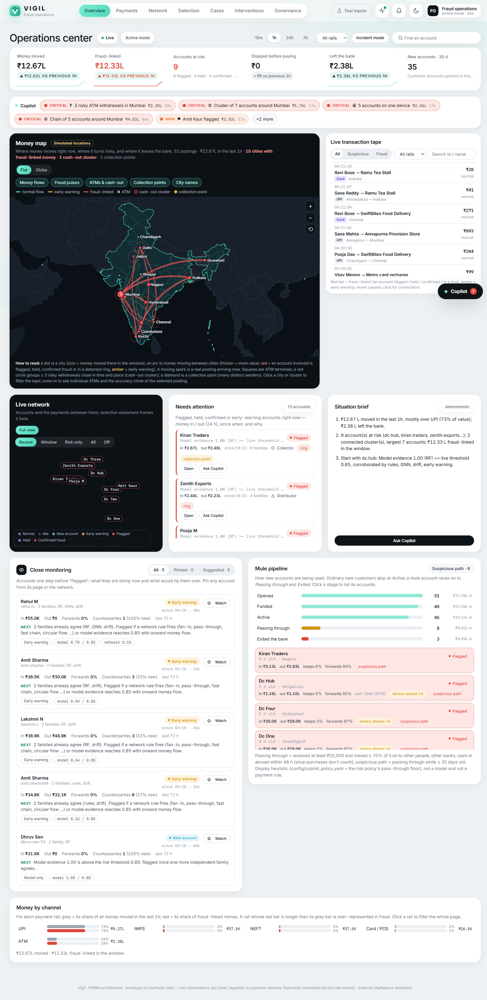

Top to bottom: header → KPI strip → Copilot incident strip → **money map** beside the **live transaction tape** → compact 3D network, Needs attention, Situation brief → Close monitoring beside the Mule pipeline → Money by channel. The **Copilot** button sits bottom right. On a tablet or phone everything stacks in one column (KPI strip, Copilot strip, map, tape, needs attention, pipeline, close monitoring, channels, network). One **shared selection** links everything: click a city on the map, a row on the tape, an account in a list or a Copilot evidence link, and the map, tape and 3D network all follow.

**Every location is simulated.** The bank's accounts, ATMs and the places payments are made from are generated by the simulator (from hashes of the account and payment ids, never from the answer key). Wherever a place is shown, it says how a bank would know it and how precise that is, for example "Simulated location · ATM terminal · ±25 m". Locations are context for investigating; no detector, score or payment tier reads them.

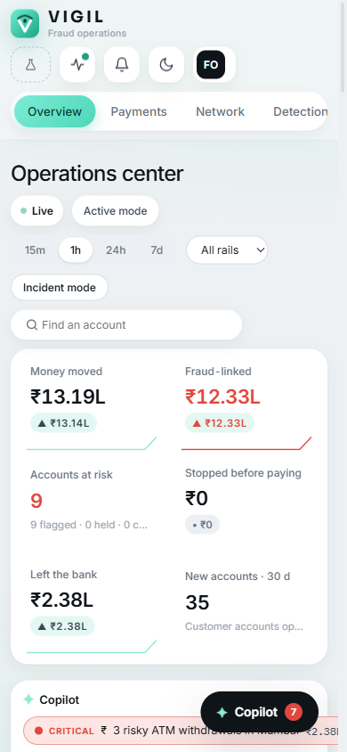

### 4.1 Header

| Control | What it does |
| --- | --- |
| Live · Active mode | The realtime connection is open (everything updates by itself) and whether Vigil's interventions are applied. |
| Window: 15m · 1h · 24h · 7d | The time window for the KPI strip, the money map and the channel chart. Remembered by the browser. |
| All rails ▾ | Filter the whole page to one payment rail: UPI, IMPS, NEFT, RTGS, Card, ATM, Wallet, International wire. |
| Incident mode | Focuses the whole page on the top open incident (section 4.13). Greyed when there is no incident. |
| Find an account | Type an id or name and press Enter to open its investigation page. |

### 4.2 KPI strip: six numbers, each against the previous window

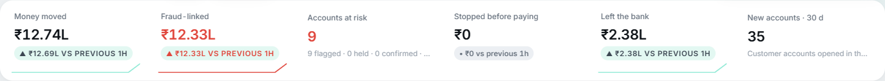

| Tile | What it shows | How to read it | Click it to |
| --- | --- | --- | --- |
| Money moved | Value of every posting in the window (transfers, cash, external). The arrow compares it with the previous window of the same length; the small line is the same value in 12 slices of the window. | A spike in a quiet window is the first sign of a burst. | Show all rails, all rows on the tape. |
| Fraud-linked | Value of postings that touch an account that is flagged, held, confirmed fraud or inside a detected ring. Red when above ₹0. | It describes the accounts as they are now: a payment made before an account was flagged turns red later. | Filter the tape to fraud-linked rows. |
| Accounts at risk | Flagged + held + confirmed accounts right now; the line below splits them and adds early warnings. | 0 in green = all clear. | Scroll to Needs attention. |
| Stopped before paying | Tier ≥ 2 payments created in the window that did not go through: held, escalated, rejected, or abandoned by the customer after a warning. | Money Vigil kept from leaving. | Open Interventions. |
| Left the bank | Value that moved outside the bank's perimeter: ATM cash, other banks, international wires. | Once money leaves, recovery is hard; watch this next to Fraud-linked. | Filter the page to the ATM rail. |
| New accounts · 30 d | Customer accounts opened in the last 30 days (and how many in this window). | Mule accounts are usually new; the Mule pipeline (4.11) shows what they do. | Scroll to the Mule pipeline. |

In incident mode the tiles show "· incident" and count only postings that touch the incident's accounts.

### 4.3 Copilot incident strip

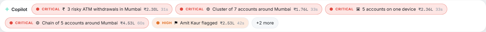

A row of chips, one per open **incident**, most severe first, then most recent. Each chip: a coloured dot and the severity in words (CRITICAL, HIGH, MEDIUM, LOW — colour is never the only signal), a symbol for the kind, a short title, the money at stake and its age. A new chip pulses briefly. More than five → "+N more". **Click a chip: the Copilot opens and the briefing is already generated — no typing needed.** With nothing open it reads "No active incidents — Copilot is watching." Section 4.4 explains incidents.

### 4.4 Vigil Copilot: incidents, briefings and chat

**The Copilot notices crucial events by itself, tells you what happened, how severe it is and what to do, and answers questions about the live data. It is read-only: it can never hold, release, freeze, approve or watch anything.**

**Where incidents come from — no AI.** A deterministic **incident engine** watches the same live events as the rest of the console and checks nine conditions every time something changes:

| Incident | Raised when | Raised by |
| --- | --- | --- |
| Ring formed | 3+ risky accounts connected by payments in the live window, at least one flagged | Network watcher (RingWatch + detection stream) |
| Account flagged | An account is flagged and not already inside a ring incident | Detection stream |
| Cash-out cluster | 3+ ATM withdrawals by flagged / ring accounts within 8 km and 45 minutes | Derived signal on simulated ATM locations |
| Impossible travel | The same account's phone in two places further apart than an airliner could fly in the time (over 900 km/h) | Derived signal on simulated device locations |
| Payment held | An open Tier 3 hold | Payment gate (PRIMA decision) |
| Coercion alert | An open Tier 4 hold + trusted contact | Payment gate (PRIMA decision + CircuitBreaker) |
| New account passing money through | An account ≤ 30 days old moved ≥ 70% of what it received (at least ₹20,000) to other people, banks, cash or abroad within 48 h | Mule pipeline heuristic |
| Device farm | 3+ accounts on one device, at least one under watch or flagged | Device graph |
| Confirmed scam money traced | Value from a bank-confirmed scam sits in accounts (TaintTrace) | TaintTrace |

The same finding never creates a second incident: a ring that grows stays one incident (its chip updates). Account-flagged, impossible-travel and new-account incidents close by themselves once their condition has been gone for 10 minutes; the others stay until you acknowledge or dismiss them. Every briefing says which engine raised it.

**Severity — what is at stake.** A hand-set, explainable rubric (in `config/copilot_policy.yaml`, not validated on real data): a base by kind (ring 65, coercion 70, cash-out 65, device farm 55, held payment 50, new account passing through 45, impossible travel 40, account flagged 35), plus up to 20 for the money at stake, up to 10 for the number of accounts, 10 if confirmed, up to 10 if the newest evidence is under 5 minutes old, minus 10 if everything is already held or confirmed. 80+ = critical, 60–79 high, 40–59 medium, else low. In the briefing, press **"— why?"** next to the severity to see each component. **Confidence** is separate: how sure the evidence is (bank-confirmed or 3+ families agree = high; rules + a model = medium; one signal or a heuristic = low).

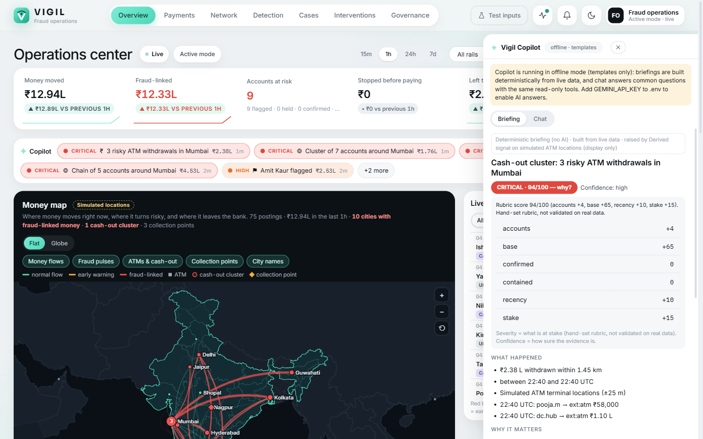

**The dock** (bottom right; Esc closes; drag its left edge to resize) has two tabs:

- **Briefing**: headline; severity (with "why?") and confidence; **What happened** (the facts and the last payments, with times); **Why it matters**; **What to do** — numbered steps, each with a button that only navigates or selects: *Show in network*, *Open connections*, *Show on map*, *Open page*, *Filter tape*, and *Watch (confirm)*, which asks you to confirm before anything is added to Close monitoring (you make the change, not the Copilot); **Open questions**; **Evidence** chips (click to select the account or open the payment). Buttons at the bottom: **Incident mode**, **Deep dive** (only with an AI key), **Acknowledge**, **Dismiss**. A note at the top says whether it is **AI-generated · verify before acting** or a **deterministic briefing (no AI)**.
- **Chat**: ask in plain words. The answer streams in; each look-up the Copilot made appears as a small chip ("get account", "trace funds") you can expand to see exactly what it asked and got (transparency). Suggestion chips: *What should I do first?*, *Trace the money*, *Who else is linked?*, *Is this a false positive?*, *Explain this like I'm new* (inside an incident) or *Show open incidents*, *Which rings are active?*, *Situation summary*, *New accounts pipeline*, *Where is money leaving the bank?*, *Channel mix*. **Stop** cancels an answer; **copy** copies it; account and payment names in answers are clickable.

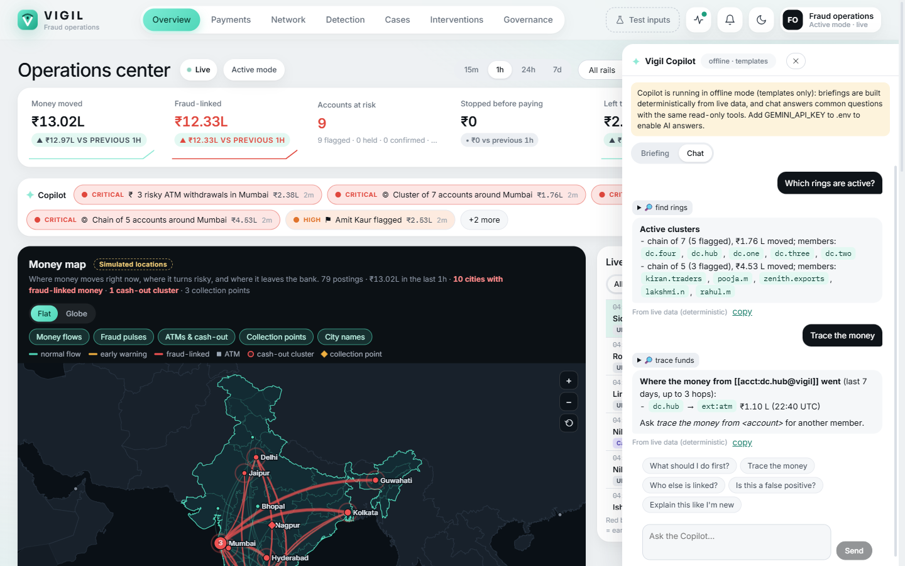

**Offline or with AI.** Without a Gemini key (the default) the Copilot is fully offline: the briefing is built from a template filled with the live facts, and chat answers the common questions with the same read-only tools — a yellow banner says so. With `GEMINI_API_KEY` in `.env`, briefings and chat come from Google's Gemini (`gemini-3.8-flash`; *Deep dive* uses `gemini-3.1-pro-preview`), which then receives the incident facts (synthetic data). Either way: it only reads; it is instructed to use only facts returned by its tools, and in briefings any account or payment id that is not part of the incident is dropped and the severity is always the engine's, not the model's; it treats names and notes written by others as data (instructions hidden in a payment note are ignored, and it has no tool that could act on them); anything that looks like a key is removed from answers.

### 4.5 Money map

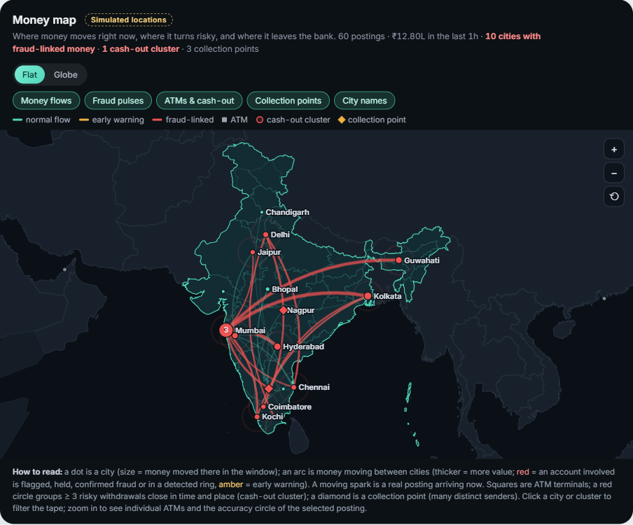

**What you see.** India (its boundary as depicted by India, from Natural Earth's India point-of-view data, bundled so it works offline) with its states; neighbouring countries in grey; four international destinations (Dubai, Singapore, London, Hong Kong) for international wires.

| Mark | Means |
| --- | --- |
| Dot | A city; size = money moved there in the window. Mint = normal, amber = postings touching early-warning accounts, red = fraud-linked money. A red ring pulsing around a dot = fraud-linked money there. |
| Arc | Money moving from one city to another; thicker = more value. Red = an account involved is flagged, held, confirmed or in a ring; amber = early warning; mint = normal. Destinations off the map show as "→ Dubai" at the edge. |
| Moving spark | One real posting arriving right now (red for a test injection). An ATM withdrawal shows as a ring growing on the spot. |
| Small square | An ATM terminal that was used (red = used by a risky account). Zoom in to see every terminal in a city. |
| Red circle with a number | A **cash-out cluster**: 3+ risky withdrawals close together in time and place; the number is how many. |
| Diamond | A **collection point**: an account receiving from at least as many distinct senders as the risk policy's fan-in rule (4 in 72 h). Red when the account is flagged. |
| Dashed circle + white pin | The selected payment's location and its accuracy (for example ±25 m at an ATM, ±3–15 km for an IP address). |

**Controls.** Layer chips: Money flows, Fraud pulses, ATMs & cash-out, Collection points, City names. Scroll or **+ / −** to zoom (country → region → city; the land outline is simplified to about 3 km, so zoom stops at street level), drag to pan, double-click or ⟲ to reset; with the map focused, the keyboard works too (+, −, 0, arrows). Hover a city for its numbers; **click a city to filter the tape to it**; click a cluster to select its accounts. **Flat | Globe** switches to the 3D globe (remembered by the browser).

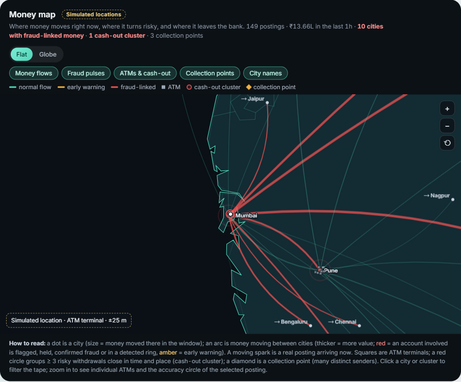

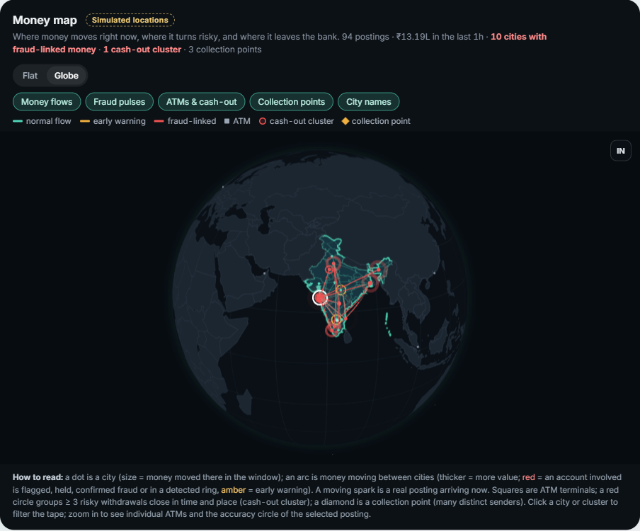

**Globe.** The same data on a rotating Earth: arcs follow great circles, lifted higher the further they go; red pulse rings on fraud-linked cities; sparks for new postings. Drag to rotate, scroll to zoom, click a city; **IN** flies back to India. It pauses when the tab is hidden or scrolled away.

**How locations are known (all simulated).**

| Basis | When | Accuracy shown |
| --- | --- | --- |
| ATM terminal | Cash withdrawal | ±25 m |
| Device GPS | Payment from a known phone | ±30 m |
| Merchant POS | Card payment (the shop's location) | ±2 km |
| IP address | Older postings with no device | ±3–15 km |
| KYC home address | Money arriving from outside the bank | city-level |
| Branch | Assisted account opening | ±100 m |

**Why it matters.** Scam money moves geographically: victims all over the country, collection in one city, cash-out at a few ATMs there, or a wire abroad. The map shows that shape at a glance.

### 4.6 Live transaction tape

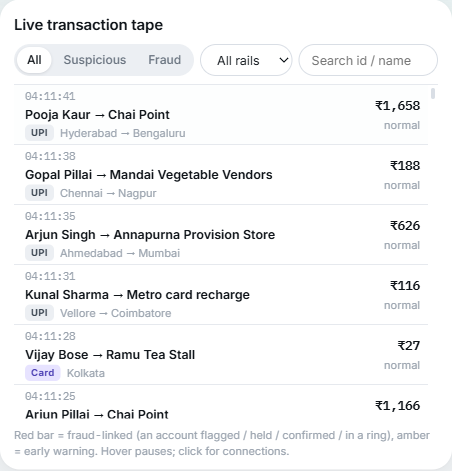

Every posting as it lands, newest first: time, payer → payee, the **rail** badge (UPI, Card, IMPS, NEFT, RTGS, ATM, Wallet, Intl wire), the cities (from → to), amount, and the most serious status of the two parties (or the payment tier). **Red left bar + tint = fraud-linked; amber = early warning.** A "test injection" tag marks attack postings.

- **Filters**: All / Suspicious / Fraud, the rail, and a search box (id or name). Clicking a city on the map, an account in a list or a Copilot evidence link filters it too ("Filtered to …", *clear*).
- **Hover pauses it**; new postings collect in an "N new" pill. It keeps the latest 300 and only draws the rows you can see, so it stays fast.
- **Click or press Enter on a row**: the map draws that payment (dashed arc, pin, accuracy circle), the 3D network frames both accounts, and the **connections drawer** opens.

### 4.7 Connections drawer: who funded it, where it went next

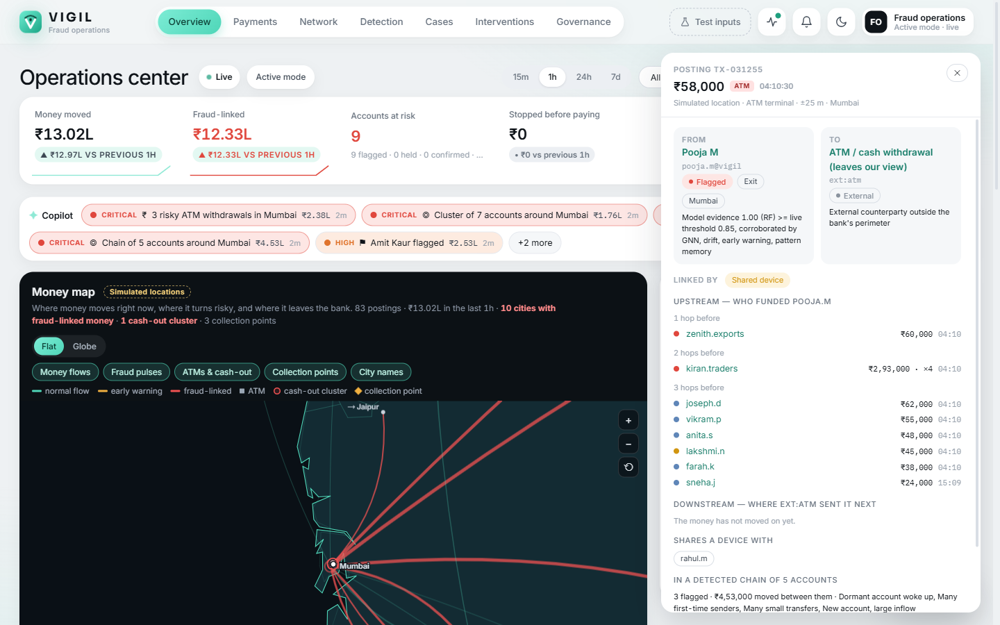

For one posting: amount, rail, time and its simulated location; **From** and **To** cards (status, role, home city, the detectors' reason); **Linked by** chips — *Shared device*, *Fan-in* (the payee receives from many distinct senders), *Fan-out* (the payer pays many), *Same ring*, *Same payee*; **Upstream** — who funded the payer, up to 3 hops back; **Downstream** — where the payee sent the money next, up to 3 hops on; shared devices and the ring it belongs to. When one account appears several times in a hop, it is shown once with the total and "× n". Buttons: **Show on map**, **Show in network**, **Open recipient**, **Ask Copilot about this**. Esc closes it.

**Example.** Pooja M → ATM, ₹58,000, "Simulated location · ATM terminal · ±25 m · Mumbai": upstream one hop is Zenith Exports (₹60,000), two hops Kiran Traders (₹2,30,000) — the ring's cash-out leg in one picture.

### 4.8 Compact live network

The same 3D network as before (every dot an account, every line a payment), now compact. Selecting anything elsewhere frames those accounts here and switches the edges to **Risk only**. Colours:

| Colour | Status | Meaning |
| --- | --- | --- |
| Blue | Normal | Made or received a payment in the last 10 minutes; no detector flags it. |
| Dark grey | Idle | No payment in the last 10 minutes. |
| Light blue | New account | Opened less than 7 days ago. |
| Amber | Early warning | Behaviour changed, or two detector families agree, but not enough evidence for "flagged". |
| Red | Flagged | Corroborated mule evidence (strong model evidence + another family + money moved on; or a network rule + two families). |
| Purple | Held | One of the account's own payments is on a scoped hold — usually the customer being protected. |
| Crimson | Confirmed fraud | Received a payment the bank confirmed as a scam. |

Edge buttons: Recent (last 2 minutes), Window (10 minutes), Risk only, All, Off. Drag to rotate, scroll to zoom, click a dot for the account drawer (status, network and model scores, traced value, recent postings, Watch). **Full view** opens the Network page.

### 4.9 Needs attention

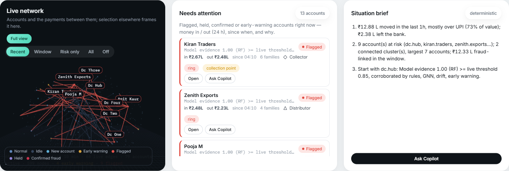

Every account that is confirmed fraud, held, flagged or at early warning, most serious first. Each row: name and the detectors' one-line reason; status; **money in and out in the last 24 h**; since when it has that status; how many detector families agree; its role; **ring** (inside a detected cluster) and **collection point** tags. Click a row to select it everywhere; **Open** goes to its investigation page; **Ask Copilot** asks why it is flagged and where its money went.

### 4.10 Situation brief

Three plain lines built from live data (no AI): how much money moved and over which rail, and how much left the bank; how many accounts are at risk and the largest connected cluster, with the fraud-linked value; what was stopped and which account to start with. **Ask Copilot** opens a chat with "situation summary and what to look at first".

### 4.11 Close monitoring

Accounts one step before "flagged" (unchanged from before, now beside the pipeline): **pinned** by an analyst (Watch button, optional note) and **suggested** automatically (early warning, model evidence without corroboration, pattern match). Each card: last-72-hour activity (in, out, forwards %, counterparties), **NEXT** (exactly what would flag it) and tags. Accounts already flagged are in Needs attention instead.

### 4.12 Mule pipeline: how new accounts are being used

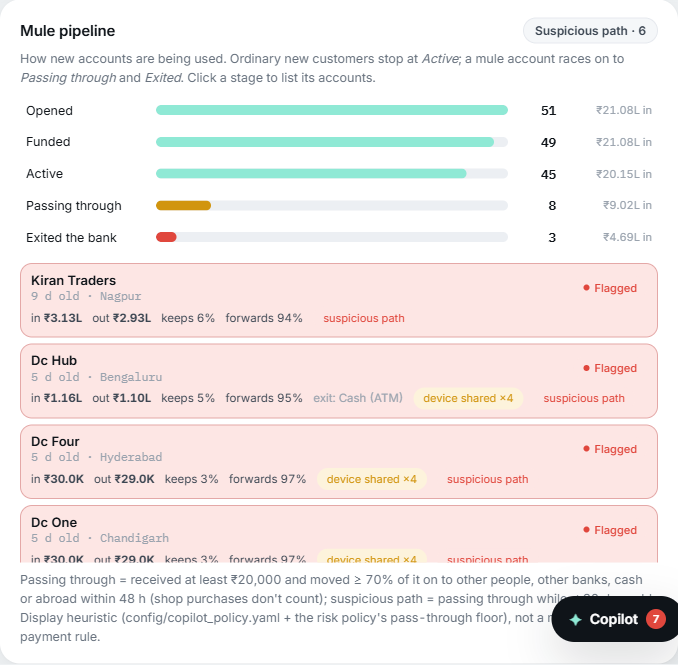

Every account opened in the last 60 days, as a funnel:

| Stage | Means |
| --- | --- |
| Opened | Account exists. |
| Funded | Received its first money. |
| Active | Has also sent money out. |
| Passing through | Received at least ₹20,000 and moved 70% or more of it on to other people, other banks, cash or abroad within 48 hours (shop purchases don't count). |
| Exited the bank | …and some of it left the bank (cash, other banks, international). |

Bars = how many accounts reached each stage, with the money that came into them. **Ordinary new customers stop at Active**: the demo world includes 40 legitimate new accounts (students, salaried, freelancers, shop owners — including a freelancer paid by many clients who keeps the money, and a new shop with fast but honest turnover). A mule races on to Passing through and Exited. **Suspicious path** = passing through while 30 days old or younger; the button lists only those. Click a stage to list its accounts; each row shows age, how it was opened (app, branch, agent, kiosk) and where, money in and out, how much it keeps and forwards, its exits, device sharing (two accounts with no risk signals are tagged "family / shop pattern") and status. The rule is a display heuristic in `config/copilot_policy.yaml`; it never sets a status.

### 4.13 Money by channel

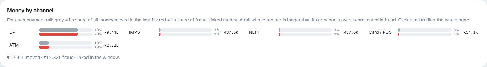

For each rail: a grey bar = its share of all money moved in the window, a red bar = its share of fraud-linked money. **A rail whose red bar is longer than its grey bar is over-represented in fraud.** Click a rail to filter the whole page to it (click again or ✕ to clear). Background payments use UPI or card (one habit per customer); the phone can pay by UPI, IMPS, NEFT, RTGS, card or wallet; attacks add IMPS, NEFT, card and ATM cash.

### 4.14 Incident mode

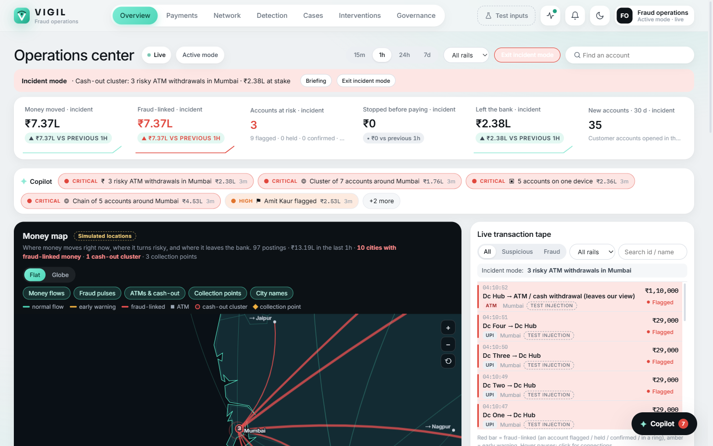

Press **Incident mode** in the header (or in a briefing): a banner names the incident and its money at stake; the map flies to it, the tape shows only its accounts, the 3D network frames them and the KPI strip counts only postings that touch them. **Exit incident mode** returns to the whole bank. It also ends by itself if the incident closes.

### 4.15 How to show the Overview (about 2 minutes)

1. "This is the bank's fraud operations view: where money moves, where it turns risky, and how mule accounts are built." Point at the KPI strip, then the map and the tape ("every location is simulated, and says how it would be known").
2. Inject the money-mule network (Test inputs). Watch the arcs converge on Mumbai, red rows on the tape, and the Copilot strip: **CRITICAL · Ring formed**.
3. Click the chip: "the briefing is already written — what happened, why it matters, what to do; severity is a rubric you can open; the Copilot only reads."
4. Chat: *Which rings are active?* Then click the red Pooja M → ATM row: "cash-out in Mumbai, funded by Zenith Exports, funded by Kiran Traders."
5. Point at the Mule pipeline: "40 ordinary new customers stop at Active; Kiran Traders, 9 days old, forwarded 98% and is on the suspicious path."

## 5. Payments (Transaction guard)

**This page is the heart of PRIMA: the customer's phone on the left, and on the right the bank's full assessment of the same payment, made before any money moves.** The customer sees one calm, proportionate message; the bank sees every reason.

&#91;image: Payments page before any payment: the phone and the policy primer\]

### 5.1 The phone (customer device)

- **Paying as**: switch between the two demo customers (Ramesh, Sunita). Their balance shows underneath, including any amount on hold.
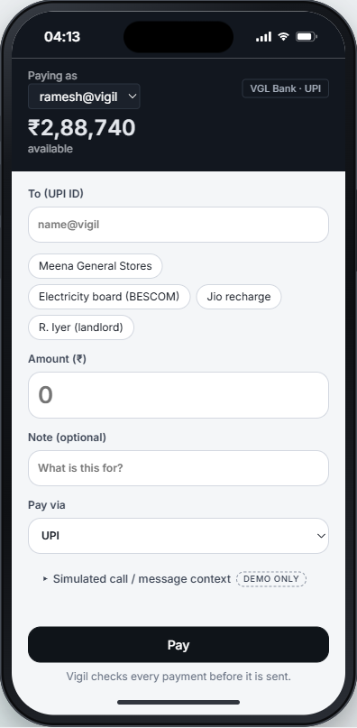

- **To (UPI id)** with quick-pick payees, **Amount**, **Note**, and **Pay via** (UPI, IMPS, NEFT, RTGS, card, wallet). The rail is recorded on the payment and shown on the Overview's tape and channel chart; it does not change the risk score.
- **Simulated call / message context (DEMO ONLY)**: type what a scam caller said (for example "police, keep it secret, transfer now"). Vigil's ContextFlag reads it. In a real bank this would come from call or message signals; here it is simulated and labelled.
- **Pay**: sends the payment intent. The phone shows "Vigil is checking this payment" for a moment, then one of the screens below.

| Tier | What the customer sees | What the customer can do |
| --- | --- | --- |
| T0 Pass | "Paid ₹500" with a tick and "Simulated payment — no real money moved". | Nothing to do. |
| T1 Heads-up | A short note about what looks unusual. | Continue or Cancel. |
| T2 Confirm purpose | "Please confirm before you pay", why we are interrupting, and a box: What is this payment for? | Confirm & pay (after typing a purpose) or Don't send. |
| T3 Scoped hold | "We're holding this payment while the bank checks the recipient." Only this amount is held; the account works normally; review within 30 minutes. A hold reference (HLD-…). | Cancel this payment, or wait for the bank. If the bank releases it: "Bank released this payment — complete it". |
| T4 Hold + trusted contact | As T3, plus the trusted contact is notified. The contact's responses appear on the phone. | Cancel, or wait. |
| Rejected / cancelled | "Nothing was sent. Your account works normally." | New payment. |

The customer text is generated from facts only and never contains accusing words (there is a banned-word list in the code). Below the message: **What changed** (recent account changes), **Why we are interrupting** (the facts) and **What action is being taken**.

&#91;image: Tier 2 on the phone: confirm before you pay\]

### 5.2 The tiles above the assessment

- **Decision p50 · p95**: how long Vigil takes to decide. p50 = the typical (median) payment, p95 = 95% of payments are faster than this. About 3 ms and 7 ms.
- **Zero friction**: share of payments passed at Tier 0 (about 99%). Proof that Vigil is not a nag.
- **Decisions**: number of payments assessed, and the policy version.
- **Open interventions**: payments waiting, and the money held.
- **Mode**: ACTIVE (interventions applied) or SHADOW (recommend only).

### 5.3 How the score is built (the most important idea)

Every payment is scored on **five dimensions**. Each dimension is the sum of the rules that fired in it (capped at 1.0). The weights come from the versioned policy file `config/risk_policy.yaml`:

| Dimension | Weight | What it looks at | Example rules (points added) |
| --- | --- | --- | --- |
| External intelligence (SIMULATED) | 25% | Fraud registry reports about the recipient | reported 0.65, confirmed mule 1.00 |
| Network (RingWatch) | 25% | The recipient's money-flow structure in the last 72 h | many first-time senders 0.25, rapid pass-through 0.30, circular flow 0.25, received a confirmed scam 0.45, holds traced scam money 0.40 |
| Journey (TrailScore) | 20% | What the sender did in the last 30 minutes | new device 0.20, payee added 0.15, limit raised 0.20, takeover sequence 0.25 |
| Behaviour | 15% | This payment vs the sender's own 180-day history | unusually large 0.30, first payment to this payee 0.15, most of the balance 0.30, unusual hour 0.05 |
| Context (ContextFlag, SIMULATED) | 15% | Pressure cues in the call or message | urgency 0.25, secrecy 0.30, fear of authority 0.35, bypass approval 0.30 |

Then four steps:

1. **Base score** = each dimension score × its weight, added up.
2. **Corroboration bonus**: every *extra* dimension at 0.5 or above adds +0.10. Independent evidence agreeing counts more than one loud signal.
3. **Named adjustments** (each recorded by name on the decision): *floors* (recipient confirmed as a mule, or holding ₹10,000+ of traced scam money → at least Tier 3); *friction guard* (an established, clean relationship with 3+ past payments → at most Tier 1); *CircuitBreaker needs sender evidence* (Tier 4 only when the journey or context shows the sender may be compromised or coerced; otherwise at most Tier 3).
4. **The ladder** turns the final score into a tier:

| Final score | Tier | Action |
| --- | --- | --- |
| below 0.15 | T0 | Approved |
| 0.15 to 0.28 | T1 | Heads-up shown |
| 0.28 to 0.42 | T2 | Confirm before paying |
| 0.42 to 0.55 | T3 | Payment held for review (scoped hold) |
| 0.55 and above | T4 | Held + trusted contact alerted |

These numbers are hand-set, explainable demo values, not fitted to real fraud data. Machine-learning models never change the tier; they appear only as corroborating evidence.

### 5.4 The assessment, row by row

&#91;image: Full assessment of the everyday ₹500 payment (Tier 0)\]

| Row | What it shows |
| --- | --- |
| Sender | Who pays: account age, available and held money, daily limit, trusted contact, a one-line persona. |
| Recipient | Who receives: age, kind, balance (or "outside the bank's view" for other banks). |
| Amount | The amount, its share of the available balance, the note, the sender's median payment and the **robust z** (how unusual this amount is for this sender; median-based so one old big payment does not distort it; 3.5+ = outlier). |
| Relationship | First payment, or established ("paid 13 times before, typically ₹700"). |
| Device | Which device sent it: primary, secondary, or unknown. |
| Behaviour · Network · External · Journey · Context | One line per rule that fired: name and rule id, a plain reason, the evidence values as chips, the provenance (computed live / SIMULATED, and how old) and the points added. On the right: dimension score × weight = contribution. "No rule fired in this family" when clean. |
| Model evidence | Random Forest, GNN, rule engine, early warning, drift and pattern memory for the recipient, each with its value and whether it flags. Corroborating only. |
| Final decision | The score bar with the tier thresholds as ticks, base + policy adjustments, each adjustment by name, the tier, the intent's state, the intervention, the bank action, and the mode / recommended / applied tier / bank baseline. |

Below the table: the case id, **Investigate**, **Replay decision** and **Decision record** links; **Exactly what the customer was shown**; and **Provider · ledger · monitoring** with the intent's lifecycle (Created → Risk evaluated → Approved → Payment initiated → Payment succeeded → Monitored, or Held / Escalated / Rejected / Cancelled). "No money has moved" is stated whenever the payment is not approved yet. **Recent intents** lists this customer's past payments; click one to load its assessment. **Customer kiosk ↗** opens the phone alone, for a second screen. On a held payment, **Release hold** and **Reject payment** appear at the top of the assessment.

### 5.5 Worked examples from the demo run (real numbers)

| Payment | What fired | Maths | Result |
| --- | --- | --- | --- |
| Ramesh → Meena General Stores, ₹500, 01:46 | Only "unusual hour" (behaviour 0.05). Paid this grocer 13 times. | 0.05 × 0.15 = 0.007 | **T0**, paid in 1.8 ms |
| Ramesh → Kiran Traders, ₹1,500, 01:48 | Behaviour 0.20 (first payee, unusual hour); network 0.45 (rapid pass-through 98%, new account with large inflow); external 0.65 (registry: reported) | 0.030 + 0.113 + 0.163 = 0.305; only one dimension ≥ 0.5, no bonus | **T2**, confirm purpose |
| Ramesh → Kiran Traders, ₹45,000, 01:47 | Behaviour 0.50 (unusually large: robust z 99, first payee, unusual hour); network 0.45; external 0.65 | 0.075 + 0.113 + 0.163 = 0.350, + 0.10 (external and behaviour both ≥ 0.5) = 0.450 | **T3**, scoped hold |
| Same payment after the scam was confirmed | Network rises to 1.00 (received a confirmed scam +0.45, holds traced money +0.40, many first-time senders +0.25 …) | base 0.487 + 0.20 (three dimensions agree) = 0.688, which is T4 territory, but **capped at T3**: nothing shows Ramesh himself is coerced | **T3**, adjustment CAP\_NO\_SENDER\_EVIDENCE |
| Sunita → RK Legal Services, ₹5,61,600 (coerced journey) | Journey 0.90 (new device, payee added, limit raised, takeover sequence, large transfer after changes); behaviour 0.75; context 1.00 (urgency, secrecy, fear of authority, bypass) | 0.180 + 0.113 + 0.150 = 0.443, + 0.20 = 0.642 | **T4**, hold + Arjun alerted |

**Why the ₹45,000 payment is T3 at night but T2 by day.** At night the "unusual hour" signal (+0.05) lifts behaviour from 0.45 to 0.50. That crosses the 0.5 line, so behaviour starts to count as a second agreeing dimension and the +0.10 bonus applies (0.343 → 0.450). By day the same payment scores about 0.343, which is Tier 2. The case page's counterfactuals show this.

&#91;image: ₹45,000 to Kiran Traders at 01:47: Tier 3 on the phone, and the assessment\]

&#91;image: The full Tier 3 assessment: every rule, its evidence and its points\]

&#91;image: The same payment after the scam was confirmed: network 1.00, score 0.688, capped at Tier 3\]

&#91;image: Sunita's coerced payment: Tier 4, hold + trusted contact (opened from Recent intents)\]

### 5.6 How to show Payments (3 minutes)

1. Test inputs → *Everyday · grocer ₹500* → **Open on customer device** → **Pay**. "Most payments pass silently, in milliseconds." Point at the T0 assessment: everything clean except a tiny unusual-hour note.
2. Test inputs → *Risky recipient · ₹45,000* → Open on customer device → Pay. Read the phone message aloud, then walk the right-hand rows: first payee, outlier amount, rapid pass-through, registry report. "The customer sees facts, the bank sees the evidence and the maths."
3. After the scam is confirmed (section 15 step 5), pay again: network jumps to 1.00 and the score to 0.688, but it stays a scoped hold because there is no sign Ramesh himself is under pressure.

## 6. Trusted contact phone (CircuitBreaker)

**On a Tier 4 hold, the person the customer nominated (here Arjun, for Sunita) gets facts on their phone and can act in one tap.** It opens at `/contact/arjun` and updates live.

| Before Arjun responds | After "I'm calling them now" |
| --- | --- |
| &#91;image: Alert card on Arjun's phone\] | &#91;image: After Arjun taps I'm calling them now\] |

- **The card**: time, "PAYMENT ON HOLD", one plain sentence (an unusually large payment to a newly added recipient), the amount (₹5,61,600) and the facts: payee added minutes ago, signed in on a new device 8 minutes ago, transfer limit raised 4 minutes ago.
- **It never accuses anyone.** No "fraud", no "scam": facts only, and "Only this one payment is paused — the account keeps working."
- **Three buttons**: *I'm calling them now*, *Acknowledge*, *This payment is expected*. The response is recorded on the decision, shown on Sunita's phone ("Trusted contact: …"), in the bank's case (CircuitBreaker column in Interventions) and in the decision replay as its last frame.

**Why it matters.** In a "digital arrest" scam the victim is told to tell no one. A family member who hears the facts at the right moment breaks the isolation. That is the purpose of the CircuitBreaker.

**How to show it.** Open it on a phone (same Wi-Fi) or a second tab before running the coerced journey. When the T4 hold lands, show Arjun's card and tap *I'm calling them now*.

## 7. Network

**The Network page is the full workbench for the money-flow picture: the same live network as the Overview, plus five colour lenses, the live feeds, and a frozen "evidence scene" for investigating one ring.** Two tabs at the top right: **Live universe** and **Evidence scene**.

### 7.1 Live universe and its lenses

&#91;image: Live universe, Live status lens\]

The toolbar changes what the colour of each dot means (a **lens**):

| Lens | Colour means | Use it to |
| --- | --- | --- |
| Live status (default) | The account's live status (same colours as the Overview, section 4.8). | See who is flagged, held, warned right now. |
| Risk | The RingWatch network score: blue below 0.30, amber 0.30–0.50, orange 0.50–0.75, red 0.75+. This is the score the payment engine uses. | Show what the payment decisions "see" about each recipient. |
| Model score | The strongest model evidence (Random Forest or GNN), same colour bands; dark = not scored. Labelled SYNTHETIC VALIDATION, corroborating only. | Compare the models' opinion with the rules. |
| Roles | Bright = the account has a mule role inside flagged structure; dark = no role. | Show the shape of a ring (collector, distributor, exit). |
| Taint | Red = holds value traced from a confirmed scam; dot size grows with the amount. Dark = untainted. | After confirming a scam: show where the stolen money sits now. |

| Risk lens | Model score lens |
| --- | --- |
| &#91;image: Risk lens\] | &#91;image: Model score lens\] |

| Roles lens | Taint lens (after the scam was confirmed) |
| --- | --- |
| &#91;image: Roles lens\] | &#91;image: Taint lens\] |

Other controls:

- **Auto-orbit**: slow automatic rotation on or off.
- **Simulator ground truth**: colours the payments the simulator tagged as injected (magenta). This is the answer key, shown only for evaluation; no detector ever reads it. Use it to prove the detection did not cheat: the red (flagged) accounts were found without this tag.
- **Reset view** and **Zoom to N flagged / held**.
- **Find account**: type part of an id or name and press Find; the camera flies to it and opens the drawer (section 4.8).
- **Edges** filter: the same five buttons as on the Overview.

&#91;image: Simulator ground truth on: injected payments in magenta\]

### 7.2 Live activity (below the network)

&#91;image: Live activity feeds\]

| Feed | Shows |
| --- | --- |
| Live transactions | Every payment after it is scored: payer → payee, amount, channel, time, origin (ambient = background, user = phone, scenario = test input), the transaction id, the payer and payee network scores and how long scoring took (about 15–20 ms). |
| Risky transactions | Only payments where the payer or payee was at early warning or worse right after scoring. Empty when the network is calm. |
| Alert stream | Every payment decision at Tier 1 or above (HELD, MEDIUM … with the tier and the customer message), plus account status changes and CircuitBreaker events. |

### 7.3 Evidence scene (second tab)

&#91;image: Evidence scene: the suspicious subgraph, Risk mode\]

&#91;image: Evidence scene scoped to the money-mule network, Mule roles mode\]

A smaller, frozen picture for investigating: only the suspicious accounts and their counterparties (default), one account's neighbourhood, or one attack. The layout is computed once on the server, so nothing moves while you talk.

- **Shape = role**: sphere = ordinary account (white ring = victim), diamond = collector, cone = distributor, hexagon = pass-through mule, pentagon-like = suspected mule, four-sided point = exit / cash-out, star = coordinator, cylinder = entry, box = external account.
- **Colour = status / score** for the chosen mode; **ring** = held, confirmed fraud or victim.
- **Modes**: Money flow, Risk, Taint, Mule roles, GNN score, Rule score, ML score.
- **3D / 2D**: switch to a flat graph if the 3D view is hard to read on a projector.
- **Scope**: Suspicious subgraph (default), a focus account (1 or 2 hops), or any attack or demo scenario.
- **Node cap**: how many accounts to show (60 by default).
- **Time replay / Attack replay**: plays the payments in this scene in the order they happened, with Play, Pause and step buttons.
- **Info box** (top left): nodes and edges shown, scope, build time, the time window, and counts of high-risk accounts, role holders, confirmed, held and victims.
- **Click a node**: drawer with Expand 1-hop / 2-hop, the account intelligence and, on an incoming payment from a victim, **Confirm scam** (the same as Test inputs → Report a confirmed scam). Click a line: the payments it aggregates.
- Below the scene: **TaintTrace** (value traced from confirmed scams, LIBR and pro rata side by side) and **Accounts with network evidence** (RingWatch list).

**How to show it.** After injecting the money-mule network, open Evidence scene → Scope = *Act 3 · Money-mule network*, mode *Mule roles*, and press **Attack replay**: the victims pay Kiran Traders (collector), money hops to Zenith Exports and Pooja M (pass-through) and out to an ATM (exit).

## 8. Detection & models

**Detection explains how Vigil finds mule accounts, read top to bottom in four numbered sections.** Every chart carries the same three-line caption: **Shows** (what it is), **How to read** and **Right now** (what it says this minute, computed live).

&#91;image: Page intro: eight independent detector families, agreement is what counts\]

**The one idea to remember.** Vigil runs eight independent detector families on every account. One family alone never makes an account "flagged": a busy shop trips the rules, a salaried customer shows drift, a scam victim looks like a sudden change. An account gets a status only when independent families agree, and "flagged" also needs money moving onward. And no model ever decides a payment; the transparent policy engine does (section 5).

### 8.1 Section 1 · What the detectors see right now (live)

&#91;image: Row 1: which detectors flag, why the model thinks so, which network rules fire\]

**Which detectors are flagging accounts?** One bar per family; the length is how many accounts that family flags on its own. The counts overlap (one account can be in several bars). In the screenshot drift flags 21 accounts and the rule engine 13, yet only 12 accounts have two or more families agreeing, and only those can be at early warning or flagged. That gap is the whole point: single signals are noisy, agreement is evidence.

**Why does the model think these accounts are mules?** SHAP for the Random Forest, summed over the five riskiest accounts right now (listed under the chart). Each bar is a category of behaviour. Red = it made the accounts look more like mules; blue = it made them look normal; longer = stronger. Hover a bar to see what it measures:

| Category | Measures |
| --- | --- |
| Value Risk | How much money came in and went out in 72 h |
| Counterparty Novelty | How many counterparties are new to the account |
| Retention Risk | How little of the received money it keeps (fast forwarding) |
| Velocity Risk | How many payments vs its usual rate |
| Ring Participation | How many different accounts it pays and is paid by |
| Account Newness | How recently it was opened |
| Dormancy Risk | How long it was quiet before |
| Channel Risk | How many rails (UPI, IMPS, NEFT) it uses |
| Shared Device Risk | How many accounts share its device |
| Structuring Risk | Payments just below the ₹10,000 band |

In the screenshot Value Risk dominates, followed by Counterparty Novelty and Retention Risk: big sums, from strangers, passed straight on. SHAP explains the model's opinion, never the payment decision.

**Which network rules are firing?** The RingWatch rules the payment engine itself uses, with how many accounts trip each one now: part of a fast chain 9, rapid pass-through 6, circular flow 6, splits money out 3, many first-time senders 3, and so on. These rules feed the network part of every payment's score, so they change what customers see.

&#91;image: Row 2: early warning, mule roles, pattern memory\]

**Who is suddenly behaving differently?** (early warning) Accounts whose recent activity changed sharply compared with everyone else, with a score (relative to the population, not a probability) and what changed: New Account, Pass-Through, High Fan-Out. A warning, not proof: a victim or someone just paid shows it too.

**What role does each mule play?** Counts by role inside flagged structure: coordinator, collector (gathers from many), distributor (spreads to many), exit (cashes out), entry. Ordinary accounts never get a role. The second list is the same idea from the RingWatch rules.

**Does anything look like a known mule pattern?** (pattern memory) How closely an account's money-flow shape matches a stored signature: kiran.traders 92% Rapid Fan-In, swift.collect 89%, pooja.m 87% Velocity Chain. Similarity means "looks like", never "is".

### 8.2 Section 2 · Did we catch the attacks you injected?

&#91;image: Answer-key explanation, last attack result and attack history\]

When you inject a pattern, the simulator knows which accounts are the mules (the **answer key**, "simulator ground truth"). Vigil never sees that list. It scores payments as they arrive; when the run ends, it is graded.

- **Last attack result**: mules injected, detected, missed, time to first warning, time to detection, false positives, and the account names as clickable tokens (detected in red, missed in amber, warned, false positives). Precision and recall below.
- **Attack history**: one row per run: pattern, start time, payments, mules detected / injected, first warning, detection time, precision, recall, the model threshold at that time, status.

&#91;image: Run charts: which patterns were caught, how fast and how complete, the self-adjusting threshold\]

| Chart | How to read it | In the screenshot |
| --- | --- | --- |
| Which attack patterns were caught? | Grey = times injected, green = times at least one mule was flagged. Green as tall as grey = caught every time. | 5 of 5 patterns caught. |
| How fast, and how complete? | Blue bars = seconds from the first injected payment to the first flag (shorter = faster). Red line = share of that run's mules flagged (100% = all). | Typical 2.4 s to first flag; on average 90% of injected mules flagged. |
| How the flagged bar adjusts itself | The live threshold model evidence must reach before an account can be flagged. After each graded run it moves up if an ordinary account was wrongly flagged, down if mules were missed, always between 0.45 and 0.85. It never changes a payment tier. | Flat at 0.85: no false positives, and the missed mules were not near misses. |

### 8.3 Section 3 · Every account, every detector

&#91;image: Account scoring table\]

All 549 scored customer accounts, each detector's score side by side; click a row to investigate, click a column header to sort.

| Column | Meaning |
| --- | --- |
| Live status | As on the Overview. |
| Strongest | The highest of rules, RF and GNN. |
| Rules | Points from six simple checks (received from 4+ accounts, sent to 4+ accounts, kept under 20% of ₹10,000+ received, device shared by 3+ accounts, 3+ payment rails, 8+ payments in 72 h) divided by 12. 4 points (0.33) flags. A score, not a probability. |
| Random Forest / GNN | The models' probability the account is a mule (calibrated on synthetic worlds). |
| Drift | low / medium / high change versus its own last 45 days. |
| Early warning | Whether early warning flags it. |
| Role | Its role, if inside flagged structure. |

Filters: **Elevated** (any score 0.30+, early warning, high drift or a role), **Behaviour change** (early warning or high drift), **Rules vs models disagree** (one side says risky, the other does not: worth a second look), **All**. Many "Elevated" rows are idle shops with rules 0.42 and models near 0: busy accounts trip simple rules, which is exactly why rules alone never set a status.

### 8.4 Section 4 · How good are the models? (synthetic validation)

&#91;image: Model quality: headline numbers and the two comparison charts\]

Every number here is measured on computer-generated test worlds the models never saw in training (90 training worlds, 30 validation, 30 test, split by world). It is **not** real-bank accuracy, and the page says so.

- **Random Forest ROC-AUC 0.982, PR-AUC 0.914; GNN ROC-AUC 0.983, PR-AUC 0.953; rule engine recall 0.39 (precision 0.20).**
- **ROC-AUC**: pick one mule and one ordinary account at random; how often does the model rank the mule higher? 1.0 = always, 0.5 = coin toss.
- **How accurate is each detector?** Precision (of the accounts it flagged, how many were mules), Recall (of all mules, how many it found), F1 (the balance) and PR-AUC (ranking quality when mules are rare) for each detector. The GNN ranks best; the rule engine alone finds only 39% of mules, which is why the models corroborate it.
- **Which attack types does each detector catch?** For each of the ten attack families, the share of its mules found by RF (blue), GNN (pink) and rules (green). A short bar is a blind spot, for example the Random Forest finds 48% of smurfing mules. That is why several families are combined.

&#91;image: Model registry: every detector on the same test worlds\]

&#91;image: Model card (Random Forest): test performance, confusion matrix, calibration, per-attack generalisation\]

The **model registry** compares all five registered detectors on the same test worlds; click a row or a tab for its **model card**:

- **Held-out test performance**: precision 0.929, recall 0.842, threshold 0.536, flag rate 3.1%, prevalence 3.4%, 9,171 test accounts of which 310 mules.
- **Confusion matrix**: of 8,861 ordinary accounts, 20 wrongly flagged (FP); of 310 mules, 261 caught (TP) and 49 missed (FN).
- **Calibration**: does a score of 0.8 really mean 80%? The dots after calibration (isotonic regression) sit near the diagonal; Brier and ECE errors drop from 0.012 / 0.029 to 0.006 / 0.003.
- **Per-attack detection and leave-one-attack-out**: recall per attack family, and recall when that family was hidden from training. Orange = recall falls more than 0.15 on an unseen family (an honest weakness, for example dormant activation 0.80 → 0.40).
- Further down: a leakage audit, global SHAP by category, false positives by persona, training details.

**How to show Detection (1 minute).** Point at section 1's first chart: "lots of single signals, few agreements; only agreement counts." Scroll to section 2 after your attacks: "every pattern caught, no false positives, in about two seconds." End on the SYNTHETIC VALIDATION banner: "rules decide the payment, models corroborate."

## 9. Cases: the case list and the account investigation page

**Cases is where an analyst investigates: every intervention is a case, and every account has an investigation page.** There are two entry points: a payment (the case list) and an account (search or the network list).

### 9.1 The case list

&#91;image: Case list (left) and accounts with network evidence (right)\]

- **Cases table**: every payment at Tier 2 or above, plus every scenario and customer decision. Columns: opened (and how long ago), case id, sender → recipient, amount, tier, state (Escalated, Held, Challenged …), **Why** (the reason labels: "Fear / authority impersonation · Unusually large for you …"), hold amount and review clock, trusted-contact response, and origin (CUS = customer device, SCN = scenario, STR = background stream).
- **Filters**: free text, tier buttons (T4, T3+, T2+, T1+; T2+ is the default because Tier 1 heads-ups are mostly background traffic) and All / Open.
- **Open an account investigation**: type any account id.
- **Accounts with network evidence**: every account with a RingWatch score of 0.30 or more, with its structural role (collector, pass-through mule …) and score bar; a red "confirmed" tag marks accounts that received a confirmed scam.

### 9.2 The account investigation page (Kiran Traders)

&#91;image: Header and score tiles\]

**Header**: name and id, live status, role, age. Buttons: **Watch** (adds it to Close monitoring, with an optional note; it then reads Watching and an "on watchlist" tag appears), **3D network · 1-hop / 2-hop** (the Network page focused on this account) and, for demo customers, Transaction Guard.

**Tiles** (top row = operational, second row = model evidence):

| Tile | Kiran's value | Meaning |
| --- | --- | --- |
| Live status | Flagged | Status now, and when it was last active. |
| Network score · RingWatch | 0.85, 4 rules fired | The score payments to this account carry (operational). |
| Detector consensus | 8 / 8, strong agreement | How many of the evaluated families flag it. |
| Role | Collector | "Collects from 8 senders and moves 94% of it on." |
| Random Forest / GNN | 1.00 / 1.00 | Model probabilities (calibrated on synthetic worlds). |
| Rule engine | 5/12 pts, flagged | The simple-checks score. |
| Early warning | 0.38, flagged | Behaviour-change score. |

The chip line under the tiles: opening date, devices, balance, number of postings with total in and out, traced value (LIBR), daily limit, trusted contact.

&#91;image: Scores over time, and what moved the model score (SHAP)\]

- **Scores as they are re-computed**: each dot is the backend's value at that moment (network, RF, GNN, rules, early warning). The models keep no score history, so the series starts when you open the page and grows as the account transacts.
- **What moved the model score**: SHAP by category for this one account. Base value 0.500 → the model's raw prediction 0.999. Value Risk, Counterparty Novelty and Account Newness pushed it up; Channel Risk pulled it down a little.

&#91;image: Why flagged, and the window features\]

- **Why flagged?** (or "Why it is not flagged"): plain-language bullets, operational first (RingWatch: many first-time senders, rapid pass-through 94% within 60 minutes, part of a fast chain, new account with large inflow), then consensus, role and the three biggest SHAP features. **Rules fired** (red = RingWatch, operational; amber = rule-engine points), **Early-warning signals**, **Network features (72 h)** as chips, **External intelligence** (SIMULATED registry: reported, risk 0.62), and a collapsible list of RingWatch evidence with contributions and provenance.
- **Window features**: the 15 numbers the models see, "now" (last 72 h) beside the account's own baseline (the 45 days before), the change and each feature's SHAP. Kiran: 8 senders now vs 0 before, ₹3,12,500 in vs 0, retention 0.06 (keeps only 6%).

&#91;image: Recent transactions and the 1-hop neighbourhood\]

- **Recent transactions**: the ledger postings, newest first: id, time, direction (in / out), counterparty, amount, source (scenario postings carry a red "scenario" tag = simulator ground truth).
- **Neighbours · 1-hop scene**: a small frozen graph of direct counterparties (switch to 2-hop or open in 3D) and a table: account, direction, number of payments, amount, status.

&#91;image: Status changes, payment decisions about this account, and the answer key\]

- **Status changes · PRIMA decisions**: the current status line (network risk, model evidence) and every payment decision involving the account (T2 ₹1,500, T3 ₹45,000 from Ramesh).
- **Simulator ground truth** (labelled "evaluation only — never scored"): "Injected as a mule by RUN-000001 · Money-mule network — detected (+0.02 s)". The answer key, shown for honesty, never used by detectors.
- **Risk evolution chart**: for an account that sends payments, its latest decision replayed frame by frame ("Payment decisions as sender"). For an account that receives (like Kiran), the network score at each decision about payments to it (the title now reads "Payments to this account · network score at each decision"). Each marker says why the score moved. **Payment intents**: payments this account started itself.

&#91;image: Explains the MODEL: consensus, SHAP per feature, drift, pattern memory, role\]

- **Explains the MODEL** (corroborating evidence, never sets the tier): the **detector consensus table** (each of the ten families: value, kind, flagged or not, version and time), **SHAP per feature** and by category, **behavioural drift** (baseline vs current per feature, drift score and level), **pattern memory** (similarity to Rapid Fan-In 92%, Shared-Device Cluster, Circular Ring) and the **role** assessment with its evidence and the gate it passed.

&#91;image: Account record\]

- **Account record**: kind, persona, devices, payees, primary device, trusted contact, opening date and the scene flags.

&#91;image: An account on the watchlist: Watching button and the note in the header\]

**How to show it (1.5 minutes).** From Needs attention, click Kiran Traders. Read the tiles left to right ("flagged, 8 of 8 families agree, collector"), then "Why flagged?": "received from 8 accounts that had never paid it, moved 94% on within an hour." Point at SHAP: "this explains the model; the payment decision is explained by the rules." Optionally press **Watch** on a victim (Lakshmi N) to show close monitoring.

## 10. Case page: replay, counterfactuals, provenance

**One case page per payment decision answers: why was this payment risky, how did the risk build up, what would have made it safe, and what should the investigator do next?** Open it from the case list, Needs attention → Payments, Interventions (Case →) or a toast. The example is Sunita's coerced payment (DEC-000242).

&#91;image: Case header and tiles\]

**Header**: tier, sender → recipient, amount, and one plain sentence ("Final score 0.64 → Tier 4. Main drivers: your recent account activity, the conversation context."). Buttons: **Release hold**, **Reject payment** (the same actions as Interventions), **Decision record**, **Recipient network**. Tiles: final score (base + adjustments), intervention, state, scoped hold and its review deadline, the trusted contact's response, evidence count (12 signals, 3 of 5 dimensions fired), mode and the bank baseline, and how long the evaluation took (3.6 ms).

### 10.1 Decision Replay: watch the risk build up

&#91;image: Decision Replay at its last frame\]

Press **Replay** (or step with prev / next or the slider). Each frame re-scores the evidence known at that moment with the same policy engine:

| Time | Event | Score | Tier |
| --- | --- | --- | --- |
| 01:45 | Baseline, account behaving normally | 0.00 | T0 |
| 01:46 | Login from a new device | 0.04 | T0 |
| 01:48 | Payee added | 0.07 | T0 |
| 01:50 | Transfer limit increased | 0.11 | T0 |
| 01:52 | Suspicious call context captured (SIMULATED) | 0.36 | T2 |
| 01:54 | ₹5,61,600 transfer attempted | 0.64 | T4 |
| 01:54 | Held + Arjun alerted; scoped hold created | 0.64 | T4 |
| 01:55 | Trusted contact: calling user | 0.64 | T4 |

On the right: the score at this frame with the tier thresholds as ticks, the five dimension sub-scores (journey 0.90, behaviour 0.75, context 1.00) and a small step chart. **Each step was ordinary on its own; the sequence was not.** That is why journey (TrailScore) exists.

### 10.2 Risk over time and the counterfactual ladder

&#91;image: Risk over time (left) and the counterfactual ladder (right)\]

- **Risk over time** (Sender / Recipient toggle): the same story as a chart with the tier bands shaded and labels where the score moved, and a table: time, score (and the jump), tier, what changed, and the rule ids behind it.
- **Counterfactual ladder**: the policy re-run without certain evidence, to show what would have made the payment safe. With an established recipient: still T4 (0.590). With a normal amount: T3 (0.432). Without the pressure context: T2 (0.393). With an established recipient, a normal amount and no journey or context signals: T0 (0.000). Generated by re-running the same versioned engine; no language model is involved.

### 10.3 Two explanations, kept apart on purpose

| Explains the OPERATIONAL DECISION | Explains the MODEL |
| --- | --- |
| &#91;image: ReasonLine: the decision explained\] | &#91;image: Detector consensus and SHAP\] |

- **ReasonLine (left)** explains the decision: the score bar, each dimension's score × weight = contribution, every fired rule with its plain reason, evidence and points, and the named policy adjustments (here +0.20 corroboration). This is the only thing on the authorisation path.
- **Model side (right)** explains the models' opinion: families on the authorisation path for this decision, the model evidence recorded on it, and the account intelligence (consensus, SHAP, drift, pattern memory, role) for the recipient or sender. It never sets the tier.

### 10.4 Provenance: where every signal came from

&#91;image: Evidence provenance table\]

One row per signal: name and rule id, dimension, value (evidence), contribution, source ("Account journey events", "Sender payment history (180 d, robust statistics)", "Simulated call/message context"), when it was observed, how fresh it was, the rule and policy version, status (SIMULATED / observed / computed) and confidence. A regulator or auditor can see exactly what the decision rested on.

### 10.5 Money trace, recipient network, journey and next steps

&#91;image: Money trace and recipient network\]

&#91;image: Sender journey and what an investigator does next\]

- **Value traced from confirmed scams**: TaintTrace results (LIBR and pro rata side by side) when a confirmed scam is involved.
- **Recipient network (last 72 h)**: a small graph of the recipient's flows.
- Tabs **Sender journey** (every event with "x min before", including the simulated call transcript), **Intervention & lifecycle** and **Parties**.
- **What an investigator does next**: 1 decide the hold (Release / Reject, with the deadline and the contact's response), 2 check the recipient, 3 check the sender, 4 follow the money (expand in 3D, confirm a verified victim report to start TaintTrace), 5 the record (audit-grade raw JSON).

**How to show it (1.5 minutes).** Open Sunita's Tier 4 case, press **Replay** and narrate the frames: "new device, payee, limit: each normal; then the call; then 95% of her savings." Point at the counterfactual ladder: "remove the call context and it would have been a Tier 2 question, not a hold." Finish on provenance: "every number has a source and a version."

## 11. Interventions: holds, release and reject

**Interventions is the bank's action queue: every hold and confirmation, its review clock, and the Release / Reject decision.** Holds are scoped to one payment's amount; no account is ever frozen.

&#91;image: Interventions queue with three holds\]

**Tiles**: In queue (open alerts), Holds active, Value held (₹6,51,600 in the screenshot), Review overdue (holds past their review time), Trusted contact (CircuitBreaker alerts still waiting for an answer), the count by tier in this view, and Shadow (recommendations recorded but not enforced).

**Filters**: Holds T3/T4, Confirm T2, Inform T1, All; and Open vs All states.

**Table columns**: opened and age, tier, intervention (what the customer was told), state (Held, Escalated, Challenged, Approved, Rejected), sender → recipient, amount, hold amount and reference (VGL-HOLD-000003), **review SLA** (time left before the review deadline, for example "20m 48s left, by 02:24:12"), CircuitBreaker (contact and response: "Arjun Rao, calling user"), and the bank action buttons **Release**, **Reject**, **Case →**.

&#91;image: After releasing one hold and rejecting another (All states)\]

| Action | What happens |
| --- | --- |
| Release | The hold closes and the intent becomes Approved. Scenario and background payments are then sent through the simulated rail automatically; a customer's own payment continues on their phone ("Bank released this payment — complete it"). The decision record keeps the operator action (actor = bank). |
| Reject | Asks for confirmation, then closes the hold and moves the intent to Rejected. Nothing is sent and the money is available to the customer again. The phone shows "The bank stopped this payment". |

The three cards at the bottom repeat what each tier does and what Release and Reject do, so a new analyst can read them on the page.

**How to show it (30 seconds).** Release Ramesh's first ₹45,000 hold and reject the second (confirm the dialog). Switch to *All states*: one Approved, one Rejected, the review clocks closed. "Real state changes, recorded with who did what."

## 12. Governance: mode, policy, models, records

**Governance shows how a bank would control Vigil: trial it in Shadow mode, compare it with the bank's own rules, then switch it on, with every decision kept as an append-only, versioned record.** Three tabs: Mode · policy · models, Decision records, Deployment positioning.

### 12.1 Mode · policy · models (Shadow mode shown)

&#91;image: Governance in Shadow mode: mode card, bank baseline vs Vigil, policy, decisions by tier, models, recent actions\]

- **Mode card** with the **Active / Shadow** switch and the three-step rollout: 1 Shadow (Vigil decides and records beside the bank's baseline; no customer sees an intervention), 2 Measure (false challenges avoided, frauds the baseline missed, agreement rate), 3 Enable tiers (Active).
- **Bank baseline vs Vigil recommendation**: decisions evaluated in shadow, how many Vigil would intervene on (T2+), how many the baseline would challenge, the agreement rate, and a table: decision, mode, amount, Vigil's tier, the tier actually applied, the bank baseline (approve / OTP step-up / decline) and whether they agree. In the screenshot, DEC-000478 (Sunita → Kiran Traders ₹20,000 in shadow): Vigil recommended **T4**, the bank's baseline said **approve**, so **T0 was applied** and the payment went through. That is exactly the evidence a bank collects before turning Vigil on.
- **Policy (version 2026.10.07-v3.1 + content hash)**: the dimension weights, the corroboration rule, the intervention ladder with its score ranges, and the named adjustments (floors, friction guard, CircuitBreaker needs sender evidence). "Hand-set demo weights, versioned. Not fitted or validated on real fraud data." Every decision stores the policy version it used.
- **Decisions by tier**: total since seeding, a per-minute live chart (almost all T0, with rare coloured caps) and the count and share per tier (T0 99%).
- **Registered models**: rf-v2, gnn-gat-v2, rules-v2, drift-v2, pattern-memory-v2, each "active" and "Corroborating evidence only — not used for payment authorisation", with a link to Detection.
- **Recent operator, customer and contact actions**: who did what (customer created, bank approved / rejected, contact responded) with time and detail.

&#91;image: The same payment on the Payments page in Shadow mode: the yellow band, Mode SHADOW\]

### 12.2 Decision records and the record page

&#91;image: Decision records tab\]

The latest scenario and customer decisions (decision id, time, sender → recipient, amount, tier, action, origin) and **Open a record by id**. Each record is append-only (the database refuses edits) and carries a SHA-256 of its content as an integrity check.

&#91;image: Decision record DEC-000242\]

The record page shows, read from the stored record only: identity (decision, intent, timestamp, parties, amount, device, channel, policy version, evaluation context such as "local hour 14 IST, pinned by scripted scenario"), the chosen action (score, intervention, bank action, hold, CircuitBreaker, mode, bank baseline, state), **dimensions evaluated** with reason codes, the **policy ladder at decision time** and every component version, the full provenance table, operator / customer actions, the payment result, and **one decision, three renderings**: Bank analyst (ReasonLine), Customer, and Audit payload. Buttons: **View raw record** (the JSON), **Replay decision**, **Investigate**.

### 12.3 Deployment positioning

The third tab (picture in section 1) says where Vigil sits next to India's existing systems (bank EFRMS / AML, RBIH's MuleHunter.AI, the RBI-led DPIP, I4C's NCRP / 1930, DoT's FRI), states clearly that Vigil has no access to any of them, and lists each layer as Built or Simulated, with "one payment, end to end".

**How to show it (1 minute).** Test inputs → *Switch to SHADOW*, make the risky payment, open Governance: "Vigil recommended a hold; the bank's rule approved; nothing was blocked; the disagreement is recorded." Switch back to ACTIVE. Open one decision record → View raw record: "append-only, versioned, replayable."

## 13. System health and Scenario lab

**Two support screens, reached from the top bar (pulse icon) and from Test inputs: one says whether the platform is working, the other runs any of the 15 scripted scenarios.**

### 13.1 System health (pulse icon)

&#91;image: System health\]

| Area | Shows | What "good" looks like |
| --- | --- | --- |
| Tiles | Status, uptime and when the world was seeded, decision p95 / p50, API round-trip from this browser, realtime connection, detection layer (RF · GNN · drift · pattern memory), database size, throughput. | OK, LIVE, ON, single-digit ms decisions. |
| Ledger postings per 10 s | Every posting, normal vs injected. | A steady row of bars. |
| Decisions by tier per minute | Payment decisions per minute by tier. | Almost all grey (T0). |
| Pre-commit engine | Policy version, mode, "ML on decision path: no — transparent engine only", decisions, pending intents, latency. | ML on decision path = no. |
| Payment rail | Simulated payment rail; "Money moves: never — settlement is simulated; the ledger posts only after approval or a bank release." |  |
| Push channel | This browser's connection, server sockets, "Polling: none", background stream on / off. | open, none, on. |
| Ledger & graph | Accounts, transactions, graph nodes / edges / version, **ledger conservation: balanced (₹0)**, seeded time. | Balanced (₹0): not a paisa created or lost. |
| Server-side caches, Inputs and models | Cache hit rates; detection intelligence available; external intel provider (SIMULATED); context signals (SIMULATED). |  |
| v2 endpoint coverage | Each API the screens need, its status and time. | All 200. |

Buttons: **Check now** and **Background stream on / off** (pause the everyday traffic for a quiet demo).

### 13.2 Scenario lab

&#91;image: Scenario lab\]

All 15 deterministic scenarios in three groups: **payment journeys** (s0 Normal payment, s1 Risky recipient, s3 Coerced / digital-arrest payment), **attack patterns** (s2 Money-mule network plus the ten single patterns) and **controls** (s4 False-positive control: a big payment where everything else is normal, which must pass). Pick one to see what it demonstrates, its expected outcome ("Expected: Tier 0 — approved instantly, zero friction"), and buttons **Start**, **Reset**, **Replay**, **Compare detectors** (which detector flagged which participant), plus a live step log and the decisions produced. The same inputs give the same decisions after every reset.

Use it when you want a scenario that is not in Test inputs (for example the false-positive control), or to compare detectors account by account.

## 14. Test inputs: every demo control

**Test inputs (top bar, or Alt + T) is the only place with demo controls; every button is a real API call that drives the real system.** Escape or Close hides it.

&#91;image: Test inputs drawer\]

| # | Section | Controls | What happens |
| --- | --- | --- | --- |
| 1 | Customer payment | Presets: *Everyday · grocer ₹500*, *Risky recipient · ₹45,000*, *Large but legitimate · ₹1,20,000* (rent deposit to the landlord). Paying as (Ramesh / Sunita), Amount, To, Note, Simulated call / message context. **Open on customer device** (goes to Payments with the phone filled in; you press Pay) or **Submit directly** (decides it here and shows the tier, score and a link to the case). | A real payment intent through the full pre-commit path. |
| 2 | Inject a mule-network pattern | A list of the 11 network patterns (Money-mule network plus 10 single patterns, section 16) and **Inject**. While it runs: progress, Pause / Resume. When it ends: "detected 3 of 4 injected accounts, no false positives, 0.0 s to detection". | Real ledger postings streamed over 10–20 s, scored live, then graded against the answer key. The Copilot strip raises incidents within seconds (section 4.4). Attacks happen in scripted cities: the money-mule ring cashes out at ATMs in Mumbai; the cross-channel hub is moved from Delhi to Kolkata mid-attack (impossible travel). |
| 3 | Coerced payment (digital-arrest journey) | **Run journey**; a link to the trusted contact's phone. | Sunita: new device → payee added → limit raised → threatening call (simulated) → 95% of her savings → Tier 4 and Arjun alerted. |
| 4 | Report a confirmed scam | **Find ring source** (finds the first payment into Kiran Traders from a victim), then **Report as confirmed scam**. | A bank-confirmed fraud label is created; TaintTrace re-runs and says how many accounts hold traced value. The next payment to any of them is floored at Tier 3. |
| 5 | Environment | **Pause / Resume background traffic**, **Switch to SHADOW / ACTIVE**, **Reset demo world** (asks to confirm). A link to the Scenario lab. | Reset restores the identical starting world: every posting, decision, label, hold, attack run and watchlist entry since seeding is discarded. |

Tip: inject one pattern at a time, and reset before a new one when you want the cleanest result. Several attacks in a row without a reset still work, but the world has changed by then (section 16 explains one case where that matters).

## 15. Demo script: the 12-minute run

**Eight steps, each with what to click, what appears and what to say; every result below was produced live on 13 Oct 2026.** Before you start: Test inputs → Reset demo world, open the trusted-contact page on a phone or second tab, check the pulse icon is green.

| # | Time | Do | You will see | Say |
| --- | --- | --- | --- | --- |
| 1 | 1.5 min | Stay on the Overview. Point at the KPI strip, the money map (try Globe), the live tape, Needs attention, the Mule pipeline and Money by channel. | Arcs between cities, sparks for new postings; "No active incidents — Copilot is watching" or a chip for Kiran Traders. | "This is the bank's fraud operations view: where money moves, where it turns risky, how mule accounts are built — live." |
| 2 | 1 min | Test inputs → *Everyday · grocer ₹500* → Open on customer device → Pay. | Phone: Paid ₹500. Right: T0, score 0.007, decided in about 2 ms. | "Most payments pass silently. Friction is reserved for evidence." |
| 3 | 1.5 min | Test inputs → *Risky recipient · ₹45,000* → Open on customer device → Pay. | By day: T2 "Please confirm before you pay". After midnight: T3 scoped hold (unusual hour, section 5.5). Right: first payee, outlier amount, rapid pass-through, registry report (simulated). | "The customer sees facts; the bank sees every rule, its evidence and its points." |
| 4 | 2.5 min | Test inputs → Inject → *Money-mule network* (17 postings over about 20 s). Close the drawer, watch the Overview. Click the **CRITICAL · Ring formed** chip; in Chat ask *Which rings are active?*; click the red Pooja M → ATM row on the tape. | Red arcs converge on Mumbai; red tape rows; toasts; Fraud-linked and Accounts at risk rise; the briefing appears without typing (severity with "why?", what to do); the drawer shows the cash-out funded by Zenith Exports ← Kiran Traders. Detection → section 2: 3 / 4 flagged, the 4th at early warning, 0 false positives. | "Vigil never saw the answer key. The incident engine is deterministic; the Copilot explains it and only reads." |
| 5 | 1.5 min | Needs attention → Kiran Traders. Read the tiles and Why flagged. Then Test inputs → Report a confirmed scam → Find ring source → Report. Pay the risky ₹45,000 again. | 8 of 8 families agree, collector. After the report: TaintTrace finds 2 accounts holding traced value. The new payment: network 1.00, score 0.688, scoped hold (capped at T3: no sign Ramesh is coerced). | "What the network learns after a payment changes the next decision before it." |
| 6 | 2 min | Test inputs → Run journey (coerced). Show Arjun's phone, tap *I'm calling them now*. Open the T4 case → **Replay**. | T4: ₹5,61,600 held, Arjun alerted with facts. Replay: 0.04 → 0.07 → 0.11 → 0.36 → 0.64. Counterfactual ladder and provenance below. | "Each step was ordinary; the sequence was not. The family hears facts, never accusations." |
| 7 | 1.5 min | Interventions → Release one hold, Reject another. Governance → Test inputs → Switch to SHADOW → a risky payment → back to ACTIVE. | Real state changes. In shadow: Vigil recommends T4, the bank baseline approves, T0 applied, disagreement recorded. | "A bank starts in shadow, measures, then switches on. Every decision is an append-only record." |
| 8 | 1 min | Detection: section 1 first chart, section 2 run results, the SYNTHETIC VALIDATION banner. | Many single signals, few agreements; every pattern caught, no false positives. | "Rules decide the payment; models corroborate. SHAP explains the model; the reason line explains the decision." |

**If something looks off:** Test inputs → Reset demo world, then start again from step 1. All steps give the same result after a reset (step 3 depends on the clock as noted).

## 16. Attack patterns and what Vigil caught

**All 11 injectable patterns were detected in the live check on 13 Oct 2026 (re-run on the v10 build, identical to the run before v10), with 0 false positives in every run; every injected mule that was not flagged was still surfaced at early warning.** Method: for each pattern, reset the world, inject it exactly as Test inputs does, wait for the graded run, record the result.

| Pattern | What the simulator does | Mules flagged / injected | False positives | First warning | First flag |
| --- | --- | --- | --- | --- | --- |
| Money-mule network (s2) | Victims pay Kiran Traders (fan-in) → rapid pass-through to Zenith Exports → split to Pooja M and Rahul M → cash-out at ATMs in Mumbai (simulated). | 3 / 4 (Rahul M at early warning) | 0 | 0.03 s | 0.03 s |
| Fan-In | Six first-time senders pay a 3-day-old collector (Swift Collect, Kolkata), which forwards 90% out. | 1 / 1 | 0 | 1.2 s | 3.5 s |
| Fan-Out | A freshly funded distributor (Bulk Payouts, Hyderabad) pays six accounts within minutes. | 1 / 1 | 0 | 0.03 s | 1.3 s |
| Circular Ring | Four accounts pass money round a loop back to the origin. | 4 / 4 | 0 | 1.2 s | 3.5 s |
| Velocity Chain | Funds hop through five accounts in minutes, then cash out (ATM in Mumbai). | 3 / 5 (first and last at early warning) | 0 | 1.2 s | 1.2 s |
| Cross-Channel Burst | One hub moves money across UPI, IMPS, NEFT and card within minutes; its phone jumps Delhi → Kolkata (impossible travel). | 1 / 1 | 0 | 2.4 s | 3.6 s |
| Shared Device Cluster | Five accounts on one device collect and consolidate, then cash out at an ATM in Mumbai. | 5 / 5 | 0 | 0.03 s | 0.03 s |
| Behavioural Drift | A quiet account suddenly pays many new counterparties and stops keeping money. | 1 / 1 | 0 | 1.2 s | 3.6 s |
| Early Volume Spike | A one-day-old account (Fresh Wallet, Surat) sees heavy volume in and out. | 1 / 1 | 0 | 0.03 s | 1.2 s |
| Smurfing | Money split into many transfers just under ₹10,000. | 1 / 1 | 0 | 2.4 s | 2.4 s |
| Dormant Activation | An account quiet for 76 days receives and empties ₹1.5 lakh. | 1 / 1 | 0 | 0.03 s | 3.5 s |

**Why three accounts stay at early warning, by design.** Rahul M, and the first and last links of the velocity chain, show only one network signal: the fast chain (received money and paid it on within 30 minutes). A scam victim, or an ordinary customer paying a bill right after payday, shows exactly the same thing. Promoting that single signal to "flagged" would flag victims, which the detection rules were changed to stop. So they surface at early warning and in Close monitoring, where an analyst sees them.

**One case that depends on the world state.** In a freshly reset world the Circular Ring is 4 / 4. Injected after several other attacks without a reset, it once came out 3 / 4: the ring's starting account (it pays first and is paid back last) had only drift and RingWatch agreeing, one family short. A rule that flagged "closed loop + any one family" was tried and rejected, because it also flagged an ordinary customer who happened to sit on an everyday four-account payment cycle. Reset before an attack when you want the clean result.

**Where to see the results.** The Copilot strip and its briefings (Overview), the toasts, Detection → section 2 (last attack result, attack history, the three run charts), the account page's "Simulator ground truth" line, and Network → Simulator ground truth.

## 17. Honest answers to hard questions

**Say these plainly if asked; the screens already label every one of them.**

| Question | Answer |
| --- | --- |
| Is this connected to a real bank, RBI, NPCI or MuleHunter? | No. All data is synthetic, the external registry and call context are simulated and labelled SIMULATED, and no real money moves. Vigil is designed to sit beside those systems and consume their signals through one adapter. |
| How accurate are the models? | Random Forest ROC-AUC 0.982 and GNN 0.983 on held-out synthetic worlds. That is synthetic validation, not real-bank accuracy, and it is labelled so everywhere. |
| Does a machine-learning model block payments? | No. Payment tiers come only from the transparent, versioned policy engine. Models are corroborating evidence on the account and in the case. |
| Why are some injected mules only at early warning? | Their only network signal (a fast chain) also matches victims and ordinary customers. Flagging on it would hurt innocent people; they still surface at early warning and in Close monitoring (section 16). |
| Are the weights fitted? | No. They are hand-set, explainable demo defaults in one versioned file. Every decision records the policy version and its content hash. |
| Can Vigil freeze an account? | No. There is no freeze function. A hold applies to one payment's amount; incoming money is never held. |
| What does the customer see vs the bank? | The customer sees facts in plain words and never accusing words; the bank sees every rule, its evidence, provenance and points. The same decision has three renderings (analyst, customer, audit). |
| Why did the same payment get Tier 3 at night and Tier 2 by day? | The "unusual hour" signal (+0.05 between 00:00 and 05:00 IST) pushes behaviour to 0.50, which adds the corroboration bonus. Real policy behaviour, shown by the counterfactuals. |
| What happens after a scam is confirmed? | TaintTrace follows the money with the exact LIBR rule; accounts holding traced value get a Tier 3 floor on the next payment to them, and the network score rises. |
| How fast is it? | About 3 ms median and 7 ms p95 per payment decision; live scoring of each posting about 15–20 ms. |
| Is the demo repeatable? | Yes. Reset restores an identical world, and the scripted scenarios pin the time of day, so the same inputs give the same decisions. |
| Are the locations on the map real? | No. Every city, ATM and payment location is simulated (generated from hashes of ids, never from the answer key) and each one says how a bank would know it and how precise that is. Locations never feed a score or a tier. |
| Is the India map boundary correct? | It uses Natural Earth's India point-of-view boundary (Jammu & Kashmir, Ladakh and Arunachal Pradesh are inside India's outline; checked). A production system should use a Survey of India–approved dataset. |
| Is the Copilot an AI that decides things? | No. Incidents and their severity come from a deterministic engine. The Copilot only reads and explains; it cannot hold, release, freeze, approve or watch anything — "Watch" is a proposal you confirm. Without a key it uses templates; with Gemini its text is labelled "AI-generated · verify before acting". |
| Does data leave the laptop? | Not by default. Only if a Gemini key is configured, the Copilot sends incident facts (synthetic) to Google's API. |
| How is severity decided, and is it validated? | A hand-set rubric (base by kind + money at stake + accounts + confirmed + recency − already contained), shown part by part in every briefing. Not validated on real data. Confidence is shown separately. |
| Are all new accounts treated as mules? | No. The demo world includes 40 ordinary new customers; they stop at "Active" in the mule pipeline. Only an account that receives at least ₹20,000 and forwards 70%+ of it within 48 hours is on the "suspicious path". |
